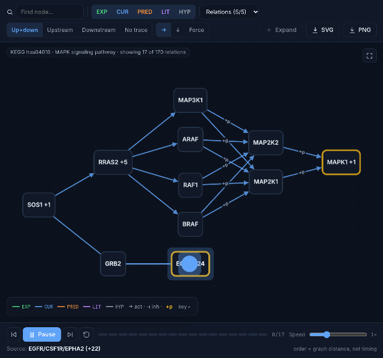
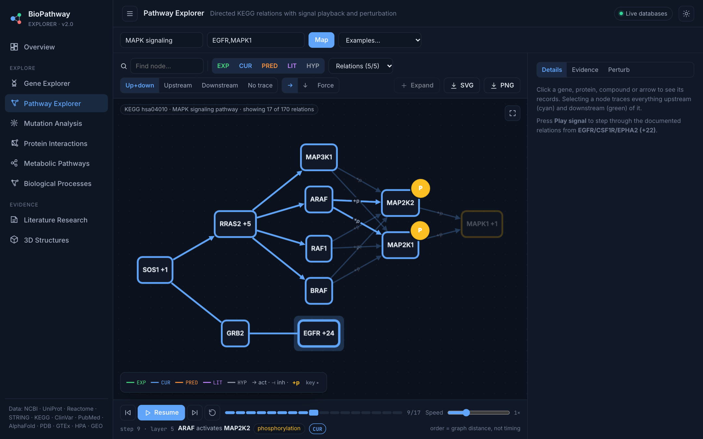
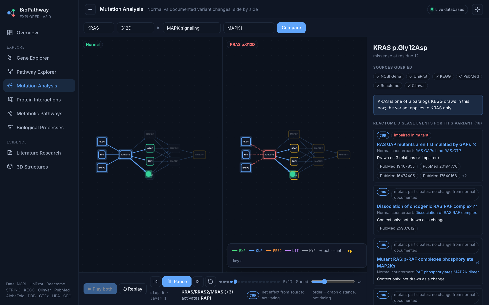
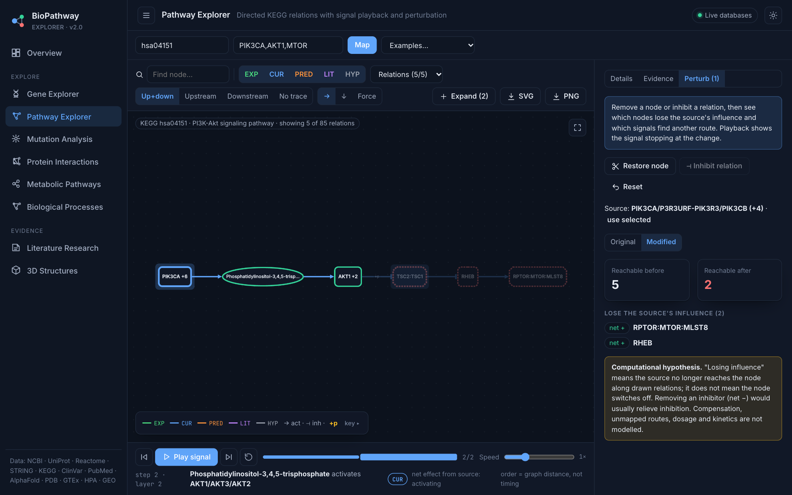
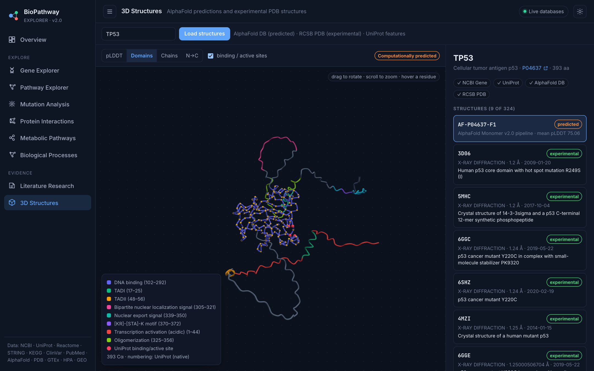
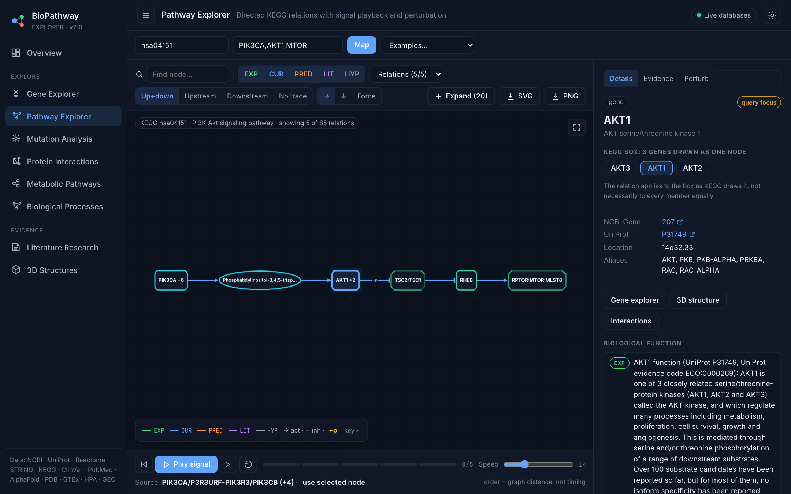
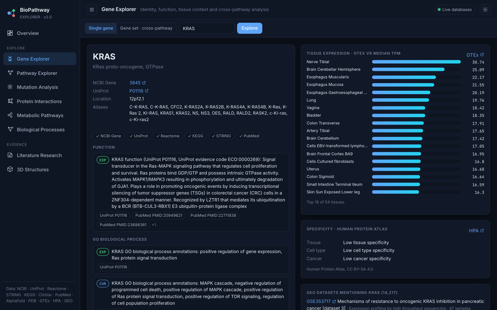
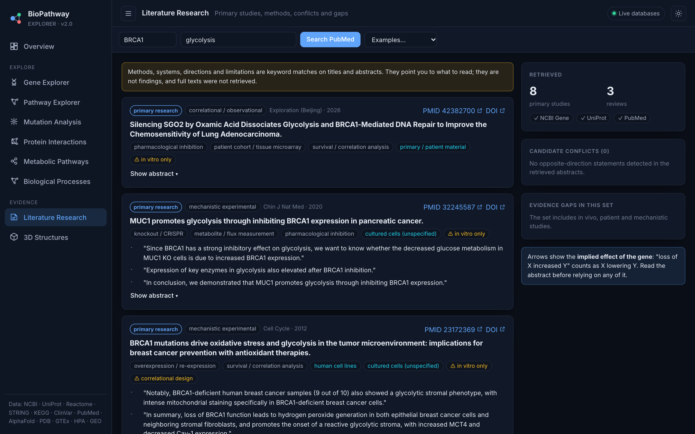
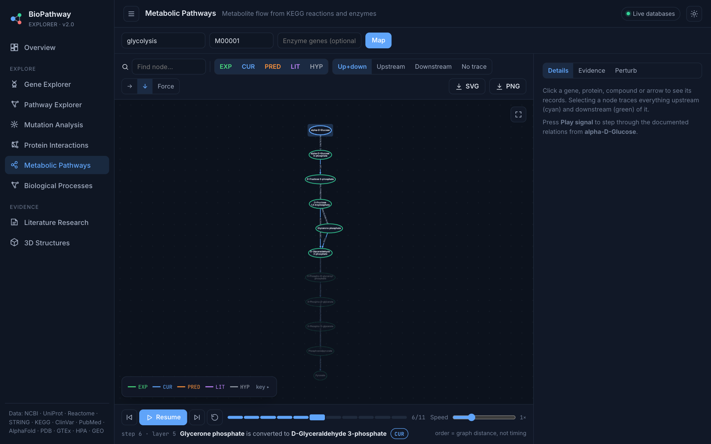

# BioPathway Mapper 2.0

**An evidence-labelled molecular biology research platform: a Claude Skill, an MCP server and an interactive, animated pathway explorer, all built on live records from NCBI, UniProt, Reactome, STRING, KEGG, ClinVar, PubMed, AlphaFold, RCSB PDB, GTEx, the Human Protein Atlas and GEO.**

Every arrow comes from a database record that states it, carries an evidence class, and links back to its source. Nothing is drawn because it "sounds right".



<sub>Signal playback on the real KEGG MAPK map (hsa04010). Each step is one documented relation, ordered by graph distance. Green = activation, red = inhibition, amber **P** = KEGG-recorded phosphorylation. Step order is not timing or kinetics.</sub>

---

## What you can do

| | |
|---|---|
|  | **Pathway Explorer.** Directed KEGG relations rendered with Cytoscape.js. Click any protein for its records, trace everything upstream or downstream, search, filter by evidence class or relation type, expand branches from the full map, and export SVG or PNG. Play, pause, step, replay and change the speed of signal propagation. |
|  | **Normal vs mutant.** Side-by-side KRAS vs KRAS G12D, with identical layout and synchronised playback. Mutant changes come only from Reactome disease events for that exact variant. Here "RAS GAP mutants aren't stimulated by GAPs" maps onto the NF1/RASA1/RASA2 ⊣ RAS edges, which are drawn as impaired, so the inhibitory pulse stops at ✕. |
|  | **Perturbation simulator.** Remove a node or inhibit a relation and see which nodes lose the source's influence, with the **net sign** of each lost route and any alternative routes. Removing TSC1/TSC2 cuts PI3K's net-activating route to RHEB and mTORC1. The panel explains why that predicts disinhibition in cells, and why it is a hypothesis. |
|  | **3D structures (Three.js).** AlphaFold models (pLDDT colouring) and experimental PDB entries (method, resolution), mapped to UniProt numbering through SIFTS. Colour by confidence, domain, chain or N→C position, hover residues, and click a domain, site or variant to fly to it. |
|  | **Protein panel.** Gene and protein identifiers, UniProt function with ECO evidence codes, GO processes, Reactome/KEGG pathways, STRING partners and database links. KEGG paralog boxes are made explicit. |
|  | **Tissue and cell-type context.** GTEx median TPM by tissue, Human Protein Atlas specificity and GEO datasets, plus Reactome over-representation and shared KEGG maps for gene sets. |
|  | **Literature research.** Primary studies vs reviews, extracted methods and model systems, gene/topic claims with the *implied gene effect* (loss-of-function wording is inverted), candidate conflicts, evidence gaps, and PMID + DOI links. |
|  | **Metabolic pathways.** Metabolite flow from KEGG reactions with the human enzymes for every step, played as a flux animation. |

More: [Overview](docs/images/overview.png) · [Protein interactions](docs/images/interactions-tp53.png) · [Reactome processes](docs/images/process-brca1.png) · [KRAS structure](docs/images/structure-kras.png) · [Light theme](docs/images/pathway-light.png)

---

## Architecture

```
┌─────────────────────────┐   ┌──────────────────────────────┐   ┌──────────────────────────────┐
│ 1. BioPathway Mapper     │   │ 2. BioPathway MCP server      │   │ 3. BioPathway Explorer        │
│    Claude Skill          │   │    scripts/bpm_mcp.py         │   │    explorer/ (React + TS)     │
│ SKILL.md + references/   │   │    13 tools, stdio JSON-RPC   │   │ Cytoscape · Motion · Three.js │
│ how to choose analyses,  │   │                               │   │ D3 scales · Vite              │
│ read evidence, word claims│  └──────────────┬───────────────┘   └──────────────┬───────────────┘
└────────────┬────────────┘                  │                                  │ HTTP /api
             │ bpm_cli.py                     ▼                                  ▼
             └──────────────────► scripts/bpm/service.py ◄──────────── scripts/bpm_api.py
                                  one operation table
                                           │
          analysis.py · explorer.py · litmine.py · evidence.py · report.py
                                           │
     http.py: cache · rate limits · retries · stale fallback · offline · provenance log
                                           │
  NCBI Gene/PubMed/ClinVar/GEO · UniProt · Reactome (Content + Analysis) · STRING · KEGG · AlphaFold · RCSB · GTEx · HPA
```

Each database client exists once. The skill, the MCP server and the Explorer all call the same operations, so the evidence rules are identical everywhere.

## Quick start

Requirements: Python 3.9+ (standard library only). Node 18+ is needed only to build the Explorer.

### 1. As a Claude Skill

```bash
git clone https://github.com/a6nkay-source/Biopathway.git ~/.claude/skills/biopathway-mapper
```

Then ask Claude things like *"How does KRAS G12D change RAS-MAPK signalling? Separate solid from weak evidence."* The skill decides which analyses to run, reads the evidence and labels every claim.

### 2. As an MCP server

```bash
claude mcp add biopathway -- python3 ~/.claude/skills/biopathway-mapper/scripts/bpm_mcp.py
```

Tools: `report`, `pathway_graph`, `interaction_graph`, `metabolic_graph`, `process_graph`, `node_info`, `compare_mutation`, `perturb_pathway`, `structures`, `structure_coords`, `expression`, `enrichment`, `literature`.

### 3. The Explorer

```bash
cd explorer && npm install && npm run build && cd ..
python3 scripts/bpm_api.py            # open http://127.0.0.1:8790
```

For development with hot reload, run `python3 scripts/bpm_api.py` and `cd explorer && npm run dev` (Vite proxies `/api` to port 8790). Without the API, the Explorer falls back to **bundled demo data** for the six reference scenarios (`explorer/public/data`, regenerate with `python3 scripts/export_explorer_data.py`), so it can be hosted as a static site.

### Command line

```bash
python3 scripts/bpm_cli.py pathway "MAPK signaling" --genes EGFR,MAPK1
python3 scripts/bpm_cli.py mutation KRAS G12D
python3 scripts/bpm_cli.py literature glycolysis --genes BRCA1
python3 scripts/bpm_cli.py tool compare_mutation gene=KRAS change=G12D pathway="MAPK signaling" genes=MAPK1
python3 scripts/bpm_cli.py tool perturb_pathway query=hsa04151 genes=PIK3CA,MTOR source=PIK3CA remove=TSC2
python3 scripts/bpm_cli.py tool structures query=TP53
python3 scripts/bpm_cli.py tool expression symbol=KRAS context=pancreas
```

## Evidence classes

| Code | Meaning | Typical source |
|---|---|---|
| **EXP** | experimentally validated | UniProt ECO:0000269/314/315/353; GO IDA/IMP/IPI; STRING experiments channel ≥ 0.4 |
| **CUR** | curated database evidence | KEGG relations/reactions; Reactome non-inferred events; ClinVar expert panel / multi-submitter |
| **PRED** | computationally predicted | Reactome orthology inference; UniProt similarity; STRING co-expression etc.; AlphaFold models |
| **EXP-lit** | experimentally shown in a primary study Claude read | abstract states the experiment; system and replication always stated |
| **LIT** | literature-supported association | STRING text-mining only; ClinVar single submitter; reviews; correlational studies |
| **HYP** | hypothetical / insufficiently established | no strong record; background knowledge |

Rules and rationale: [references/evidence-framework.md](references/evidence-framework.md).

## Scientific design decisions

- **Only records draw relationships.** PubMed hits never become edges. Literature mining is labelled as keyword extraction to guide reading.
- **Direction is checked, not assumed.** KEGG binding is undirected. The tool also flags expression edges that contradict a map's transcriptional hub as "direction suspect": KEGG's own hsa04115 file encodes PUMA → p53 backwards, and the tool flags it without "fixing" it.
- **Mutations are variant-specific.** `compare_mutation` uses only Reactome disease events for the exact variant entity (KRAS G12D = R-HSA-6802333). Without such an entity, nothing is drawn as changed.
- **Perturbations are signed hypotheses.** "Unreachable" means influence lost along drawn relations, not that a node switches off. Net route signs make double negatives (AKT ⊣ TSC ⊣ RHEB) explicit.
- **Animations encode graph order only.** No timing, kinetics or quantities are implied. Reduced-motion settings switch to static step highlighting.
- **Structures show provenance.** Predicted (AlphaFold, pLDDT) vs experimental (PDB, method, resolution). Peptide-only entries are skipped, and overlays use SIFTS-mapped residues only.

## Testing and evaluation

```bash
cd tests && python3 -m unittest discover        # 96 tests (offline, recorded API responses)
cd explorer && npm test                         # 19 tests (graph logic, playback, perturbation, real bundled maps)
cd explorer && node scripts/capture.mjs --url http://127.0.0.1:8790 --out ../docs/images --gif   # UI check + screenshots
```

The Python tests cover evidence rules, the HTTP cache/retry/rate-limit layer, parsers, Cytoscape graph generation, relationship direction and sign on real KEGG maps, mutation comparison, perturbation, structure provenance and SIFTS mapping, tissue context, citation URL validation, literature mining, database errors, the HTTP API and the MCP server lifecycle.

The evaluation report, covering multiple runs per scenario plus an independent biological-correctness review of every drawn relationship, is in [docs/evaluation/](docs/evaluation/).

## Repository layout

```
SKILL.md                     skill instructions (YAML frontmatter)
references/                  evidence framework, workflows, data sources, interpretation, explorer & MCP
scripts/
  bpm/                       analyses, evidence, report, explorer payloads, literature mining, service
  bpm/integrations/          ncbi, uniprot, reactome, stringdb, kegg, structures, expression
  bpm_cli.py                 command line (analyses + `tool <op>`)
  bpm_api.py                 HTTP API + static Explorer host
  bpm_mcp.py                 MCP stdio server
  export_explorer_data.py    bundles the demo scenarios
explorer/                    React + TypeScript app (src/, public/data, scripts/capture.mjs)
tests/                       Python unittest suite + recorded fixtures
evals/                       eval cases (claude plugin eval format)
examples/                    generated reports for the reference scenarios
docs/                        screenshots and evaluation report
```

## Limits

- Organisms with KEGG/Reactome mapping: human, mouse, rat, zebrafish, fly, worm and yeast.
- `pathway_graph` reconstructs KEGG maps. Reactome is used for processes, disease events and enrichment, not reaction-level directed graphs.
- STRING, ClinVar, GTEx and PubMed provide association-level evidence by design.
- Literature mining reads titles and abstracts, not full texts.
- **KEGG API use is restricted to academic users.** Use `--no-kegg` / `BPM_DISABLE_KEGG=1` otherwise. Respect each source's terms (UniProt, STRING and HPA under CC BY or CC BY-SA, Reactome under CC0/CC BY, NCBI public domain).

## Licence notes for data

Outputs contain data from the sources above. Keep the citations when redistributing outputs.
