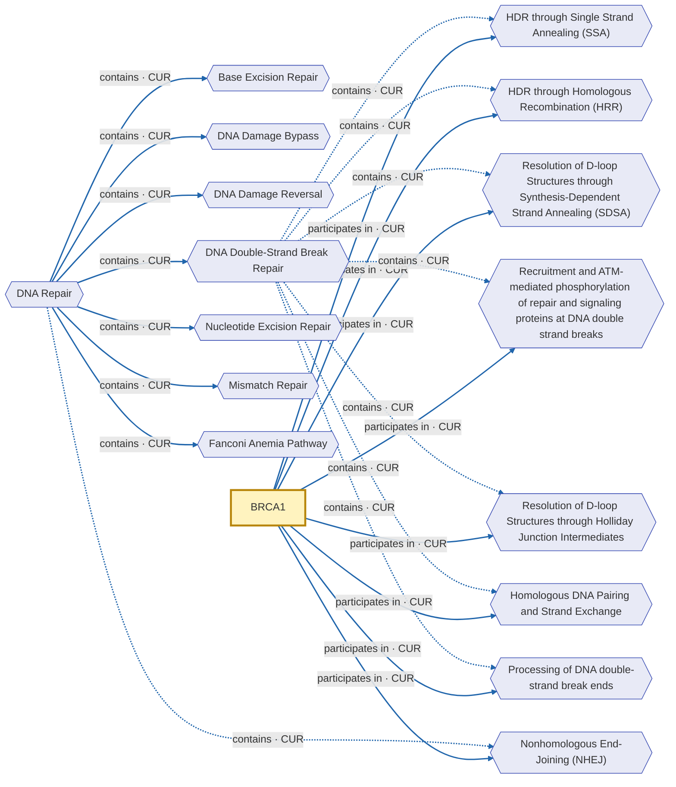

# BioPathway Mapper: process analysis

**Query:** `DNA repair | genes: BRCA1`

## 1. Input and resolved identifiers

| Input | Symbol | NCBI Gene | UniProt | Name | Location |
|---|---|---|---|---|---|
| BRCA1 | BRCA1 | 672 | P38398 | BRCA1 DNA repair associated | 17q21.31 |

## 2. Data source status

| Source | Status |
|---|---|
| KEGG | ok |
| NCBI Gene | ok |
| PubMed | ok |
| Reactome | ok |
| UniProt | ok |

21 API requests (21 served from cache).

## 3. Pathway context

| Source | ID | Name | Gene | Evidence | Note |
|---|---|---|---|---|---|
| Reactome | [R-HSA-73894](https://reactome.org/content/detail/R-HSA-73894) | DNA Repair |  | CUR |  |
| Reactome | [R-HSA-5685938](https://reactome.org/content/detail/R-HSA-5685938) | HDR through Single Strand Annealing (SSA) | BRCA1 | CUR | inside R-HSA-73894 |
| Reactome | [R-HSA-5685942](https://reactome.org/content/detail/R-HSA-5685942) | HDR through Homologous Recombination (HRR) | BRCA1 | CUR | inside R-HSA-73894 |
| Reactome | [R-HSA-5693554](https://reactome.org/content/detail/R-HSA-5693554) | Resolution of D-loop Structures through Synthesis-Dependent Strand Annealing (SDSA) | BRCA1 | CUR | inside R-HSA-73894 |
| Reactome | [R-HSA-5693565](https://reactome.org/content/detail/R-HSA-5693565) | Recruitment and ATM-mediated phosphorylation of repair and signaling proteins at DNA double strand breaks | BRCA1 | CUR | inside R-HSA-73894 |
| Reactome | [R-HSA-5693568](https://reactome.org/content/detail/R-HSA-5693568) | Resolution of D-loop Structures through Holliday Junction Intermediates | BRCA1 | CUR | inside R-HSA-73894 |
| Reactome | [R-HSA-5693571](https://reactome.org/content/detail/R-HSA-5693571) | Nonhomologous End-Joining (NHEJ) | BRCA1 | CUR | inside R-HSA-73894 |
| Reactome | [R-HSA-5693579](https://reactome.org/content/detail/R-HSA-5693579) | Homologous DNA Pairing and Strand Exchange | BRCA1 | CUR | inside R-HSA-73894 |
| Reactome | [R-HSA-5693607](https://reactome.org/content/detail/R-HSA-5693607) | Processing of DNA double-strand break ends | BRCA1 | CUR | inside R-HSA-73894 |
| Reactome | [R-HSA-5693616](https://reactome.org/content/detail/R-HSA-5693616) | Presynaptic phase of homologous DNA pairing and strand exchange | BRCA1 | CUR | inside R-HSA-73894 |
| Reactome | [R-HSA-9974237](https://reactome.org/content/detail/R-HSA-9974237) | Negative Regulation of DNA Double Strand Break Response | BRCA1 | CUR | inside R-HSA-73894 |
| Reactome | [R-HSA-1221632](https://reactome.org/content/detail/R-HSA-1221632) | Meiotic synapsis | BRCA1 | CUR | outside this process |
| Reactome | [R-HSA-3108214](https://reactome.org/content/detail/R-HSA-3108214) | SUMOylation of DNA damage response and repair proteins | BRCA1 | CUR | outside this process |
| Reactome | [R-HSA-5689901](https://reactome.org/content/detail/R-HSA-5689901) | Metalloprotease DUBs | BRCA1 | CUR | outside this process |
| Reactome | [R-HSA-6796648](https://reactome.org/content/detail/R-HSA-6796648) | TP53 Regulates Transcription of DNA Repair Genes | BRCA1 | CUR | outside this process |
| Reactome | [R-HSA-6804756](https://reactome.org/content/detail/R-HSA-6804756) | Regulation of TP53 Activity through Phosphorylation | BRCA1 | CUR | outside this process |
| Reactome | [R-HSA-69473](https://reactome.org/content/detail/R-HSA-69473) | G2/M DNA damage checkpoint | BRCA1 | CUR | outside this process |
| Reactome | [R-HSA-8951664](https://reactome.org/content/detail/R-HSA-8951664) | Neddylation | BRCA1 | CUR | outside this process |
| Reactome | [R-HSA-8953750](https://reactome.org/content/detail/R-HSA-8953750) | Transcriptional Regulation by E2F6 | BRCA1 | CUR | outside this process |
| Reactome | [R-HSA-912446](https://reactome.org/content/detail/R-HSA-912446) | Meiotic recombination | BRCA1 | CUR | outside this process |
| Reactome | [R-HSA-9663199](https://reactome.org/content/detail/R-HSA-9663199) | Defective DNA double strand break response due to BRCA1 loss of function | BRCA1 | CUR | outside this process |
| Reactome | [R-HSA-9699150](https://reactome.org/content/detail/R-HSA-9699150) | Defective DNA double strand break response due to BARD1 loss of function | BRCA1 | CUR | outside this process |
| Reactome | [R-HSA-9701192](https://reactome.org/content/detail/R-HSA-9701192) | Defective homologous recombination repair (HRR) due to BRCA1 loss of function | BRCA1 | CUR | outside this process |
| Reactome | [R-HSA-9704331](https://reactome.org/content/detail/R-HSA-9704331) | Defective HDR through Homologous Recombination Repair (HRR) due to PALB2 loss of BRCA1 binding function | BRCA1 | CUR | outside this process |
| Reactome | [R-HSA-9704646](https://reactome.org/content/detail/R-HSA-9704646) | Defective HDR through Homologous Recombination Repair (HRR) due to PALB2 loss of BRCA2/RAD51/RAD51C binding function | BRCA1 | CUR | outside this process |
| Reactome | [R-HSA-9709570](https://reactome.org/content/detail/R-HSA-9709570) | Impaired BRCA2 binding to RAD51 | BRCA1 | CUR | outside this process |
| KEGG | [hsa03030](https://www.kegg.jp/pathway/hsa03030) | DNA replication |  | CUR | name match 0.507 BRCA1: not in map |
| KEGG | [hsa03430](https://www.kegg.jp/pathway/hsa03430) | Mismatch repair |  | CUR | name match 0.506 BRCA1: not in map |
| KEGG | [hsa03410](https://www.kegg.jp/pathway/hsa03410) | Base excision repair |  | CUR | name match 0.505 BRCA1: not in map |

## 4. Reconstructed molecular relationships

Evidence mix: CUR 23

| From | Relation | To | Evidence | Basis | Refs |
|---|---|---|---|---|---|
| DNA Repair | → contains | Base Excision Repair | CUR | Reactome expert-curated, peer-reviewed event | [1] |
| DNA Repair | → contains | DNA Damage Bypass | CUR | Reactome expert-curated, peer-reviewed event | [1] |
| DNA Repair | → contains | DNA Damage Reversal | CUR | Reactome expert-curated, peer-reviewed event | [1] |
| DNA Repair | → contains | DNA Double-Strand Break Repair | CUR | Reactome expert-curated, peer-reviewed event | [1] |
| DNA Repair | → contains | Nucleotide Excision Repair | CUR | Reactome expert-curated, peer-reviewed event | [1] |
| DNA Repair | → contains | Mismatch Repair | CUR | Reactome expert-curated, peer-reviewed event | [1] |
| DNA Repair | → contains | Fanconi Anemia Pathway | CUR | Reactome expert-curated, peer-reviewed event | [1] |
| BRCA1 | → participates in | HDR through Single Strand Annealing (SSA) | CUR | Reactome expert-curated, peer-reviewed event | [2] |
| DNA Double-Strand Break Repair | → contains | HDR through Single Strand Annealing (SSA) | CUR | Reactome hierarchy; intermediate sub-pathways omitted | [3] |
| BRCA1 | → participates in | HDR through Homologous Recombination (HRR) | CUR | Reactome expert-curated, peer-reviewed event | [4] |
| DNA Double-Strand Break Repair | → contains | HDR through Homologous Recombination (HRR) | CUR | Reactome hierarchy; intermediate sub-pathways omitted | [3] |
| BRCA1 | → participates in | Resolution of D-loop Structures through Synthesis-Dependent Strand Annealing (SDSA) | CUR | Reactome expert-curated, peer-reviewed event | [5] |
| DNA Double-Strand Break Repair | → contains | Resolution of D-loop Structures through Synthesis-Dependent Strand Annealing (SDSA) | CUR | Reactome hierarchy; intermediate sub-pathways omitted | [3] |
| BRCA1 | → participates in | Recruitment and ATM-mediated phosphorylation of repair and signaling proteins at DNA double strand breaks | CUR | Reactome expert-curated, peer-reviewed event | [6] |
| DNA Double-Strand Break Repair | → contains | Recruitment and ATM-mediated phosphorylation of repair and signaling proteins at DNA double strand breaks | CUR | Reactome hierarchy; intermediate sub-pathways omitted | [3] |
| BRCA1 | → participates in | Resolution of D-loop Structures through Holliday Junction Intermediates | CUR | Reactome expert-curated, peer-reviewed event | [7] |
| DNA Double-Strand Break Repair | → contains | Resolution of D-loop Structures through Holliday Junction Intermediates | CUR | Reactome hierarchy; intermediate sub-pathways omitted | [3] |
| BRCA1 | → participates in | Nonhomologous End-Joining (NHEJ) | CUR | Reactome expert-curated, peer-reviewed event | [8] |
| DNA Repair | → contains | Nonhomologous End-Joining (NHEJ) | CUR | Reactome hierarchy; intermediate sub-pathways omitted | [1] |
| BRCA1 | → participates in | Homologous DNA Pairing and Strand Exchange | CUR | Reactome expert-curated, peer-reviewed event | [9] |
| DNA Double-Strand Break Repair | → contains | Homologous DNA Pairing and Strand Exchange | CUR | Reactome hierarchy; intermediate sub-pathways omitted | [3] |
| BRCA1 | → participates in | Processing of DNA double-strand break ends | CUR | Reactome expert-curated, peer-reviewed event | [10] |
| DNA Double-Strand Break Repair | → contains | Processing of DNA double-strand break ends | CUR | Reactome hierarchy; intermediate sub-pathways omitted | [3] |

## 5. Evidence-labelled statements

### Process overview

- **[CUR]** DNA Repair (Reactome summary): DNA repair is a phenomenal multi-enzyme, multi-pathway system required to ensure the integrity of the cellular genome. Living organisms are constantly exposed to harmful metabolic by-products, environmental chemicals and radiation that damage their DNA, thus corrupting genetic information. In addition, normal cellular pH and temperature create conditions that are hostile to the integrity of DNA and its nucleotide components. DNA damage can also arise as a consequence of spontaneous errors during DNA replication. The DNA repair machinery continuously scans the genome and maintains genome ... [1]

### Mechanism (BRCA1)

- **[CUR]** Reactome event R-HSA-9707051: UBXN1 binds BRCA1:BARD1 heterodimer [11]
- **[CUR]** Reactome event R-HSA-5693551: Phosphorylation of BRCA1-A complex at multiple sites by ATM [12]
- **[CUR]** Reactome event R-HSA-5683385: Formation of BRCA1-A complex at DNA DSBs [13]
- **[CUR]** Reactome event R-HSA-9701003: BAP1 binds BRCA1:BARD1 heterodimer [14]
- **[CUR]** Reactome event R-HSA-9701000: BRCA1:BARD1 heterodimer autoubiquitinates [15]
- **[CUR]** Reactome event R-HSA-5659781: BRCA1 forms a heterodimer with BARD1 [16]
- **[CUR]** Reactome event R-HSA-9700998: BAP1 disrupts the BRCA1:BARD1 heterodimer [17]
- **[CUR]** Reactome event R-HSA-5683801: CHEK2 phosphorylates BRCA1 [18]
- **[CUR]** Reactome event R-HSA-9974238: CRL4A-DCAF8L1 polyubiquitinates BRCA1 [19]
- **[CUR]** Reactome event R-HSA-9974400: 26S Proteasome degrades polyubiquitinated BRCA1, BARD1 [20]
- **[CUR]** Reactome event R-HSA-5684108: BRCA1 binds phosphorylated RBBP8 [21]

## 6. Pathway diagram

Reactome hierarchy: process -> sub-pathways, and the curated sub-pathways each queried gene participates in. Dashed 'contains' skips intermediate levels.

| Line colour | Code | Evidence class |
|---|---|---|
| green | EXP | experimentally validated |
| blue | CUR | curated database evidence |
| orange | PRED | computationally predicted |
| purple | LIT | literature-supported association |
| grey | HYP | hypothetical/insufficiently established |

Solid arrow = activation/conversion/membership; `x` head = inhibition; dashed = expression, indirect or non-curated; no head = undirected association.

## 7. Interpretation notes and limits

- Reactome candidates: R-HSA-73894 DNA Repair; R-HSA-9675135 Diseases of DNA repair; R-HSA-5693532 DNA Double-Strand Break Repair; R-HSA-9675136 Diseases of DNA Double-Strand Break Repair; R-HSA-5358508 Mismatch Repair.
- BRCA1 has 18 Reactome pathways outside DNA Repair (listed in section 3). Roles there are not part of this process reconstruction.
- BRCA1 participates in 10 sub-pathways of DNA Repair; 8 drawn.

## 8. Literature

CUR rows are references cited by the curated pathway record; LIT rows are search hits offered for reading and were not used to draw any relationship.

- **[CUR]** Curtin NJ (2012). DNA repair dysregulation from cancer driver to therapeutic target. *Nat Rev Cancer*. [PMID:23175119](https://pubmed.ncbi.nlm.nih.gov/23175119/) — reference of Reactome R-HSA-73894
- **[CUR]** Lindahl T (1999). Quality control by DNA repair. *Science*. [PMID:10583946](https://pubmed.ncbi.nlm.nih.gov/10583946/) — reference of Reactome R-HSA-73894
- **[LIT]** Tarsounas M (2020). The antitumorigenic roles of BRCA1-BARD1 in DNA repair and replication. *Nat Rev Mol Cell Biol*. [PMID:32094664](https://pubmed.ncbi.nlm.nih.gov/32094664/) — PubMed search: BRCA1[tiab] AND DNA repair[tiab]
- **[LIT]** Farmer H (2005). Targeting the DNA repair defect in BRCA mutant cells as a therapeutic strategy. *Nature*. [PMID:15829967](https://pubmed.ncbi.nlm.nih.gov/15829967/) — PubMed search: BRCA1[tiab] AND DNA repair[tiab]
- **[LIT]** Krishnan R (2021). BRCA1 and Metastasis: Outcome of Defective DNA Repair. *Cancers (Basel)*. [PMID:35008272](https://pubmed.ncbi.nlm.nih.gov/35008272/) — PubMed search: BRCA1[tiab] AND DNA repair[tiab]
- **[LIT]** Roy R (2011). BRCA1 and BRCA2: different roles in a common pathway of genome protection. *Nat Rev Cancer*. [PMID:22193408](https://pubmed.ncbi.nlm.nih.gov/22193408/) — PubMed search: BRCA1[tiab] AND DNA repair[tiab]
- **[LIT]** San Martin Alonso M (2021). Untangling the crosstalk between BRCA1 and R-loops during DNA repair. *Nucleic Acids Res*. [PMID:33755171](https://pubmed.ncbi.nlm.nih.gov/33755171/) — PubMed search: BRCA1[tiab] AND DNA repair[tiab]

## Sources

1. Reactome R-HSA-73894 — DNA Repair. <https://reactome.org/content/detail/R-HSA-73894>
2. Reactome R-HSA-5685938 — HDR through Single Strand Annealing (SSA). <https://reactome.org/content/detail/R-HSA-5685938>
3. Reactome R-HSA-5693532. <https://reactome.org/content/detail/R-HSA-5693532>
4. Reactome R-HSA-5685942 — HDR through Homologous Recombination (HRR). <https://reactome.org/content/detail/R-HSA-5685942>
5. Reactome R-HSA-5693554 — Resolution of D-loop Structures through Synthesis-Dependent Strand Annealing (SDSA). <https://reactome.org/content/detail/R-HSA-5693554>
6. Reactome R-HSA-5693565 — Recruitment and ATM-mediated phosphorylation of repair and signaling proteins at DNA double strand breaks. <https://reactome.org/content/detail/R-HSA-5693565>
7. Reactome R-HSA-5693568 — Resolution of D-loop Structures through Holliday Junction Intermediates. <https://reactome.org/content/detail/R-HSA-5693568>
8. Reactome R-HSA-5693571 — Nonhomologous End-Joining (NHEJ). <https://reactome.org/content/detail/R-HSA-5693571>
9. Reactome R-HSA-5693579 — Homologous DNA Pairing and Strand Exchange. <https://reactome.org/content/detail/R-HSA-5693579>
10. Reactome R-HSA-5693607 — Processing of DNA double-strand break ends. <https://reactome.org/content/detail/R-HSA-5693607>
11. Reactome R-HSA-9707051 — UBXN1 binds BRCA1:BARD1 heterodimer. <https://reactome.org/content/detail/R-HSA-9707051>
12. Reactome R-HSA-5693551 — Phosphorylation of BRCA1-A complex at multiple sites by ATM. <https://reactome.org/content/detail/R-HSA-5693551>
13. Reactome R-HSA-5683385 — Formation of BRCA1-A complex at DNA DSBs. <https://reactome.org/content/detail/R-HSA-5683385>
14. Reactome R-HSA-9701003 — BAP1 binds BRCA1:BARD1 heterodimer. <https://reactome.org/content/detail/R-HSA-9701003>
15. Reactome R-HSA-9701000 — BRCA1:BARD1 heterodimer autoubiquitinates. <https://reactome.org/content/detail/R-HSA-9701000>
16. Reactome R-HSA-5659781 — BRCA1 forms a heterodimer with BARD1. <https://reactome.org/content/detail/R-HSA-5659781>
17. Reactome R-HSA-9700998 — BAP1 disrupts the BRCA1:BARD1 heterodimer. <https://reactome.org/content/detail/R-HSA-9700998>
18. Reactome R-HSA-5683801 — CHEK2 phosphorylates BRCA1. <https://reactome.org/content/detail/R-HSA-5683801>
19. Reactome R-HSA-9974238 — CRL4A-DCAF8L1 polyubiquitinates BRCA1. <https://reactome.org/content/detail/R-HSA-9974238>
20. Reactome R-HSA-9974400 — 26S Proteasome degrades polyubiquitinated BRCA1, BARD1. <https://reactome.org/content/detail/R-HSA-9974400>
21. Reactome R-HSA-5684108 — BRCA1 binds phosphorylated RBBP8. <https://reactome.org/content/detail/R-HSA-5684108>

Records retrieved between 2026-11-13T19:28:33Z and 2026-11-13T19:28:44Z (UTC). Databases are updated continually; re-run to refresh.