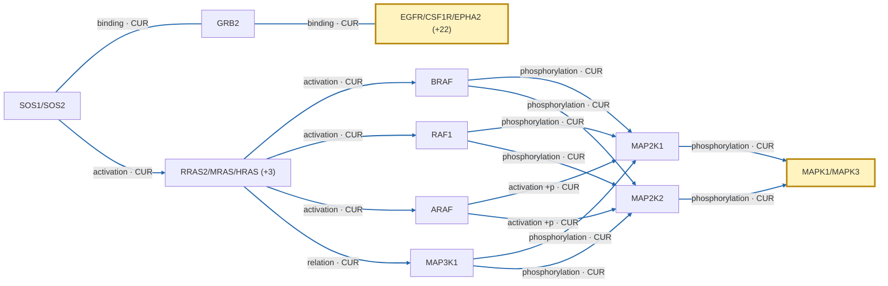

# BioPathway Mapper: pathway analysis

**Query:** `MAPK signaling | genes: EGFR, MAPK1`

## 1. Input and resolved identifiers

| Input | Symbol | NCBI Gene | UniProt | Name | Location |
|---|---|---|---|---|---|
| EGFR | EGFR | 1956 | P00533 | epidermal growth factor receptor | 7p11.2 |
| MAPK1 | MAPK1 | 5594 | P28482 | mitogen-activated protein kinase 1 | 22q11.22 |

## 2. Data source status

| Source | Status |
|---|---|
| KEGG | ok |
| NCBI Gene | ok |
| PubMed | ok |
| Reactome | ok |
| UniProt | ok |

17 API requests (17 served from cache).

## 3. Pathway context

| Source | ID | Name | Gene | Evidence | Note |
|---|---|---|---|---|---|
| KEGG | [hsa04010](https://www.kegg.jp/pathway/hsa04010) | MAPK signaling pathway |  | CUR |  |
| Reactome | [R-HSA-9652817](https://reactome.org/content/detail/R-HSA-9652817) | Signaling by MAPK mutants | MAPK1 | CUR |  |
| Reactome | [R-HSA-198753](https://reactome.org/content/detail/R-HSA-198753) | ERK/MAPK targets | MAPK1 | CUR |  |
| Reactome | [R-HSA-5674135](https://reactome.org/content/detail/R-HSA-5674135) | MAP2K and MAPK activation | MAPK1 | CUR |  |
| Reactome | [R-HSA-881907](https://reactome.org/content/detail/R-HSA-881907) | Gastrin-CREB signalling pathway via PKC and MAPK | MAPK1 | CUR |  |
| Reactome | [R-HSA-2871796](https://reactome.org/content/detail/R-HSA-2871796) | FCERI mediated MAPK activation | MAPK1 | CUR |  |

## 4. Reconstructed molecular relationships

Evidence mix: CUR 17

| From | Relation | To | Evidence | Basis | Refs |
|---|---|---|---|---|---|
| GRB2 | — binding | EGFR/CSF1R/EPHA2 (+22) | CUR | KEGG manually curated pathway map; KGML PPrel [binding/association] | [1] |
| SOS1/SOS2 | — binding | GRB2 | CUR | KEGG manually curated pathway map; KGML PPrel [binding/association] | [1] |
| SOS1/SOS2 | → activation | RRAS2/MRAS/HRAS (+3) | CUR | KEGG manually curated pathway map; KGML PPrel [activation] | [1] |
| RRAS2/MRAS/HRAS (+3) | → activation | BRAF | CUR | KEGG manually curated pathway map; KGML PPrel [activation] | [1] |
| RRAS2/MRAS/HRAS (+3) | → activation | RAF1 | CUR | KEGG manually curated pathway map; KGML PPrel [activation] | [1] |
| BRAF | → phosphorylation | MAP2K1 | CUR | KEGG manually curated pathway map; KGML PPrel [phosphorylation] | [1] |
| BRAF | → phosphorylation | MAP2K2 | CUR | KEGG manually curated pathway map; KGML PPrel [phosphorylation] | [1] |
| RAF1 | → phosphorylation | MAP2K1 | CUR | KEGG manually curated pathway map; KGML PPrel [phosphorylation] | [1] |
| RAF1 | → phosphorylation | MAP2K2 | CUR | KEGG manually curated pathway map; KGML PPrel [phosphorylation] | [1] |
| MAP2K1 | → phosphorylation | MAPK1/MAPK3 | CUR | KEGG manually curated pathway map; KGML PPrel [phosphorylation] | [1] |
| MAP2K2 | → phosphorylation | MAPK1/MAPK3 | CUR | KEGG manually curated pathway map; KGML PPrel [phosphorylation] | [1] |
| MAP3K1 | → phosphorylation | MAP2K1 | CUR | KEGG manually curated pathway map; KGML PPrel [phosphorylation] | [1] |
| MAP3K1 | → phosphorylation | MAP2K2 | CUR | KEGG manually curated pathway map; KGML PPrel [phosphorylation] | [1] |
| RRAS2/MRAS/HRAS (+3) | → activation | ARAF | CUR | KEGG manually curated pathway map; KGML PPrel [activation] | [1] |
| ARAF | → activation +p | MAP2K1 | CUR | KEGG manually curated pathway map; KGML PPrel [activation, phosphorylation] | [1] |
| ARAF | → activation +p | MAP2K2 | CUR | KEGG manually curated pathway map; KGML PPrel [activation, phosphorylation] | [1] |
| RRAS2/MRAS/HRAS (+3) | → relation | MAP3K1 | CUR | KEGG manually curated pathway map; KGML PPrel [no subtype] | [1] |

## 5. Evidence-labelled statements

### Mechanism

- **[CUR]** EGFR to MAPK1, shortest directed route in KEGG hsa04010 (MAPK signaling pathway): EGFR/CSF1R/EPHA2 (+22) -[binding, undirected]-> GRB2 -[binding, undirected]-> SOS1/SOS2 -[activation]-> RRAS2/MRAS/HRAS (+3) -[activation]-> ARAF -[activation +p]-> MAP2K2 -[phosphorylation]-> MAPK1/MAPK3 (8 equally short routes; all are drawn). Each step is a KEGG-drawn relation; a route is a curated summary and may skip intermediates. [1]

## 6. Pathway diagram

Directed relations redrawn from the KEGG map (KGML). Arrow = activation, x = inhibition, dashed = expression/indirect. Multi-gene boxes are paralog groups that KEGG draws as one node.

| Line colour | Code | Evidence class |
|---|---|---|
| green | EXP | experimentally validated |
| blue | CUR | curated database evidence |
| orange | PRED | computationally predicted |
| purple | LIT | literature-supported association |
| grey | HYP | hypothetical/insufficiently established |

Solid arrow = activation/conversion/membership; `x` head = inhibition; dashed = expression, indirect or non-curated; no head = undirected association.

## 7. Interpretation notes and limits

- No directed KEGG route for: MAPK1 -> EGFR. This reflects the map's drawing, not proof that no regulation exists.
- KEGG hsa04010 contains 170 reconstructable relations; 17 are kept for this question.

## 8. Literature

CUR rows are references cited by the curated pathway record; LIT rows are search hits offered for reading and were not used to draw any relationship.

- **[CUR]** Chen Z (2001). MAP kinases. *Chem Rev*. [PMID:11749383](https://pubmed.ncbi.nlm.nih.gov/11749383/) — reference of KEGG hsa04010
- **[CUR]** Tanoue T (2002). Docking interactions in the mitogen-activated protein kinase cascades. *Pharmacol Ther*. [PMID:12191611](https://pubmed.ncbi.nlm.nih.gov/12191611/) — reference of KEGG hsa04010
- **[CUR]** Dent P (2003). MAPK pathways in radiation responses. *Oncogene*. [PMID:12947395](https://pubmed.ncbi.nlm.nih.gov/12947395/) — reference of KEGG hsa04010
- **[CUR]** Huang EJ (2003). Trk receptors: roles in neuronal signal transduction. *Annu Rev Biochem*. [PMID:12676795](https://pubmed.ncbi.nlm.nih.gov/12676795/) — reference of KEGG hsa04010
- **[CUR]** Harper SJ (2001). Signalling for survival and death in neurones: the role of stress-activated kinases, JNK and p38. *Cell Signal*. [PMID:11369511](https://pubmed.ncbi.nlm.nih.gov/11369511/) — reference of KEGG hsa04010
- **[LIT]** Liao Y (2022). Exploring the mechanism of Alisma orientale for the treatment of pregnancy induced hypertension and potential hepato-nephrotoxicity by using network pharmacology, network toxicology, molecular docking and molecular dynamics simulation. *Front Pharmacol*. [PMID:36457705](https://pubmed.ncbi.nlm.nih.gov/36457705/) — PubMed search: EGFR[tiab] AND MAPK1[tiab] AND (mapk)
- **[LIT]** Ge B (2024). Integrated network toxicology, molecular docking, and in vivo experiments to elucidate molecular mechanism of aflatoxin B1 hepatotoxicity. *Ecotoxicol Environ Saf*. [PMID:38564860](https://pubmed.ncbi.nlm.nih.gov/38564860/) — PubMed search: EGFR[tiab] AND MAPK1[tiab] AND (mapk)
- **[LIT]** Wang J (2022). The Potential Mechanisms of Cinobufotalin Treating Colon Adenocarcinoma by Network Pharmacology. *Front Pharmacol*. [PMID:35814224](https://pubmed.ncbi.nlm.nih.gov/35814224/) — PubMed search: EGFR[tiab] AND MAPK1[tiab] AND (mapk)
- **[LIT]** Varvil MS (2022). The miRNome of canine invasive urothelial carcinoma. *Front Vet Sci*. [PMID:36072391](https://pubmed.ncbi.nlm.nih.gov/36072391/) — PubMed search: EGFR[tiab] AND MAPK1[tiab] AND (mapk)
- **[LIT]** Molina P (2025). Non-canonical EGFR signaling promotes MAPK-dependent extrusion of epithelial cells. *J Cell Sci*. [PMID:41132131](https://pubmed.ncbi.nlm.nih.gov/41132131/) — PubMed search: EGFR[tiab] AND MAPK1[tiab] AND (mapk)

## Sources

1. KEGG hsa04010 — MAPK signaling pathway. <https://www.kegg.jp/pathway/hsa04010>

Records retrieved between 2026-11-13T19:28:33Z and 2026-11-13T19:29:03Z (UTC). Databases are updated continually; re-run to refresh.