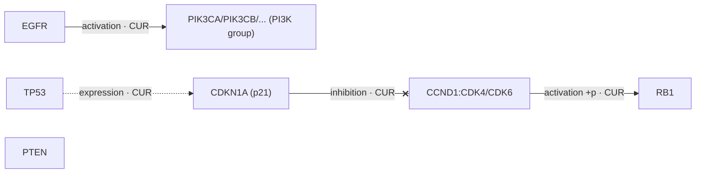

# Glioblastoma (GBM): genes, pathways and API access

Compiled 2026-11-19 with the BioPathway Mapper skill (live NCBI Gene, UniProt, Reactome, KEGG, STRING, PubMed records) and a look at the AlphaGenome Atlas page.

Research use only. Neither these records nor AlphaGenome predictions are for clinical decisions.

## Files in this folder

| File | What it holds |
|---|---|
| `genes/report.md` | Full per-gene report: pathways, STRING interactions, UniProt function, sources |
| `glioma_pathway/report.md` | KEGG hsa05214 "Glioma": directed relationships and KEGG's own references |
| `enrichment.json` | Reactome pathway enrichment for the 13-gene set |
| `*/diagram.mmd`, `*/diagram.dot` | Mermaid and Graphviz pathway diagrams |
| `*/analysis.json` | Raw data behind each report |

## 1. Core GBM genes (resolved identifiers)

Which genes count as GBM drivers comes from background knowledge (TCGA GBM core pathways), not from these database runs [HYP]. The IDs come from NCBI Gene and UniProt.

| Gene | Pathway axis | NCBI Gene | UniProt | Locus | Usual alteration in GBM (background) |
|---|---|---|---|---|---|
| EGFR | RTK/RAS/PI3K | 1956 | P00533 | 7p11.2 | Amplification, EGFRvIII |
| PDGFRA | RTK/RAS/PI3K | 5156 | P16234 | 4q12 | Amplification |
| PTEN | RTK/RAS/PI3K | 5728 | P60484 | 10q23.31 | Deletion or mutation |
| PIK3CA | RTK/RAS/PI3K | 5290 | P42336 | 3q26.32 | Activating mutation |
| NF1 | RTK/RAS/PI3K | 4763 | P21359 | 17q11.2 | Loss (mesenchymal subtype) |
| TP53 | p53 | 7157 | P04637 | 17p13.1 | Mutation |
| MDM2 | p53 | 4193 | Q00987 | 12q15 | Amplification |
| CDKN2A | p53 and RB | 1029 | P42771 | 9p21.3 | Homozygous deletion |
| CDK4 | RB | 1019 | P11802 | 12q14.1 | Amplification |
| RB1 | RB | 5925 | P06400 | 13q14.2 | Deletion or mutation |
| IDH1 | Metabolism | 3417 | O75874 | 2q34 | R132H (IDH-mutant glioma; WHO 2021 no longer calls these GBM) |
| TERT | Telomere | 7015 | O14746 | 5p15.33 | Promoter mutation |
| MGMT | DNA repair | 4255 | P16455 | 10q26.3 | Promoter methylation (predicts temozolomide response) |

## 2. Curated pathway map (KEGG hsa05214 Glioma)



- EGFR activates the PI3K catalytic group [CUR; KEGG hsa05214].
- TP53 drives expression of CDKN1A (p21), which inhibits cyclin D1–CDK4/6. That complex phosphorylates RB1 [CUR; KEGG hsa05214].
- The map draws no directed route between the RTK/PI3K arm and the p53/RB arm. That is a limit of how the map is drawn, not evidence that the arms never interact.
- PTEN is on the map, but the selected edges leave it unconnected. The full KEGG relation set is in `glioma_pathway/analysis.json`.

## 3. Strongest STRING associations (undirected, not mechanism)

| Pair | Evidence | STRING channel |
|---|---|---|
| CDK4 – CDKN2A | EXP | experiments 0.999 |
| CDK4 – RB1 | EXP | experiments 0.999 |
| MDM2 – TP53 | EXP | experiments 0.999 |
| MDM2 – CDKN2A | EXP | experiments 0.999 |
| MDM2 – RB1 | EXP | experiments 0.999 |
| TP53 – CDKN2A | EXP | experiments 0.999 |
| PIK3CA – EGFR | EXP | experiments 0.997 |
| TP53 – PTEN | EXP | experiments 0.976 |
| PDGFRA – EGFR | EXP | experiments 0.930 |
| EGFR – PTEN | EXP | experiments 0.912 |
| PIK3CA – PTEN | EXP | experiments 0.791 |
| EGFR – NF1 | EXP | experiments 0.770 |

The STRING experiments channel can include evidence transferred from orthologs. Pairs involving IDH1, MGMT or TERT were mostly text-mining co-mentions only [LIT].

## 4. Top Reactome enrichment for the 13-gene set

| Reactome ID | Pathway | Genes hit | FDR |
|---|---|---|---|
| R-HSA-2559585 | Oncogene Induced Senescence | 9/42 | 5.1e-14 |
| R-HSA-2559580 | Oxidative Stress Induced Senescence | 8/113 | 1.7e-09 |
| R-HSA-2559583 | Cellular Senescence | 9/200 | 2.5e-09 |
| R-HSA-6806003 | Regulation of TP53 Expression and Degradation | 5/46 | 6.3e-07 |
| R-HSA-1257604 | PIP3 activates AKT signaling | 8/315 | 1.1e-06 |

Also relevant: R-HSA-5637810 "Constitutive Signaling by EGFRvIII" [CUR].

## 5. AlphaGenome Atlas: what it offers, and what wasn't queried

- **Atlas** (https://deepmind.google.com/science/alphagenome/atlas) holds precomputed AlphaGenome Variant Impact (AVI) scores for all ~9 billion possible SNVs in the human genome, coding and non-coding. It is browsed through a web page.
- **Sign-in required:** the variant explorer needs a Google sign-in, so no GBM variant scores were pulled for this report. Once signed in, good loci to check: the **TERT promoter** (C228T / C250T, chr5 ~1.295 Mb, hg38), **IDH1 R132**, the **MGMT promoter / enhancer**, **EGFR**, and the **CDKN2A/B** locus at 9p21.
- **Terms:** outputs are for non-commercial use only and must not be used to train other models. Cite Avsec et al., 2026 for the model and Cheng et al., 2026 for the Atlas.
- **Help:** https://deepmind.google.com/science/alphagenome/faqs and alphagenome@google.com.

## 6. API keys and access

No API keys were found, created or stored here. Each one is personal and should be generated under your own account.

| Service | Key needed? | How to get access |
|---|---|---|
| AlphaGenome API (model predictions) | **Yes, a personal key** | Sign in at deepmind.google.com/science/alphagenome and request an API key. Use it with the Python client (`pip install alphagenome`, then `dna_client.create(API_KEY)`). Store it in an environment variable such as `ALPHAGENOME_API_KEY`. Never commit it. |
| AlphaGenome Atlas | Google sign-in (no key) | Browser; Atlas says it also supports AI-agent workflows |
| NCBI E-utilities (Gene, PubMed, ClinVar) | Optional | A free key from your NCBI account raises the limit from 3 to 10 requests/s |
| UniProt REST | No | https://rest.uniprot.org |
| Reactome Content / Analysis Service | No | https://reactome.org/ContentService |
| STRING API | No | https://string-db.org/api |
| KEGG REST | No (free for academic use only) | https://rest.kegg.jp; commercial use needs a licence |

To re-run any of these analyses:

```bash
python3 ~/.claude/skills/biopathway-mapper/scripts/bpm_cli.py gene EGFR PTEN TP53 --out ./rerun
```

## 7. Caveats

- All six data sources answered (KEGG, NCBI Gene, PubMed, Reactome, STRING, UniProt).
- STRING edges show association, not direction or activation.
- The KEGG glioma map is a curated summary that can skip intermediate steps. Its references date from 2001 to 2006.
- The GBM-specific alteration column, the WHO 2021 note and the AlphaGenome loci to check are background knowledge [HYP]. They do not come from the database runs.
- Primary GBM papers were not read for this pass. KEGG's reference list (PMIDs 15639402, 12154354, 11253051, 16700615, 12762887) is further reading.
