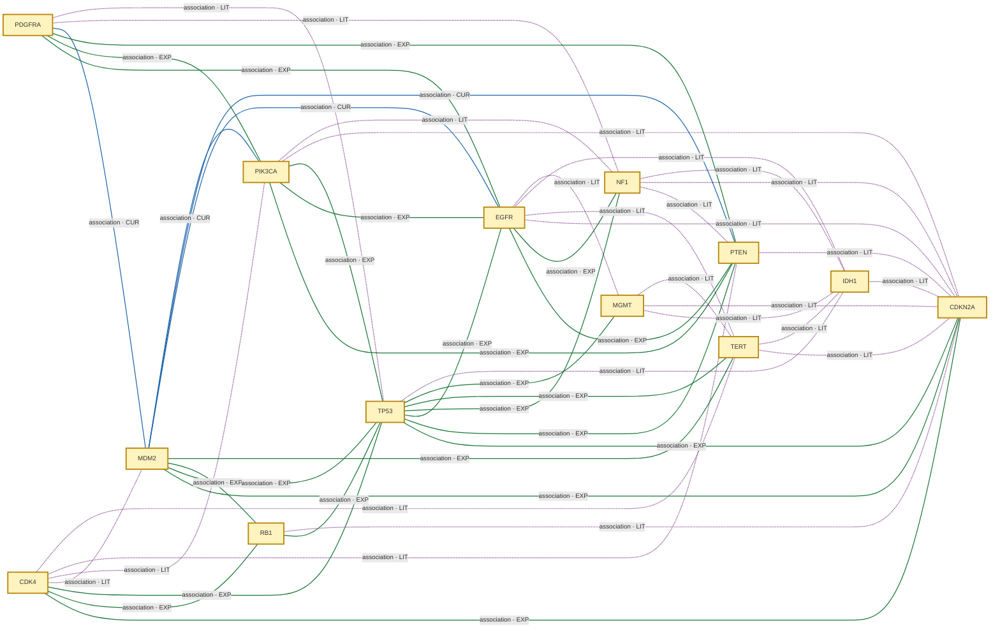

# BioPathway Mapper: gene analysis

**Query:** `EGFR, PDGFRA, PTEN, PIK3CA, NF1, TP53, MDM2, CDKN2A, CDK4, RB1, IDH1, TERT, MGMT`

## 1. Input and resolved identifiers

| Input | Symbol | NCBI Gene | UniProt | Name | Location |
|---|---|---|---|---|---|
| EGFR | EGFR | 1956 | P00533 | epidermal growth factor receptor | 7p11.2 |
| PDGFRA | PDGFRA | 5156 | P16234 | platelet derived growth factor receptor alpha | 4q12 |
| PTEN | PTEN | 5728 | P60484 | phosphatase and tensin homolog | 10q23.31 |
| PIK3CA | PIK3CA | 5290 | P42336 | phosphatidylinositol-4,5-bisphosphate 3-kinase catalytic subunit alpha | 3q26.32 |
| NF1 | NF1 | 4763 | P21359 | neurofibromin 1 | 17q11.2 |
| TP53 | TP53 | 7157 | P04637 | tumor protein p53 | 17p13.1 |
| MDM2 | MDM2 | 4193 | Q00987 | MDM2 proto-oncogene | 12q15 |
| CDKN2A | CDKN2A | 1029 | P42771 | cyclin dependent kinase inhibitor 2A | 9p21.3 |
| CDK4 | CDK4 | 1019 | P11802 | cyclin dependent kinase 4 | 12q14.1 |
| RB1 | RB1 | 5925 | P06400 | RB transcriptional corepressor 1 | 13q14.2 |
| IDH1 | IDH1 | 3417 | O75874 | isocitrate dehydrogenase (NADP(+)) 1 | 2q34 |
| TERT | TERT | 7015 | O14746 | telomerase reverse transcriptase | 5p15.33 |
| MGMT | MGMT | 4255 | P16455 | O-6-methylguanine-DNA methyltransferase | 10q26.3 |

## 2. Data source status

| Source | Status |
|---|---|
| KEGG | ok |
| NCBI Gene | ok |
| PubMed | ok |
| Reactome | ok |
| STRING | ok |
| UniProt | ok |

68 API requests (21 served from cache).

## 3. Pathway context

| Source | ID | Name | Gene | Evidence | Note |
|---|---|---|---|---|---|
| Reactome | [R-HSA-1227986](https://reactome.org/content/detail/R-HSA-1227986) | Signaling by ERBB2 | EGFR | CUR |  |
| Reactome | [R-HSA-1236382](https://reactome.org/content/detail/R-HSA-1236382) | Constitutive Signaling by Ligand-Responsive EGFR Cancer Variants | EGFR | CUR |  |
| Reactome | [R-HSA-1236394](https://reactome.org/content/detail/R-HSA-1236394) | Signaling by ERBB4 | EGFR | CUR |  |
| Reactome | [R-HSA-1250196](https://reactome.org/content/detail/R-HSA-1250196) | SHC1 events in ERBB2 signaling | EGFR | CUR |  |
| Reactome | [R-HSA-1251932](https://reactome.org/content/detail/R-HSA-1251932) | PLCG1 events in ERBB2 signaling | EGFR | CUR |  |
| Reactome | [R-HSA-1257604](https://reactome.org/content/detail/R-HSA-1257604) | PIP3 activates AKT signaling | EGFR | CUR |  |
| Reactome | [R-HSA-177929](https://reactome.org/content/detail/R-HSA-177929) | Signaling by EGFR | EGFR | CUR |  |
| Reactome | [R-HSA-179812](https://reactome.org/content/detail/R-HSA-179812) | GRB2 events in EGFR signaling | EGFR | CUR |  |
| Reactome | [R-HSA-180292](https://reactome.org/content/detail/R-HSA-180292) | GAB1 signalosome | EGFR | CUR |  |
| Reactome | [R-HSA-180336](https://reactome.org/content/detail/R-HSA-180336) | SHC1 events in EGFR signaling | EGFR | CUR |  |
| Reactome | [R-HSA-182971](https://reactome.org/content/detail/R-HSA-182971) | EGFR downregulation | EGFR | CUR |  |
| Reactome | [R-HSA-1963640](https://reactome.org/content/detail/R-HSA-1963640) | GRB2 events in ERBB2 signaling | EGFR | CUR |  |
| Reactome | [R-HSA-1963642](https://reactome.org/content/detail/R-HSA-1963642) | PI3K events in ERBB2 signaling | EGFR | CUR |  |
| Reactome | [R-HSA-212718](https://reactome.org/content/detail/R-HSA-212718) | EGFR interacts with phospholipase C-gamma | EGFR | CUR |  |
| Reactome | [R-HSA-2179392](https://reactome.org/content/detail/R-HSA-2179392) | EGFR Transactivation by Gastrin | EGFR | CUR |  |
| Reactome | [R-HSA-2219530](https://reactome.org/content/detail/R-HSA-2219530) | Constitutive Signaling by Aberrant PI3K in Cancer | EGFR | CUR |  |
| Reactome | [R-HSA-445144](https://reactome.org/content/detail/R-HSA-445144) | Signal transduction by L1 | EGFR | CUR |  |
| Reactome | [R-HSA-5637810](https://reactome.org/content/detail/R-HSA-5637810) | Constitutive Signaling by EGFRvIII | EGFR | CUR |  |
| Reactome | [R-HSA-5638303](https://reactome.org/content/detail/R-HSA-5638303) | Inhibition of Signaling by Overexpressed EGFR | EGFR | CUR |  |
| Reactome | [R-HSA-5673001](https://reactome.org/content/detail/R-HSA-5673001) | RAF/MAP kinase cascade | EGFR | CUR |  |
| Reactome | [R-HSA-6785631](https://reactome.org/content/detail/R-HSA-6785631) | ERBB2 Regulates Cell Motility | EGFR | CUR |  |
| Reactome | [R-HSA-6811558](https://reactome.org/content/detail/R-HSA-6811558) | PI5P, PP2A and IER3 Regulate PI3K/AKT Signaling | EGFR | CUR |  |
| Reactome | [R-HSA-8847993](https://reactome.org/content/detail/R-HSA-8847993) | ERBB2 Activates PTK6 Signaling | EGFR | CUR |  |
| Reactome | [R-HSA-8856825](https://reactome.org/content/detail/R-HSA-8856825) | Cargo recognition for clathrin-mediated endocytosis | EGFR | CUR |  |
| Reactome | [R-HSA-8856828](https://reactome.org/content/detail/R-HSA-8856828) | Clathrin-mediated endocytosis | EGFR | CUR |  |
| Reactome | [R-HSA-8857538](https://reactome.org/content/detail/R-HSA-8857538) | PTK6 promotes HIF1A stabilization | EGFR | CUR |  |
| Reactome | [R-HSA-8863795](https://reactome.org/content/detail/R-HSA-8863795) | Downregulation of ERBB2 signaling | EGFR | CUR |  |
| Reactome | [R-HSA-8866910](https://reactome.org/content/detail/R-HSA-8866910) | TFAP2 (AP-2) family regulates transcription of growth factors and their receptors | EGFR | CUR |  |
| Reactome | [R-HSA-9009391](https://reactome.org/content/detail/R-HSA-9009391) | Extra-nuclear estrogen signaling | EGFR | CUR |  |
| Reactome | [R-HSA-9013507](https://reactome.org/content/detail/R-HSA-9013507) | NOTCH3 Activation and Transmission of Signal to the Nucleus | EGFR | CUR |  |
| Reactome | [R-HSA-9609690](https://reactome.org/content/detail/R-HSA-9609690) | HCMV Early Events | EGFR | CUR |  |
| Reactome | [R-HSA-9634638](https://reactome.org/content/detail/R-HSA-9634638) | Estrogen-dependent nuclear events downstream of ESR-membrane signaling | EGFR | CUR |  |
| Reactome | [R-HSA-9664565](https://reactome.org/content/detail/R-HSA-9664565) | Signaling by ERBB2 KD Mutants | EGFR | CUR |  |
| Reactome | [R-HSA-9665348](https://reactome.org/content/detail/R-HSA-9665348) | Signaling by ERBB2 ECD mutants | EGFR | CUR |  |
| Reactome | [R-HSA-9665686](https://reactome.org/content/detail/R-HSA-9665686) | Signaling by ERBB2 TMD/JMD mutants | EGFR | CUR |  |
| Reactome | [R-HSA-9820960](https://reactome.org/content/detail/R-HSA-9820960) | Respiratory syncytial virus (RSV) attachment and entry | EGFR | CUR |  |
| Reactome | [R-HSA-9927432](https://reactome.org/content/detail/R-HSA-9927432) | Developmental Lineage of Mammary Gland Myoepithelial Cells | EGFR | CUR |  |
| KEGG | [hsa01521](https://www.kegg.jp/pathway/hsa01521) | EGFR tyrosine kinase inhibitor resistance | EGFR | CUR |  |
| KEGG | [hsa01522](https://www.kegg.jp/pathway/hsa01522) | Endocrine resistance | EGFR | CUR |  |
| KEGG | [hsa03272](https://www.kegg.jp/pathway/hsa03272) | Virion - Hepatitis viruses | EGFR | CUR |  |
| KEGG | [hsa04010](https://www.kegg.jp/pathway/hsa04010) | MAPK signaling pathway | EGFR | CUR |  |
| KEGG | [hsa04012](https://www.kegg.jp/pathway/hsa04012) | ErbB signaling pathway | EGFR | CUR |  |
| KEGG | [hsa04014](https://www.kegg.jp/pathway/hsa04014) | Ras signaling pathway | EGFR | CUR |  |
| KEGG | [hsa04015](https://www.kegg.jp/pathway/hsa04015) | Rap1 signaling pathway | EGFR | CUR |  |
| KEGG | [hsa04020](https://www.kegg.jp/pathway/hsa04020) | Calcium signaling pathway | EGFR | CUR |  |
| KEGG | [hsa04066](https://www.kegg.jp/pathway/hsa04066) | HIF-1 signaling pathway | EGFR | CUR |  |
| KEGG | [hsa04068](https://www.kegg.jp/pathway/hsa04068) | FoxO signaling pathway | EGFR | CUR |  |
| KEGG | [hsa04072](https://www.kegg.jp/pathway/hsa04072) | Phospholipase D signaling pathway | EGFR | CUR |  |
| KEGG | [hsa04144](https://www.kegg.jp/pathway/hsa04144) | Endocytosis | EGFR | CUR |  |
| KEGG | [hsa04151](https://www.kegg.jp/pathway/hsa04151) | PI3K-Akt signaling pathway | EGFR | CUR |  |
| KEGG | [hsa04510](https://www.kegg.jp/pathway/hsa04510) | Focal adhesion | EGFR | CUR |  |
| KEGG | [hsa04518](https://www.kegg.jp/pathway/hsa04518) | Integrin signaling | EGFR | CUR |  |
| KEGG | [hsa04519](https://www.kegg.jp/pathway/hsa04519) | Cadherin signaling | EGFR | CUR |  |
| KEGG | [hsa04520](https://www.kegg.jp/pathway/hsa04520) | Adherens junction | EGFR | CUR |  |
| KEGG | [hsa04540](https://www.kegg.jp/pathway/hsa04540) | Gap junction | EGFR | CUR |  |
| KEGG | [hsa04630](https://www.kegg.jp/pathway/hsa04630) | JAK-STAT signaling pathway | EGFR | CUR |  |
| KEGG | [hsa04810](https://www.kegg.jp/pathway/hsa04810) | Regulation of actin cytoskeleton | EGFR | CUR |  |
| KEGG | [hsa04912](https://www.kegg.jp/pathway/hsa04912) | GnRH signaling pathway | EGFR | CUR |  |
| KEGG | [hsa04915](https://www.kegg.jp/pathway/hsa04915) | Estrogen signaling pathway | EGFR | CUR |  |
| KEGG | [hsa04921](https://www.kegg.jp/pathway/hsa04921) | Oxytocin signaling pathway | EGFR | CUR |  |

558 more in the JSON output.

## 4. Reconstructed molecular relationships

Evidence mix: EXP 22, CUR 4, LIT 46, HYP 1

| From | Relation | To | Evidence | Basis | Refs |
|---|---|---|---|---|---|
| PDGFRA | — association | TERT | LIT | STRING text-mining channel 0.576 only; co-mention in literature, not a demonstrated interaction | [1] |
| PDGFRA | — association | MGMT | LIT | STRING text-mining channel 0.694 only; co-mention in literature, not a demonstrated interaction | [2] |
| PDGFRA | — association | IDH1 | LIT | STRING text-mining channel 0.718 only; co-mention in literature, not a demonstrated interaction | [3] |
| PDGFRA | — association | CDKN2A | LIT | STRING text-mining channel 0.675 only; co-mention in literature, not a demonstrated interaction | [4] |
| PDGFRA | — association | TP53 | LIT | STRING text-mining channel 0.708 only; co-mention in literature, not a demonstrated interaction | [5] |
| PDGFRA | — association | NF1 | LIT | STRING text-mining channel 0.810 only; co-mention in literature, not a demonstrated interaction | [6] |
| PDGFRA | — association | MDM2 | CUR | STRING curated-database channel 0.650 (>= 0.4) | [7] |
| PDGFRA | — association | PTEN | EXP | STRING experiments channel 0.567 (>= 0.4); channel can include evidence transferred from orthologs | [8] |
| PDGFRA | — association | PIK3CA | EXP | STRING experiments channel 0.477 (>= 0.4); channel can include evidence transferred from orthologs | [9] |
| PDGFRA | — association | EGFR | EXP | STRING experiments channel 0.930 (>= 0.4); channel can include evidence transferred from orthologs | [10] |
| CDK4 | — association | EGFR | HYP | no single STRING channel reaches 0.4 (combined score 0.419) | [11] |
| CDK4 | — association | IDH1 | LIT | STRING text-mining channel 0.548 only; co-mention in literature, not a demonstrated interaction | [12] |
| CDK4 | — association | MGMT | LIT | STRING text-mining channel 0.609 only; co-mention in literature, not a demonstrated interaction | [13] |
| CDK4 | — association | NF1 | LIT | STRING text-mining channel 0.655 only; co-mention in literature, not a demonstrated interaction | [14] |
| CDK4 | — association | TERT | LIT | STRING text-mining channel 0.695 only; co-mention in literature, not a demonstrated interaction | [15] |
| CDK4 | — association | PTEN | LIT | STRING text-mining channel 0.732 only; co-mention in literature, not a demonstrated interaction | [16] |
| CDK4 | — association | PIK3CA | LIT | STRING text-mining channel 0.766 only; co-mention in literature, not a demonstrated interaction | [17] |
| CDK4 | — association | MDM2 | LIT | STRING text-mining channel 0.873 only; co-mention in literature, not a demonstrated interaction | [18] |
| CDK4 | — association | TP53 | EXP | STRING experiments channel 0.956 (>= 0.4); channel can include evidence transferred from orthologs | [19] |
| CDK4 | — association | RB1 | EXP | STRING experiments channel 0.999 (>= 0.4); channel can include evidence transferred from orthologs | [20] |
| CDK4 | — association | CDKN2A | EXP | STRING experiments channel 0.999 (>= 0.4); channel can include evidence transferred from orthologs | [21] |
| MDM2 | — association | MGMT | LIT | STRING text-mining channel 0.487 only; co-mention in literature, not a demonstrated interaction | [22] |
| MDM2 | — association | IDH1 | LIT | STRING text-mining channel 0.547 only; co-mention in literature, not a demonstrated interaction | [23] |
| MDM2 | — association | NF1 | LIT | STRING text-mining channel 0.582 only; co-mention in literature, not a demonstrated interaction | [24] |
| MDM2 | — association | PIK3CA | CUR | STRING curated-database channel 0.400 (>= 0.4) | [25] |
| MDM2 | — association | PTEN | CUR | STRING curated-database channel 0.400 (>= 0.4) | [26] |
| MDM2 | — association | EGFR | CUR | STRING curated-database channel 0.650 (>= 0.4) | [27] |
| MDM2 | — association | TERT | EXP | STRING experiments channel 0.918 (>= 0.4); channel can include evidence transferred from orthologs | [28] |
| MDM2 | — association | RB1 | EXP | STRING experiments channel 0.999 (>= 0.4); channel can include evidence transferred from orthologs | [29] |
| MDM2 | — association | TP53 | EXP | STRING experiments channel 0.999 (>= 0.4); channel can include evidence transferred from orthologs | [30] |
| MDM2 | — association | CDKN2A | EXP | STRING experiments channel 0.999 (>= 0.4); channel can include evidence transferred from orthologs | [31] |
| PIK3CA | — association | MGMT | LIT | STRING text-mining channel 0.570 only; co-mention in literature, not a demonstrated interaction | [32] |
| PIK3CA | — association | RB1 | LIT | STRING text-mining channel 0.570 only; co-mention in literature, not a demonstrated interaction | [33] |
| PIK3CA | — association | IDH1 | LIT | STRING text-mining channel 0.702 only; co-mention in literature, not a demonstrated interaction | [34] |
| PIK3CA | — association | TERT | LIT | STRING text-mining channel 0.701 only; co-mention in literature, not a demonstrated interaction | [35] |
| PIK3CA | — association | NF1 | LIT | STRING text-mining channel 0.726 only; co-mention in literature, not a demonstrated interaction | [36] |
| PIK3CA | — association | CDKN2A | LIT | STRING text-mining channel 0.775 only; co-mention in literature, not a demonstrated interaction | [37] |
| PIK3CA | — association | TP53 | EXP | STRING experiments channel 0.770 (>= 0.4); channel can include evidence transferred from orthologs | [38] |
| PIK3CA | — association | EGFR | EXP | STRING experiments channel 0.997 (>= 0.4); channel can include evidence transferred from orthologs | [39] |
| PIK3CA | — association | PTEN | EXP | STRING experiments channel 0.791 (>= 0.4); channel can include evidence transferred from orthologs | [40] |
| RB1 | — association | TERT | LIT | STRING text-mining channel 0.440 only; co-mention in literature, not a demonstrated interaction | [41] |
| RB1 | — association | EGFR | LIT | STRING text-mining channel 0.520 only; co-mention in literature, not a demonstrated interaction | [42] |
| RB1 | — association | PTEN | LIT | STRING text-mining channel 0.585 only; co-mention in literature, not a demonstrated interaction | [43] |
| RB1 | — association | CDKN2A | LIT | STRING text-mining channel 0.753 only; co-mention in literature, not a demonstrated interaction | [44] |
| RB1 | — association | TP53 | EXP | STRING experiments channel 0.871 (>= 0.4); channel can include evidence transferred from orthologs | [45] |
| TP53 | — association | IDH1 | LIT | STRING text-mining channel 0.802 only; co-mention in literature, not a demonstrated interaction | [46] |
| TP53 | — association | MGMT | EXP | STRING experiments channel 0.470 (>= 0.4); channel can include evidence transferred from orthologs | [47] |
| TP53 | — association | TERT | EXP | STRING experiments channel 0.417 (>= 0.4); channel can include evidence transferred from orthologs | [48] |
| TP53 | — association | NF1 | EXP | STRING experiments channel 0.601 (>= 0.4); channel can include evidence transferred from orthologs | [49] |
| TP53 | — association | EGFR | EXP | STRING experiments channel 0.749 (>= 0.4); channel can include evidence transferred from orthologs | [50] |
| TP53 | — association | PTEN | EXP | STRING experiments channel 0.976 (>= 0.4); channel can include evidence transferred from orthologs | [51] |
| TP53 | — association | CDKN2A | EXP | STRING experiments channel 0.999 (>= 0.4); channel can include evidence transferred from orthologs | [52] |
| EGFR | — association | MGMT | LIT | STRING text-mining channel 0.743 only; co-mention in literature, not a demonstrated interaction | [53] |
| EGFR | — association | IDH1 | LIT | STRING text-mining channel 0.770 only; co-mention in literature, not a demonstrated interaction | [54] |
| EGFR | — association | TERT | LIT | STRING text-mining channel 0.718 only; co-mention in literature, not a demonstrated interaction | [55] |
| EGFR | — association | CDKN2A | LIT | STRING text-mining channel 0.792 only; co-mention in literature, not a demonstrated interaction | [56] |
| EGFR | — association | NF1 | EXP | STRING experiments channel 0.770 (>= 0.4); channel can include evidence transferred from orthologs | [57] |
| EGFR | — association | PTEN | EXP | STRING experiments channel 0.912 (>= 0.4); channel can include evidence transferred from orthologs | [58] |
| MGMT | — association | NF1 | LIT | STRING text-mining channel 0.571 only; co-mention in literature, not a demonstrated interaction | [59] |
| MGMT | — association | PTEN | LIT | STRING text-mining channel 0.685 only; co-mention in literature, not a demonstrated interaction | [60] |

13 more relationships in the JSON output.

## 5. Evidence-labelled statements

### Function

- **[EXP]** EGFR function (UniProt P00533, UniProt evidence code ECO:0000269): Receptor tyrosine kinase binding ligands of the EGF family and activating several signaling cascades to convert extracellular cues into appropriate cellular responses. Known ligands include EGF, TGFA/TGF-alpha, AREG, epigen/EPGN, BTC/betacellulin, epiregulin/EREG and HBEGF/heparin-binding EGF. Ligand binding triggers receptor homo- and/or heterodimerization and autophosphorylation on key cytoplasmic residues. The phosphorylated receptor recruits adapter proteins like GRB2 which in turn activates complex downstream signaling cascades. Activates at least 4 major downstream signaling cascades including the RAS-RAF-MEK-ERK, PI3 kinase-AKT, PLCgamma-PKC and STATs modules. May also activate the ... [74] [75] [76] [77] [78]
- **[EXP]** EGFR function (UniProt P00533, UniProt evidence code ECO:0000269): May act as an antagonist of EGF action [74] [79]
- **[EXP]** PDGFRA function (UniProt P16234, UniProt evidence code ECO:0000269): Tyrosine-protein kinase that acts as a cell-surface receptor for PDGFA, PDGFB and PDGFC and plays an essential role in the regulation of embryonic development, cell proliferation, survival and chemotaxis. Depending on the context, promotes or inhibits cell proliferation and cell migration. Plays an important role in the differentiation of bone marrow-derived mesenchymal stem cells. Required for normal skeleton development and cephalic closure during embryonic development. Required for normal development of the mucosa lining the gastrointestinal tract, and for recruitment of mesenchymal cells and normal development of intestinal villi. Plays a role in cell migration and chemotaxis in wound ... [80] [81] [82] [83] [84]
- **[EXP]** PTEN function (UniProt P60484, UniProt evidence code ECO:0000269): Dual-specificity protein phosphatase, dephosphorylating tyrosine-, serine- and threonine-phosphorylated proteins. Also functions as a lipid phosphatase, removing the phosphate in the D3 position of the inositol ring of PtdIns(3,4,5)P3/phosphatidylinositol 3,4,5-trisphosphate, PtdIns(3,4)P2/phosphatidylinositol 3,4-diphosphate and PtdIns3P/phosphatidylinositol 3-phosphate with a preference for PtdIns(3,4,5)P3. Furthermore, this enzyme can also act as a cytosolic inositol 3-phosphatase acting on Ins(1,3,4,5,6)P5/inositol 1,3,4,5,6 pentakisphosphate and possibly Ins(1,3,4,5)P4/1D-myo-inositol 1,3,4,5-tetrakisphosphate. Antagonizes the PI3K-AKT/PKB signaling pathway by dephosphorylating ... [85] [86] [87] [88] [89]
- **[EXP]** PTEN function (UniProt P60484, UniProt evidence code ECO:0000269): Functional kinase, like isoform 1 it antagonizes the PI3K-AKT/PKB signaling pathway. Plays a role in mitochondrial energetic metabolism by promoting COX activity and ATP production, via collaboration with isoform 1 in increasing protein levels of PINK1 [85] [90]
- **[EXP]** PIK3CA function (UniProt P42336, UniProt evidence code ECO:0000269): Phosphoinositide-3-kinase (PI3K) phosphorylates phosphatidylinositol (PI) and its phosphorylated derivatives at position 3 of the inositol ring to produce 3-phosphoinositides. Uses ATP and PtdIns(4,5)P2 (phosphatidylinositol 4,5-bisphosphate) to generate phosphatidylinositol 3,4,5-trisphosphate (PIP3). PIP3 plays a key role by recruiting PH domain-containing proteins to the membrane, including AKT1 and PDPK1, activating signaling cascades involved in cell growth, survival, proliferation, motility and morphology. Participates in cellular signaling in response to various growth factors. Involved in the activation of AKT1 upon stimulation by receptor tyrosine kinases ligands such as EGF, ... [91] [92] [93] [94] [95]
- **[EXP]** NF1 function (UniProt P21359, UniProt evidence code ECO:0000269): Stimulates the GTPase activity of Ras. NF1 shows greater affinity for Ras GAP, but lower specific activity. May be a regulator of Ras activity [96] [97] [98]
- **[EXP]** TP53 function (UniProt P04637, UniProt evidence code ECO:0000269): Multifunctional transcription factor that induces cell cycle arrest, DNA repair or apoptosis upon binding to its target DNA sequence. Acts as a tumor suppressor in many tumor types; induces growth arrest or apoptosis depending on the physiological circumstances and cell type. Negatively regulates cell division by controlling expression of a set of genes required for this process. One of the activated genes is an inhibitor of cyclin-dependent kinases. Apoptosis induction seems to be mediated either by stimulation of BAX and FAS antigen expression, or by repression of Bcl-2 expression. Its pro-apoptotic activity is activated via its interaction with PPP1R13B/ASPP1 or TP53BP2/ASPP2. However, ... [99] [100] [101] [102] [103]
- **[EXP]** MDM2 function (UniProt Q00987, UniProt evidence code ECO:0000269): E3 ubiquitin-protein ligase that mediates ubiquitination of p53/TP53, leading to its degradation by the proteasome. Inhibits p53/TP53- and p73/TP73-mediated cell cycle arrest and apoptosis by binding its transcriptional activation domain. Also acts as a ubiquitin ligase E3 toward itself and ARRB1. Permits the nuclear export of p53/TP53. Promotes proteasome-dependent ubiquitin-independent degradation of retinoblastoma RB1 protein. Inhibits DAXX-mediated apoptosis by inducing its ubiquitination and degradation. Component of the TRIM28/KAP1-MDM2-p53/TP53 complex involved in stabilizing p53/TP53. Also a component of the TRIM28/KAP1-ERBB4-MDM2 complex which links growth factor and DNA damage ... [104] [105] [106] [107] [108]
- **[EXP]** CDKN2A function (UniProt P42771, UniProt evidence code ECO:0000269): Acts as a negative regulator of the proliferation of normal cells by interacting strongly with CDK4 and CDK6. This inhibits their ability to interact with cyclins D and to phosphorylate the retinoblastoma protein [109] [110] [111]
- **[EXP]** CDK4 function (UniProt P11802, UniProt evidence code ECO:0000269): Ser/Thr-kinase component of cyclin D-CDK4 (DC) complexes that phosphorylate and inhibit members of the retinoblastoma (RB) protein family including RB1 and regulate the cell-cycle during G(1)/S transition. Phosphorylation of RB1 allows dissociation of the transcription factor E2F from the RB/E2F complexes and the subsequent transcription of E2F target genes which are responsible for the progression through the G(1) phase. Hypophosphorylates RB1 in early G(1) phase. Cyclin D-CDK4 complexes are major integrators of various mitogenenic and antimitogenic signals. Also phosphorylates SMAD3 in a cell-cycle-dependent manner and represses its transcriptional activity. Component of the ternary ... [112] [113] [114] [115]
- **[EXP]** RB1 function (UniProt P06400, UniProt evidence code ECO:0000269): Tumor suppressor that is a key regulator of the G1/S transition of the cell cycle. The hypophosphorylated form binds transcription regulators of the E2F family, preventing transcription of E2F-responsive genes. Both physically blocks E2Fs transactivating domain and recruits chromatin-modifying enzymes that actively repress transcription. Cyclin and CDK-dependent phosphorylation of RB1 induces its dissociation from E2Fs, thereby activating transcription of E2F responsive genes and triggering entry into S phase. RB1 also promotes the G0-G1 transition upon phosphorylation and activation by CDK3/cyclin-C. Directly involved in heterochromatin formation by maintaining overall chromatin structure ... [116] [117] [118] [119]
- **[EXP]** RB1 function (UniProt P06400, UniProt evidence code ECO:0000269): (Microbial infection) In case of viral infections, interactions with SV40 large T antigen, HPV E7 protein or adenovirus E1A protein induce the disassembly of RB1-E2F1 complex thereby disrupting RB1's activity [116] [120] [121] [122] [123]
- **[EXP]** IDH1 function (UniProt O75874, UniProt evidence code ECO:0000269): Catalyzes the NADP(+)-dependent oxidative decarboxylation of isocitrate (D-threo-isocitrate) to 2-ketoglutarate (2-oxoglutarate), which is required by other enzymes such as the phytanoyl-CoA dioxygenase. Can also use 2-oxoglutarate as substrate and catalyze the reduction of 2-oxoglutarate to R-2-hydroxyglutarate. Plays a critical role in the generation of NADPH, an important cofactor in many biosynthesis pathways. May act as a corneal epithelial crystallin and may be involved in maintaining corneal epithelial transparency [124] [125] [126] [127]
- **[EXP]** TERT function (UniProt O14746, UniProt evidence code ECO:0000269): Telomerase is a ribonucleoprotein enzyme essential for the replication of chromosome termini in most eukaryotes. Active in progenitor and cancer cells. Inactive, or very low activity, in normal somatic cells. Catalytic component of the teleromerase holoenzyme complex whose main activity is the elongation of telomeres by acting as a reverse transcriptase that adds simple sequence repeats to chromosome ends by copying a template sequence within the RNA component of the enzyme. Catalyzes the RNA-dependent extension of 3'-chromosomal termini with the 6-nucleotide telomeric repeat unit, 5'-TTAGGG-3'. The catalytic cycle involves primer binding, primer extension and release of product once the ... [128] [129] [130] [131] [132]
- **[CUR]** MGMT function (UniProt P16455, UniProtKB/Swiss-Prot reviewed annotation without a specific evidence code): Involved in the cellular defense against the biological effects of O6-methylguanine (O6-MeG) and O4-methylthymine (O4-MeT) in DNA. Repairs the methylated nucleobase in DNA by stoichiometrically transferring the methyl group to a cysteine residue in the enzyme. This is a suicide reaction: the enzyme is irreversibly inactivated [133]

### Biological process

- **[EXP]** EGFR GO biological process annotations: cell surface receptor signaling pathway, cell-cell adhesion, cellular response to estradiol stimulus, epidermal growth factor receptor signaling pathway, ERBB2-EGFR signaling pathway, negative regulation of apoptotic process, negative regulation of cardiocyte differentiation, negative regulation of macroautophagy, negative regulation of protein catabolic process, phosphatidylinositol 3-kinase/protein kinase B signal transduction, positive regulation of canonical Wnt signaling pathway, positive regulation of cell growth (+21 more) [74]
- **[CUR]** EGFR GO biological process annotations: negative regulation of epidermal growth factor receptor signaling pathway, ossification, protein insertion into membrane [74]
- **[PRED]** EGFR GO biological process annotations: cellular response to amino acid stimulus, cellular response to epidermal growth factor stimulus, learning or memory, neuron differentiation, positive regulation of fibroblast proliferation [74]
- **[EXP]** PDGFRA GO biological process annotations: cellular response to reactive oxygen species, negative regulation of platelet activation, peptidyl-tyrosine phosphorylation, platelet aggregation, platelet-derived growth factor receptor signaling pathway, platelet-derived growth factor receptor-alpha signaling pathway, positive regulation of calcium-mediated signaling, positive regulation of cell migration, positive regulation of cell population proliferation, positive regulation of cell proliferation by VEGF-activated platelet derived growth factor receptor signaling pathway, positive regulation of chemotaxis, positive regulation of ERK1 and ERK2 cascade (+3 more) [80]
- **[CUR]** PDGFRA GO biological process annotations: cell activation, peptidyl-tyrosine autophosphorylation, positive regulation of phosphatidylinositol 3-kinase/protein kinase B signal transduction, regulation of actin cytoskeleton organization [80]
- **[PRED]** PDGFRA GO biological process annotations: cardiac myofibril assembly, cell chemotaxis, cell migration, cell surface receptor protein tyrosine kinase signaling pathway, embryonic cranial skeleton morphogenesis, embryonic digestive tract morphogenesis, embryonic skeletal system morphogenesis, luteinization, metanephric glomerular capillary formation, retina vasculature development in camera-type eye, wound healing [80]
- **[EXP]** PTEN GO biological process annotations: cellular response to electrical stimulus, negative regulation of cell cycle G1/S phase transition, negative regulation of cell migration, negative regulation of cell population proliferation, negative regulation of epithelial to mesenchymal transition, negative regulation of focal adhesion assembly, negative regulation of G1/S transition of mitotic cell cycle, negative regulation of keratinocyte migration, negative regulation of osteoblast differentiation, negative regulation of peptidyl-serine phosphorylation, negative regulation of phosphatidylinositol 3-kinase/protein kinase B signal transduction, negative regulation of vascular associated smooth muscle cell proliferation (+9 more) [85]
- **[CUR]** PTEN GO biological process annotations: phosphatidylinositol biosynthetic process [85]
- **[PRED]** PTEN GO biological process annotations: adult behavior, blood vessel development, cell migration, central nervous system development, central nervous system myelin maintenance, central nervous system neuron axonogenesis, dendritic spine morphogenesis, dentate gyrus development, forebrain morphogenesis, heart development, learning or memory, locomotor rhythm (+24 more) [85]
- **[EXP]** PIK3CA GO biological process annotations: cellular response to insulin stimulus, interleukin-8-mediated signaling pathway, negative regulation of anoikis, neutrophil chemotaxis, phosphatidylinositol 3-kinase/protein kinase B signal transduction, positive regulation of phosphatidylinositol 3-kinase/protein kinase B signal transduction, positive regulation of protein kinase activity, positive regulation of protein localization to membrane, TORC2 signaling, vascular endothelial growth factor signaling pathway [91]
- **[CUR]** PIK3CA GO biological process annotations: anoikis, cardiac muscle contraction, endothelial cell migration, epidermal growth factor receptor signaling pathway, insulin receptor signaling pathway, negative regulation of macroautophagy, platelet activation, positive regulation of TOR signaling, T cell receptor signaling pathway, vasculature development [91]
- **[PRED]** PIK3CA GO biological process annotations: actin cytoskeleton organization, cardiac muscle cell contraction, cell migration, cellular response to hydrostatic pressure, negative regulation of actin filament depolymerization, negative regulation of gene expression, phosphatidylinositol phosphate biosynthetic process, phosphatidylinositol-3-phosphate biosynthetic process, phosphatidylinositol-mediated signaling, positive regulation of lamellipodium assembly, positive regulation of smooth muscle cell proliferation, regulation of actin filament organization (+7 more) [91]
- **[EXP]** NF1 GO biological process annotations: cognition, negative regulation of cell migration, negative regulation of endothelial cell proliferation, negative regulation of MAPK cascade, positive regulation of GTPase activity, regulation of angiogenesis, regulation of blood vessel endothelial cell migration [96]
- **[PRED]** NF1 GO biological process annotations: actin cytoskeleton organization, adrenal gland development, artery morphogenesis, brain development, camera-type eye morphogenesis, cell communication, cerebral cortex development, collagen fibril organization, extracellular matrix organization, forebrain astrocyte development, forebrain morphogenesis, heart development (+25 more) [96]
- **[EXP]** TP53 GO biological process annotations: autophagy, bone marrow development, cellular response to actinomycin D, cellular response to gamma radiation, cellular response to glucose starvation, cellular response to hypoxia, cellular response to ionizing radiation, cellular response to UV, cellular response to xenobiotic stimulus, cellular senescence, DNA damage response, DNA damage response, signal transduction by p53 class mediator (+45 more) [99]
- **[CUR]** TP53 GO biological process annotations: intrinsic apoptotic signaling pathway, negative regulation of helicase activity [99]
- **[PRED]** TP53 GO biological process annotations: circadian behavior, determination of adult lifespan, entrainment of circadian clock by photoperiod, intrinsic apoptotic signaling pathway in response to endoplasmic reticulum stress, positive regulation of programmed necrotic cell death, positive regulation of thymocyte apoptotic process, protein tetramerization, type II interferon-mediated signaling pathway [99]
- **[EXP]** MDM2 GO biological process annotations: amyloid fibril formation, apoptotic process, cellular response to gamma radiation, cellular response to hypoxia, DNA damage response, signal transduction by p53 class mediator, establishment of protein localization, negative regulation of DNA damage response, signal transduction by p53 class mediator, negative regulation of DNA-templated transcription, negative regulation of intrinsic apoptotic signaling pathway by p53 class mediator, negative regulation of signal transduction by p53 class mediator, negative regulation of transcription by RNA polymerase II, positive regulation of mitotic cell cycle (+12 more) [104]
- **[CUR]** MDM2 GO biological process annotations: positive regulation of cell population proliferation, protein polyubiquitination, protein sumoylation [104]
- **[PRED]** MDM2 GO biological process annotations: cellular response to alkaloid, cellular response to antibiotic, cellular response to estrogen stimulus, cellular response to growth factor stimulus, cellular response to hydrogen peroxide, cellular response to peptide hormone stimulus, cellular response to UV-C, cellular response to vitamin B1, fibroblast activation, negative regulation of neuron projection development, negative regulation of protein processing, positive regulation of gene expression (+13 more) [104]
- **[EXP]** CDKN2A GO biological process annotations: cellular senescence, negative regulation of cell growth, negative regulation of cell population proliferation, negative regulation of cell-matrix adhesion, negative regulation of cyclin-dependent protein serine/threonine kinase activity, negative regulation of DNA-templated transcription, negative regulation of transcription by RNA polymerase II, Ras protein signal transduction, regulation of cell cycle, regulation of G1/S transition of mitotic cell cycle, replicative senescence [109]
- **[PRED]** CDKN2A GO biological process annotations: positive regulation of macrophage apoptotic process, positive regulation of smooth muscle cell apoptotic process [109]
- **[EXP]** CDK4 GO biological process annotations: G1/S transition of mitotic cell cycle, positive regulation of cell population proliferation, positive regulation of fibroblast proliferation, positive regulation of G2/M transition of mitotic cell cycle, regulation of cell cycle, regulation of gene expression, response to xenobiotic stimulus [112]
- **[CUR]** CDK4 GO biological process annotations: regulation of transcription initiation by RNA polymerase II [112]
- **[PRED]** CDK4 GO biological process annotations: G2/M transition of mitotic cell cycle, signal transduction [112]
- **[EXP]** RB1 GO biological process annotations: chromosome organization, heterochromatin formation, maintenance of mitotic sister chromatid cohesion, myoblast differentiation, negative regulation of DNA-templated transcription, negative regulation of gene expression, negative regulation of protein kinase activity, positive regulation of mitotic metaphase/anaphase transition, positive regulation of transcription regulatory region DNA binding, protein localization to chromosome, centromeric region, Ras protein signal transduction, regulation of DNA-templated transcription (+3 more) [116]
- **[CUR]** RB1 GO biological process annotations: chromatin remodeling, negative regulation of transcription by RNA polymerase II, regulation of cell cycle [116]
- **[PRED]** RB1 GO biological process annotations: aortic valve morphogenesis, cell differentiation, cell morphogenesis involved in neuron differentiation, negative regulation of apoptotic signaling pathway, negative regulation of cell cycle, negative regulation of cell growth, negative regulation of cold-induced thermogenesis, negative regulation of G1/S transition of mitotic cell cycle, negative regulation of hepatocyte apoptotic process, negative regulation of inflammatory response, negative regulation of myofibroblast differentiation, neuron projection development (+3 more) [116]
- **[EXP]** IDH1 GO biological process annotations: 2-oxoglutarate metabolic process, isocitrate metabolic process [124]
- **[PRED]** IDH1 GO biological process annotations: female gonad development, NADP+ metabolic process, response to steroid hormone, tricarboxylic acid cycle [124]
- **[EXP]** TERT GO biological process annotations: cellular response to hypoxia, DNA biosynthetic process, DNA strand elongation, establishment of protein localization to telomere, mitochondrion organization, negative regulation of cellular senescence, negative regulation of extrinsic apoptotic signaling pathway in absence of ligand, positive regulation of miRNA transcription, positive regulation of protein localization to nucleolus, positive regulation of Wnt signaling pathway, protein import into nucleus, regulation of protein stability (+6 more) [128]
- **[CUR]** TERT GO biological process annotations: telomere maintenance, telomere maintenance via recombination [128]
- **[PRED]** TERT GO biological process annotations: heart development, negative regulation of endothelial cell apoptotic process, negative regulation of neuron apoptotic process, positive regulation of angiogenesis, positive regulation of G1/S transition of mitotic cell cycle, positive regulation of hair cycle, positive regulation of stem cell proliferation, positive regulation of transdifferentiation, positive regulation of vascular associated smooth muscle cell migration, positive regulation of vascular associated smooth muscle cell proliferation, response to cadmium ion [128]
- **[EXP]** MGMT GO biological process annotations: negative regulation of apoptotic process, positive regulation of double-strand break repair [133]
- **[PRED]** MGMT GO biological process annotations: DNA repair [133]

## 6. Pathway diagram

Undirected STRING functional-association network around the queried gene(s); line colour = evidence class. For directed signalling use the pathway analysis.

Showing the 50 most relevant of 73 relationships (focus genes first, then strongest evidence).

| Line colour | Code | Evidence class |
|---|---|---|
| green | EXP | experimentally validated |
| blue | CUR | curated database evidence |
| orange | PRED | computationally predicted |
| purple | LIT | literature-supported association |
| grey | HYP | hypothetical/insufficiently established |

Solid arrow = activation/conversion/membership; `x` head = inhibition; dashed = expression, indirect or non-curated; no head = undirected association.

## 7. Interpretation notes and limits

- STRING edges are undirected functional associations scored per evidence channel. They do not establish direct physical binding, direction or activating/inhibiting effect.

## Sources

1. STRING PDGFRA--TERT — STRING association PDGFRA-TERT. <https://string-db.org/cgi/network?identifiers=PDGFRA%0dTERT&species=9606>
2. STRING PDGFRA--MGMT — STRING association PDGFRA-MGMT. <https://string-db.org/cgi/network?identifiers=PDGFRA%0dMGMT&species=9606>
3. STRING PDGFRA--IDH1 — STRING association PDGFRA-IDH1. <https://string-db.org/cgi/network?identifiers=PDGFRA%0dIDH1&species=9606>
4. STRING PDGFRA--CDKN2A — STRING association PDGFRA-CDKN2A. <https://string-db.org/cgi/network?identifiers=PDGFRA%0dCDKN2A&species=9606>
5. STRING PDGFRA--TP53 — STRING association PDGFRA-TP53. <https://string-db.org/cgi/network?identifiers=PDGFRA%0dTP53&species=9606>
6. STRING PDGFRA--NF1 — STRING association PDGFRA-NF1. <https://string-db.org/cgi/network?identifiers=PDGFRA%0dNF1&species=9606>
7. STRING PDGFRA--MDM2 — STRING association PDGFRA-MDM2. <https://string-db.org/cgi/network?identifiers=PDGFRA%0dMDM2&species=9606>
8. STRING PDGFRA--PTEN — STRING association PDGFRA-PTEN. <https://string-db.org/cgi/network?identifiers=PDGFRA%0dPTEN&species=9606>
9. STRING PDGFRA--PIK3CA — STRING association PDGFRA-PIK3CA. <https://string-db.org/cgi/network?identifiers=PDGFRA%0dPIK3CA&species=9606>
10. STRING PDGFRA--EGFR — STRING association PDGFRA-EGFR. <https://string-db.org/cgi/network?identifiers=PDGFRA%0dEGFR&species=9606>
11. STRING CDK4--EGFR — STRING association CDK4-EGFR. <https://string-db.org/cgi/network?identifiers=CDK4%0dEGFR&species=9606>
12. STRING CDK4--IDH1 — STRING association CDK4-IDH1. <https://string-db.org/cgi/network?identifiers=CDK4%0dIDH1&species=9606>
13. STRING CDK4--MGMT — STRING association CDK4-MGMT. <https://string-db.org/cgi/network?identifiers=CDK4%0dMGMT&species=9606>
14. STRING CDK4--NF1 — STRING association CDK4-NF1. <https://string-db.org/cgi/network?identifiers=CDK4%0dNF1&species=9606>
15. STRING CDK4--TERT — STRING association CDK4-TERT. <https://string-db.org/cgi/network?identifiers=CDK4%0dTERT&species=9606>
16. STRING CDK4--PTEN — STRING association CDK4-PTEN. <https://string-db.org/cgi/network?identifiers=CDK4%0dPTEN&species=9606>
17. STRING CDK4--PIK3CA — STRING association CDK4-PIK3CA. <https://string-db.org/cgi/network?identifiers=CDK4%0dPIK3CA&species=9606>
18. STRING CDK4--MDM2 — STRING association CDK4-MDM2. <https://string-db.org/cgi/network?identifiers=CDK4%0dMDM2&species=9606>
19. STRING CDK4--TP53 — STRING association CDK4-TP53. <https://string-db.org/cgi/network?identifiers=CDK4%0dTP53&species=9606>
20. STRING CDK4--RB1 — STRING association CDK4-RB1. <https://string-db.org/cgi/network?identifiers=CDK4%0dRB1&species=9606>
21. STRING CDK4--CDKN2A — STRING association CDK4-CDKN2A. <https://string-db.org/cgi/network?identifiers=CDK4%0dCDKN2A&species=9606>
22. STRING MDM2--MGMT — STRING association MDM2-MGMT. <https://string-db.org/cgi/network?identifiers=MDM2%0dMGMT&species=9606>
23. STRING MDM2--IDH1 — STRING association MDM2-IDH1. <https://string-db.org/cgi/network?identifiers=MDM2%0dIDH1&species=9606>
24. STRING MDM2--NF1 — STRING association MDM2-NF1. <https://string-db.org/cgi/network?identifiers=MDM2%0dNF1&species=9606>
25. STRING MDM2--PIK3CA — STRING association MDM2-PIK3CA. <https://string-db.org/cgi/network?identifiers=MDM2%0dPIK3CA&species=9606>
26. STRING MDM2--PTEN — STRING association MDM2-PTEN. <https://string-db.org/cgi/network?identifiers=MDM2%0dPTEN&species=9606>
27. STRING MDM2--EGFR — STRING association MDM2-EGFR. <https://string-db.org/cgi/network?identifiers=MDM2%0dEGFR&species=9606>
28. STRING MDM2--TERT — STRING association MDM2-TERT. <https://string-db.org/cgi/network?identifiers=MDM2%0dTERT&species=9606>
29. STRING MDM2--RB1 — STRING association MDM2-RB1. <https://string-db.org/cgi/network?identifiers=MDM2%0dRB1&species=9606>
30. STRING MDM2--TP53 — STRING association MDM2-TP53. <https://string-db.org/cgi/network?identifiers=MDM2%0dTP53&species=9606>
31. STRING MDM2--CDKN2A — STRING association MDM2-CDKN2A. <https://string-db.org/cgi/network?identifiers=MDM2%0dCDKN2A&species=9606>
32. STRING PIK3CA--MGMT — STRING association PIK3CA-MGMT. <https://string-db.org/cgi/network?identifiers=PIK3CA%0dMGMT&species=9606>
33. STRING PIK3CA--RB1 — STRING association PIK3CA-RB1. <https://string-db.org/cgi/network?identifiers=PIK3CA%0dRB1&species=9606>
34. STRING PIK3CA--IDH1 — STRING association PIK3CA-IDH1. <https://string-db.org/cgi/network?identifiers=PIK3CA%0dIDH1&species=9606>
35. STRING PIK3CA--TERT — STRING association PIK3CA-TERT. <https://string-db.org/cgi/network?identifiers=PIK3CA%0dTERT&species=9606>
36. STRING PIK3CA--NF1 — STRING association PIK3CA-NF1. <https://string-db.org/cgi/network?identifiers=PIK3CA%0dNF1&species=9606>
37. STRING PIK3CA--CDKN2A — STRING association PIK3CA-CDKN2A. <https://string-db.org/cgi/network?identifiers=PIK3CA%0dCDKN2A&species=9606>
38. STRING PIK3CA--TP53 — STRING association PIK3CA-TP53. <https://string-db.org/cgi/network?identifiers=PIK3CA%0dTP53&species=9606>
39. STRING PIK3CA--EGFR — STRING association PIK3CA-EGFR. <https://string-db.org/cgi/network?identifiers=PIK3CA%0dEGFR&species=9606>
40. STRING PIK3CA--PTEN — STRING association PIK3CA-PTEN. <https://string-db.org/cgi/network?identifiers=PIK3CA%0dPTEN&species=9606>
41. STRING RB1--TERT — STRING association RB1-TERT. <https://string-db.org/cgi/network?identifiers=RB1%0dTERT&species=9606>
42. STRING RB1--EGFR — STRING association RB1-EGFR. <https://string-db.org/cgi/network?identifiers=RB1%0dEGFR&species=9606>
43. STRING RB1--PTEN — STRING association RB1-PTEN. <https://string-db.org/cgi/network?identifiers=RB1%0dPTEN&species=9606>
44. STRING RB1--CDKN2A — STRING association RB1-CDKN2A. <https://string-db.org/cgi/network?identifiers=RB1%0dCDKN2A&species=9606>
45. STRING RB1--TP53 — STRING association RB1-TP53. <https://string-db.org/cgi/network?identifiers=RB1%0dTP53&species=9606>
46. STRING TP53--IDH1 — STRING association TP53-IDH1. <https://string-db.org/cgi/network?identifiers=TP53%0dIDH1&species=9606>
47. STRING TP53--MGMT — STRING association TP53-MGMT. <https://string-db.org/cgi/network?identifiers=TP53%0dMGMT&species=9606>
48. STRING TP53--TERT — STRING association TP53-TERT. <https://string-db.org/cgi/network?identifiers=TP53%0dTERT&species=9606>
49. STRING TP53--NF1 — STRING association TP53-NF1. <https://string-db.org/cgi/network?identifiers=TP53%0dNF1&species=9606>
50. STRING TP53--EGFR — STRING association TP53-EGFR. <https://string-db.org/cgi/network?identifiers=TP53%0dEGFR&species=9606>
51. STRING TP53--PTEN — STRING association TP53-PTEN. <https://string-db.org/cgi/network?identifiers=TP53%0dPTEN&species=9606>
52. STRING TP53--CDKN2A — STRING association TP53-CDKN2A. <https://string-db.org/cgi/network?identifiers=TP53%0dCDKN2A&species=9606>
53. STRING EGFR--MGMT — STRING association EGFR-MGMT. <https://string-db.org/cgi/network?identifiers=EGFR%0dMGMT&species=9606>
54. STRING EGFR--IDH1 — STRING association EGFR-IDH1. <https://string-db.org/cgi/network?identifiers=EGFR%0dIDH1&species=9606>
55. STRING EGFR--TERT — STRING association EGFR-TERT. <https://string-db.org/cgi/network?identifiers=EGFR%0dTERT&species=9606>
56. STRING EGFR--CDKN2A — STRING association EGFR-CDKN2A. <https://string-db.org/cgi/network?identifiers=EGFR%0dCDKN2A&species=9606>
57. STRING EGFR--NF1 — STRING association EGFR-NF1. <https://string-db.org/cgi/network?identifiers=EGFR%0dNF1&species=9606>
58. STRING EGFR--PTEN — STRING association EGFR-PTEN. <https://string-db.org/cgi/network?identifiers=EGFR%0dPTEN&species=9606>
59. STRING MGMT--NF1 — STRING association MGMT-NF1. <https://string-db.org/cgi/network?identifiers=MGMT%0dNF1&species=9606>
60. STRING MGMT--PTEN — STRING association MGMT-PTEN. <https://string-db.org/cgi/network?identifiers=MGMT%0dPTEN&species=9606>
61. STRING MGMT--TERT — STRING association MGMT-TERT. <https://string-db.org/cgi/network?identifiers=MGMT%0dTERT&species=9606>
62. STRING MGMT--CDKN2A — STRING association MGMT-CDKN2A. <https://string-db.org/cgi/network?identifiers=MGMT%0dCDKN2A&species=9606>
63. STRING MGMT--IDH1 — STRING association MGMT-IDH1. <https://string-db.org/cgi/network?identifiers=MGMT%0dIDH1&species=9606>
64. STRING TERT--NF1 — STRING association TERT-NF1. <https://string-db.org/cgi/network?identifiers=TERT%0dNF1&species=9606>
65. STRING TERT--PTEN — STRING association TERT-PTEN. <https://string-db.org/cgi/network?identifiers=TERT%0dPTEN&species=9606>
66. STRING TERT--IDH1 — STRING association TERT-IDH1. <https://string-db.org/cgi/network?identifiers=TERT%0dIDH1&species=9606>
67. STRING TERT--CDKN2A — STRING association TERT-CDKN2A. <https://string-db.org/cgi/network?identifiers=TERT%0dCDKN2A&species=9606>
68. STRING NF1--IDH1 — STRING association NF1-IDH1. <https://string-db.org/cgi/network?identifiers=NF1%0dIDH1&species=9606>
69. STRING NF1--CDKN2A — STRING association NF1-CDKN2A. <https://string-db.org/cgi/network?identifiers=NF1%0dCDKN2A&species=9606>
70. STRING NF1--PTEN — STRING association NF1-PTEN. <https://string-db.org/cgi/network?identifiers=NF1%0dPTEN&species=9606>
71. STRING PTEN--IDH1 — STRING association PTEN-IDH1. <https://string-db.org/cgi/network?identifiers=PTEN%0dIDH1&species=9606>
72. STRING PTEN--CDKN2A — STRING association PTEN-CDKN2A. <https://string-db.org/cgi/network?identifiers=PTEN%0dCDKN2A&species=9606>
73. STRING IDH1--CDKN2A — STRING association IDH1-CDKN2A. <https://string-db.org/cgi/network?identifiers=IDH1%0dCDKN2A&species=9606>
74. UniProt P00533 — EGFR: Epidermal growth factor receptor. <https://www.uniprot.org/uniprotkb/P00533/entry>
75. PubMed PMID:10026169. <https://pubmed.ncbi.nlm.nih.gov/10026169/>
76. PubMed PMID:10805725. <https://pubmed.ncbi.nlm.nih.gov/10805725/>
77. PubMed PMID:11116146. <https://pubmed.ncbi.nlm.nih.gov/11116146/>
78. PubMed PMID:11483589. <https://pubmed.ncbi.nlm.nih.gov/11483589/>
79. PubMed PMID:8918811. <https://pubmed.ncbi.nlm.nih.gov/8918811/>
80. UniProt P16234 — PDGFRA: Platelet-derived growth factor receptor alpha. <https://www.uniprot.org/uniprotkb/P16234/entry>
81. PubMed PMID:10734113. <https://pubmed.ncbi.nlm.nih.gov/10734113/>
82. PubMed PMID:10947961. <https://pubmed.ncbi.nlm.nih.gov/10947961/>
83. PubMed PMID:11297552. <https://pubmed.ncbi.nlm.nih.gov/11297552/>
84. PubMed PMID:12522257. <https://pubmed.ncbi.nlm.nih.gov/12522257/>
85. UniProt P60484 — PTEN: Phosphatidylinositol 3,4,5-trisphosphate 3-phosphatase and dual-specificity protein phosphatase PTEN. <https://www.uniprot.org/uniprotkb/P60484/entry>
86. PubMed PMID:10468583. <https://pubmed.ncbi.nlm.nih.gov/10468583/>
87. PubMed PMID:11418101. <https://pubmed.ncbi.nlm.nih.gov/11418101/>
88. PubMed PMID:11707428. <https://pubmed.ncbi.nlm.nih.gov/11707428/>
89. PubMed PMID:15979280. <https://pubmed.ncbi.nlm.nih.gov/15979280/>
90. PubMed PMID:23744781. <https://pubmed.ncbi.nlm.nih.gov/23744781/>
91. UniProt P42336 — PIK3CA: Phosphatidylinositol 4,5-bisphosphate 3-kinase catalytic subunit alpha isoform. <https://www.uniprot.org/uniprotkb/P42336/entry>
92. PubMed PMID:15135396. <https://pubmed.ncbi.nlm.nih.gov/15135396/>
93. PubMed PMID:21708979. <https://pubmed.ncbi.nlm.nih.gov/21708979/>
94. PubMed PMID:23936502. <https://pubmed.ncbi.nlm.nih.gov/23936502/>
95. PubMed PMID:26593112. <https://pubmed.ncbi.nlm.nih.gov/26593112/>
96. UniProt P21359 — NF1: Neurofibromin. <https://www.uniprot.org/uniprotkb/P21359/entry>
97. PubMed PMID:2121371. <https://pubmed.ncbi.nlm.nih.gov/2121371/>
98. PubMed PMID:8417346. <https://pubmed.ncbi.nlm.nih.gov/8417346/>
99. UniProt P04637 — TP53: Cellular tumor antigen p53. <https://www.uniprot.org/uniprotkb/P04637/entry>
100. PubMed PMID:11025664. <https://pubmed.ncbi.nlm.nih.gov/11025664/>
101. PubMed PMID:12524540. <https://pubmed.ncbi.nlm.nih.gov/12524540/>
102. PubMed PMID:12810724. <https://pubmed.ncbi.nlm.nih.gov/12810724/>
103. PubMed PMID:15186775. <https://pubmed.ncbi.nlm.nih.gov/15186775/>
104. UniProt Q00987 — MDM2: E3 ubiquitin-protein ligase Mdm2. <https://www.uniprot.org/uniprotkb/Q00987/entry>
105. PubMed PMID:12821780. <https://pubmed.ncbi.nlm.nih.gov/12821780/>
106. PubMed PMID:15053880. <https://pubmed.ncbi.nlm.nih.gov/15053880/>
107. PubMed PMID:15195100. <https://pubmed.ncbi.nlm.nih.gov/15195100/>
108. PubMed PMID:15632057. <https://pubmed.ncbi.nlm.nih.gov/15632057/>
109. UniProt P42771 — CDKN2A: Cyclin-dependent kinase inhibitor 2A. <https://www.uniprot.org/uniprotkb/P42771/entry>
110. PubMed PMID:16782892. <https://pubmed.ncbi.nlm.nih.gov/16782892/>
111. PubMed PMID:7972006. <https://pubmed.ncbi.nlm.nih.gov/7972006/>
112. UniProt P11802 — CDK4: Cyclin-dependent kinase 4. <https://www.uniprot.org/uniprotkb/P11802/entry>
113. PubMed PMID:15241418. <https://pubmed.ncbi.nlm.nih.gov/15241418/>
114. PubMed PMID:18827403. <https://pubmed.ncbi.nlm.nih.gov/18827403/>
115. PubMed PMID:9003781. <https://pubmed.ncbi.nlm.nih.gov/9003781/>
116. UniProt P06400 — RB1: Retinoblastoma-associated protein. <https://www.uniprot.org/uniprotkb/P06400/entry>
117. PubMed PMID:10499802. <https://pubmed.ncbi.nlm.nih.gov/10499802/>
118. PubMed PMID:15084261. <https://pubmed.ncbi.nlm.nih.gov/15084261/>
119. PubMed PMID:39441926. <https://pubmed.ncbi.nlm.nih.gov/39441926/>
120. PubMed PMID:1316611. <https://pubmed.ncbi.nlm.nih.gov/1316611/>
121. PubMed PMID:17974914. <https://pubmed.ncbi.nlm.nih.gov/17974914/>
122. PubMed PMID:18701596. <https://pubmed.ncbi.nlm.nih.gov/18701596/>
123. PubMed PMID:2839300. <https://pubmed.ncbi.nlm.nih.gov/2839300/>
124. UniProt O75874 — IDH1: Isocitrate dehydrogenase [NADP] cytoplasmic. <https://www.uniprot.org/uniprotkb/O75874/entry>
125. PubMed PMID:10521434. <https://pubmed.ncbi.nlm.nih.gov/10521434/>
126. PubMed PMID:19935646. <https://pubmed.ncbi.nlm.nih.gov/19935646/>
127. PubMed PMID:28263965. <https://pubmed.ncbi.nlm.nih.gov/28263965/>
128. UniProt O14746 — TERT: Telomerase reverse transcriptase. <https://www.uniprot.org/uniprotkb/O14746/entry>
129. PubMed PMID:14963003. <https://pubmed.ncbi.nlm.nih.gov/14963003/>
130. PubMed PMID:15082768. <https://pubmed.ncbi.nlm.nih.gov/15082768/>
131. PubMed PMID:15857955. <https://pubmed.ncbi.nlm.nih.gov/15857955/>
132. PubMed PMID:17026956. <https://pubmed.ncbi.nlm.nih.gov/17026956/>
133. UniProt P16455 — MGMT: Methylated-DNA--protein-cysteine methyltransferase. <https://www.uniprot.org/uniprotkb/P16455/entry>

Records retrieved between 2026-11-13T20:20:37Z and 2026-11-19T17:55:04Z (UTC). Databases are updated continually; re-run to refresh.