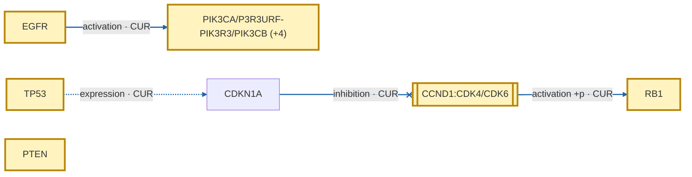

# BioPathway Mapper: pathway analysis

**Query:** `hsa05214 | genes: EGFR, PTEN, PIK3CA, TP53, CDK4, RB1`

## 1. Input and resolved identifiers

| Input | Symbol | NCBI Gene | UniProt | Name | Location |
|---|---|---|---|---|---|
| EGFR | EGFR | 1956 | P00533 | epidermal growth factor receptor | 7p11.2 |
| PTEN | PTEN | 5728 | P60484 | phosphatase and tensin homolog | 10q23.31 |
| PIK3CA | PIK3CA | 5290 | P42336 | phosphatidylinositol-4,5-bisphosphate 3-kinase catalytic subunit alpha | 3q26.32 |
| TP53 | TP53 | 7157 | P04637 | tumor protein p53 | 17p13.1 |
| CDK4 | CDK4 | 1019 | P11802 | cyclin dependent kinase 4 | 12q14.1 |
| RB1 | RB1 | 5925 | P06400 | RB transcriptional corepressor 1 | 13q14.2 |

## 2. Data source status

| Source | Status |
|---|---|
| KEGG | ok |
| NCBI Gene | ok |
| PubMed | ok |
| Reactome | ok |
| UniProt | ok |

29 API requests (25 served from cache).

## 3. Pathway context

| Source | ID | Name | Gene | Evidence | Note |
|---|---|---|---|---|---|
| KEGG | [hsa05214](https://www.kegg.jp/pathway/hsa05214) | Glioma |  | CUR |  |

## 4. Reconstructed molecular relationships

Evidence mix: CUR 4

| From | Relation | To | Evidence | Basis | Refs |
|---|---|---|---|---|---|
| CCND1:CDK4/CDK6 | → activation +p | RB1 | CUR | KEGG manually curated pathway map; KGML PPrel [activation, phosphorylation] | [1] |
| EGFR | → activation | PIK3CA/P3R3URF-PIK3R3/PIK3CB (+4) | CUR | KEGG manually curated pathway map; KGML PPrel [activation] | [1] |
| CDKN1A | → inhibition | CCND1:CDK4/CDK6 | CUR | KEGG manually curated pathway map; KGML PPrel [inhibition] | [1] |
| TP53 | → expression | CDKN1A | CUR | KEGG manually curated pathway map; KGML GErel [expression] | [1] |

## 5. Evidence-labelled statements

### Mechanism

- **[CUR]** CDK4 to RB1, shortest directed route in KEGG hsa05214 (Glioma): CCND1:CDK4/CDK6 -[activation +p]-> RB1. Each step is a KEGG-drawn relation; a route is a curated summary and may skip intermediates. [1]
- **[CUR]** EGFR to PIK3CA, shortest directed route in KEGG hsa05214 (Glioma): EGFR -[activation]-> PIK3CA/P3R3URF-PIK3R3/PIK3CB (+4). Each step is a KEGG-drawn relation; a route is a curated summary and may skip intermediates. [1]
- **[CUR]** TP53 to CDK4, shortest directed route in KEGG hsa05214 (Glioma): TP53 -[expression]-> CDKN1A -[inhibition]-> CCND1:CDK4/CDK6. Each step is a KEGG-drawn relation; a route is a curated summary and may skip intermediates. [1]
- **[CUR]** TP53 to RB1, shortest directed route in KEGG hsa05214 (Glioma): TP53 -[expression]-> CDKN1A -[inhibition]-> CCND1:CDK4/CDK6 -[activation +p]-> RB1. Each step is a KEGG-drawn relation; a route is a curated summary and may skip intermediates. [1]

## 6. Pathway diagram

Directed relations redrawn from the KEGG map (KGML). Arrow = activation, x = inhibition, dashed = expression/indirect. Multi-gene boxes are paralog groups that KEGG draws as one node.

| Line colour | Code | Evidence class |
|---|---|---|
| green | EXP | experimentally validated |
| blue | CUR | curated database evidence |
| orange | PRED | computationally predicted |
| purple | LIT | literature-supported association |
| grey | HYP | hypothetical/insufficiently established |

Solid arrow = activation/conversion/membership; `x` head = inhibition; dashed = expression, indirect or non-curated; no head = undirected association.

## 7. Interpretation notes and limits

- No directed KEGG route for: CDK4 -> EGFR; CDK4 -> PIK3CA; CDK4 -> PTEN; CDK4 -> TP53; EGFR -> CDK4; EGFR -> PTEN; EGFR -> RB1; EGFR -> TP53; PIK3CA -> CDK4; PIK3CA -> EGFR. This reflects the map's drawing, not proof that no regulation exists.
- KEGG hsa05214 contains 46 reconstructable relations; 4 are kept for this question.

## 8. Literature

CUR rows are references cited by the curated pathway record; LIT rows are search hits offered for reading and were not used to draw any relationship.

- **[CUR]** Soni D (2005). Genetics of glioblastoma multiforme: mitogenic signaling and cell cycle pathways converge. *J Clin Neurosci*. [PMID:15639402](https://pubmed.ncbi.nlm.nih.gov/15639402/) — reference of KEGG hsa05214
- **[CUR]** Zhu Y (2002). The molecular and genetic basis of neurological tumours. *Nat Rev Cancer*. [PMID:12154354](https://pubmed.ncbi.nlm.nih.gov/12154354/) — reference of KEGG hsa05214
- **[CUR]** Holland EC (2001). Gliomagenesis: genetic alterations and mouse models. *Nat Rev Genet*. [PMID:11253051](https://pubmed.ncbi.nlm.nih.gov/11253051/) — reference of KEGG hsa05214
- **[CUR]** Bansal K (2006). Molecular biology of human gliomas. *Technol Cancer Res Treat*. [PMID:16700615](https://pubmed.ncbi.nlm.nih.gov/16700615/) — reference of KEGG hsa05214
- **[CUR]** Kapoor GS (2003). Mitogenic signaling cascades in glial tumors. *Neurosurgery*. [PMID:12762887](https://pubmed.ncbi.nlm.nih.gov/12762887/) — reference of KEGG hsa05214

## Sources

1. KEGG hsa05214 — Glioma. <https://www.kegg.jp/pathway/hsa05214>

Records retrieved between 2026-11-13T20:20:37Z and 2026-11-19T17:55:08Z (UTC). Databases are updated continually; re-run to refresh.