# BioPathway Mapper: metabolic analysis

**Query:** `glycolysis | module M00001`

## 1. Input and resolved identifiers

No gene identifiers were resolved for this query.

## 2. Data source status

| Source | Status |
|---|---|
| KEGG | ok |
| Reactome | ok |

7 API requests (7 served from cache).

## 3. Pathway context

| Source | ID | Name | Gene | Evidence | Note |
|---|---|---|---|---|---|
| KEGG | [hsa00010](https://www.kegg.jp/pathway/hsa00010) | Glycolysis / Gluconeogenesis |  | CUR |  |
| KEGG | [M00001](https://www.kegg.jp/module/M00001) | Glycolysis (Embden-Meyerhof pathway), glucose => pyruvate |  | CUR |  |
| Reactome | [R-HSA-70171](https://reactome.org/content/detail/R-HSA-70171) | Glycolysis |  | CUR |  |
| Reactome | [R-HSA-9634600](https://reactome.org/content/detail/R-HSA-9634600) | Regulation of glycolysis by fructose 2,6-bisphosphate metabolism |  | CUR |  |
| Reactome | [R-HSA-70326](https://reactome.org/content/detail/R-HSA-70326) | Glucose metabolism |  | CUR |  |

## 4. Reconstructed molecular relationships

Evidence mix: CUR 12

| From | Relation | To | Evidence | Basis | Refs |
|---|---|---|---|---|---|
| alpha-D-Glucose | → conversion ADPGK/GCK/HK1 (+3) | alpha-D-Glucose 6-phosphate | CUR | KEGG reaction(s) R01786, R02189, R09085; enzymes from KGML gene entries | [1] |
| alpha-D-Glucose 6-phosphate | → conversion GPI reversible | D-Fructose 6-phosphate | CUR | KEGG reaction(s) R13199; enzymes from KGML gene entries | [1] |
| D-Fructose 6-phosphate | → conversion PFKL/PFKM/PFKP | D-Fructose 1,6-bisphosphate | CUR | KEGG reaction(s) R00756, R05805; enzymes from KGML gene entries | [1] |
| D-Fructose 1,6-bisphosphate | → conversion ALDOA/ALDOB/ALDOC reversible | Glycerone phosphate | CUR | KEGG reaction(s) R01068; enzymes from KGML gene entries | [1] |
| D-Fructose 1,6-bisphosphate | → conversion ALDOA/ALDOB/ALDOC reversible | D-Glyceraldehyde 3-phosphate | CUR | KEGG reaction(s) R01068; enzymes from KGML gene entries | [1] |
| Glycerone phosphate | → conversion TPI1 reversible | D-Glyceraldehyde 3-phosphate | CUR | KEGG reaction(s) R01015; enzymes from KGML gene entries | [1] |
| D-Glyceraldehyde 3-phosphate | → conversion GAPDH/GAPDHS reversible | 3-Phospho-D-glyceroyl phosphate | CUR | KEGG reaction(s) R01061, R01063; enzymes from KGML gene entries | [1] |
| 3-Phospho-D-glyceroyl phosphate | → conversion PGK1/PGK2 reversible | 3-Phospho-D-glycerate | CUR | KEGG reaction(s) R01512; enzymes from KGML gene entries | [1] |
| D-Glyceraldehyde 3-phosphate | → conversion enzyme not mapped in this organism | 3-Phospho-D-glycerate | CUR | KEGG reaction(s) R07159; enzymes from KGML gene entries | [1] |
| 3-Phospho-D-glycerate | → conversion BPGM/PGAM1/PGAM2 (+1) reversible | 2-Phospho-D-glycerate | CUR | KEGG reaction(s) R01518; enzymes from KGML gene entries | [1] |
| 2-Phospho-D-glycerate | → conversion ENO1/ENO2/ENO3 (+1) reversible | Phosphoenolpyruvate | CUR | KEGG reaction(s) R00658; enzymes from KGML gene entries | [1] |
| Phosphoenolpyruvate | → conversion PKLR/PKM | Pyruvate | CUR | KEGG reaction(s) R00200; enzymes from KGML gene entries | [1] |

## 5. Evidence-labelled statements

### Mechanism

- **[CUR]** KEGG module M00001 (Glycolysis (Embden-Meyerhof pathway), glucose => pyruvate) runs alpha-D-Glucose -> Pyruvate in 11 reaction steps (definition: (K00844,K12407,K00845,K25026,K00886,K08074,K00918) (K01810,K06859,K13810,K15916) (K00850,K16370,K21071,K24182,K00918) (K01623,K01624,K11645,K16305,K16306) K01803 (((K00134,K00150) K00927),K11389) (K01834,K15633,K15634,K15635) (K01689,K27394) (K00873,K12406)). [1]

## 6. Pathway diagram

Metabolite flow from KEGG reaction records: node = compound, edge label = enzyme gene(s) KEGG assigns to that reaction in this organism.

```mermaid
flowchart LR
    n0(["alpha-D-Glucose"])
    n1(["alpha-D-Glucose 6-phosphate"])
    n2(["D-Fructose 6-phosphate"])
    n3(["D-Fructose 1,6-bisphosphate"])
    n4(["Glycerone phosphate"])
    n5(["D-Glyceraldehyde 3-phosphate"])
    n6(["3-Phospho-D-glyceroyl phosphate"])
    n7(["3-Phospho-D-glycerate"])
    n8(["2-Phospho-D-glycerate"])
    n9(["Phosphoenolpyruvate"])
    n10(["Pyruvate"])
    n0 -->|"conversion ADPGK/GCK/HK1 (+3) · CUR"| n1
    n1 -->|"conversion GPI reversible · CUR"| n2
    n2 -->|"conversion PFKL/PFKM/PFKP · CUR"| n3
    n3 -->|"conversion ALDOA/ALDOB/ALDOC reversible · CUR"| n4
    n3 -->|"conversion ALDOA/ALDOB/ALDOC reversible · CUR"| n5
    n4 -->|"conversion TPI1 reversible · CUR"| n5
    n5 -->|"conversion GAPDH/GAPDHS reversible · CUR"| n6
    n6 -->|"conversion PGK1/PGK2 reversible · CUR"| n7
    n5 -->|"conversion enzyme not mapped in this organism · CUR"| n7
    n7 -->|"conversion BPGM/PGAM1/PGAM2 (+1) reversible · CUR"| n8
    n8 -->|"conversion ENO1/ENO2/ENO3 (+1) reversible · CUR"| n9
    n9 -->|"conversion PKLR/PKM · CUR"| n10
    linkStyle 0 stroke:#2166ac,stroke-width:2px
    linkStyle 1 stroke:#2166ac,stroke-width:2px
    linkStyle 2 stroke:#2166ac,stroke-width:2px
    linkStyle 3 stroke:#2166ac,stroke-width:2px
    linkStyle 4 stroke:#2166ac,stroke-width:2px
    linkStyle 5 stroke:#2166ac,stroke-width:2px
    linkStyle 6 stroke:#2166ac,stroke-width:2px
    linkStyle 7 stroke:#2166ac,stroke-width:2px
    linkStyle 8 stroke:#2166ac,stroke-width:2px
    linkStyle 9 stroke:#2166ac,stroke-width:2px
    linkStyle 10 stroke:#2166ac,stroke-width:2px
    linkStyle 11 stroke:#2166ac,stroke-width:2px
    classDef focus fill:#fff3bf,stroke:#b8860b,stroke-width:3px
    classDef compound fill:#e6f4ea,stroke:#3c8d5a
    classDef pathway fill:#e8eaf6,stroke:#3f51b5
    classDef variant fill:#fde2e1,stroke:#c0392b,stroke-width:2px
    classDef condition fill:#f3e5f5,stroke:#8e24aa
    classDef region fill:#f1f3f4,stroke:#5f6368
    class n0,n1,n2,n3,n4,n5,n6,n7,n8,n9,n10 compound
```

| Line colour | Code | Evidence class |
|---|---|---|
| green | EXP | experimentally validated |
| blue | CUR | curated database evidence |
| orange | PRED | computationally predicted |
| purple | LIT | literature-supported association |
| grey | HYP | hypothetical/insufficiently established |

Solid arrow = activation/conversion/membership; `x` head = inhibition; dashed = expression, indirect or non-curated; no head = undirected association.

## 7. Interpretation notes and limits

- No hsa enzyme is linked to reaction(s) R07159 on this map.

## Sources

1. KEGG M00001 — Glycolysis (Embden-Meyerhof pathway), glucose => pyruvate. <https://www.kegg.jp/module/M00001>

Records retrieved between 2026-11-13T19:28:33Z and 2026-11-13T19:29:54Z (UTC). Databases are updated continually; re-run to refresh.