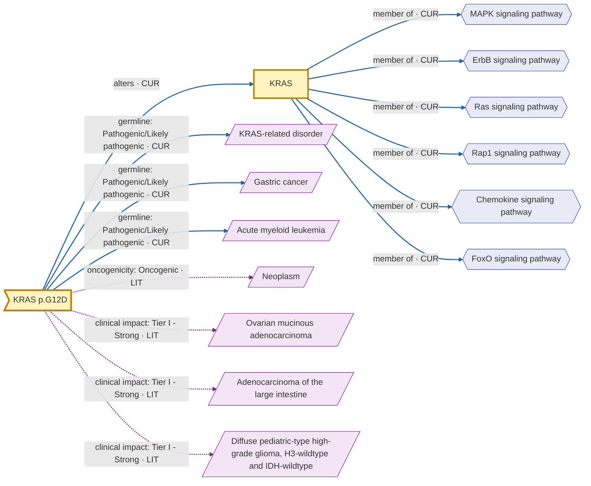

# BioPathway Mapper: mutation analysis

**Query:** `KRAS G12D`

## 1. Input and resolved identifiers

| Input | Symbol | NCBI Gene | UniProt | Name | Location |
|---|---|---|---|---|---|
| KRAS | KRAS | 3845 | P01116 | KRas proto-oncogene, GTPase | 12p12.1 |

Variant parsed as **p.Gly12Asp** (G12D; missense, residue 12).

## 2. Data source status

| Source | Status |
|---|---|
| ClinVar | ok |
| KEGG | ok |
| NCBI Gene | ok |
| PubMed | ok |
| UniProt | ok |

10 API requests (10 served from cache).

## 3. Pathway context

| Source | ID | Name | Gene | Evidence | Note |
|---|---|---|---|---|---|
| KEGG | [hsa01521](https://www.kegg.jp/pathway/hsa01521) | EGFR tyrosine kinase inhibitor resistance | KRAS | CUR |  |
| KEGG | [hsa01522](https://www.kegg.jp/pathway/hsa01522) | Endocrine resistance | KRAS | CUR |  |
| KEGG | [hsa04010](https://www.kegg.jp/pathway/hsa04010) | MAPK signaling pathway | KRAS | CUR |  |
| KEGG | [hsa04012](https://www.kegg.jp/pathway/hsa04012) | ErbB signaling pathway | KRAS | CUR |  |
| KEGG | [hsa04014](https://www.kegg.jp/pathway/hsa04014) | Ras signaling pathway | KRAS | CUR |  |
| KEGG | [hsa04015](https://www.kegg.jp/pathway/hsa04015) | Rap1 signaling pathway | KRAS | CUR |  |
| KEGG | [hsa04062](https://www.kegg.jp/pathway/hsa04062) | Chemokine signaling pathway | KRAS | CUR |  |
| KEGG | [hsa04068](https://www.kegg.jp/pathway/hsa04068) | FoxO signaling pathway | KRAS | CUR |  |
| KEGG | [hsa04071](https://www.kegg.jp/pathway/hsa04071) | Sphingolipid signaling pathway | KRAS | CUR |  |
| KEGG | [hsa04072](https://www.kegg.jp/pathway/hsa04072) | Phospholipase D signaling pathway | KRAS | CUR |  |
| KEGG | [hsa04137](https://www.kegg.jp/pathway/hsa04137) | Mitophagy - animal | KRAS | CUR |  |
| KEGG | [hsa04140](https://www.kegg.jp/pathway/hsa04140) | Autophagy - animal | KRAS | CUR |  |
| KEGG | [hsa04150](https://www.kegg.jp/pathway/hsa04150) | mTOR signaling pathway | KRAS | CUR |  |
| KEGG | [hsa04151](https://www.kegg.jp/pathway/hsa04151) | PI3K-Akt signaling pathway | KRAS | CUR |  |
| KEGG | [hsa04210](https://www.kegg.jp/pathway/hsa04210) | Apoptosis | KRAS | CUR |  |
| KEGG | [hsa04211](https://www.kegg.jp/pathway/hsa04211) | Longevity regulating pathway | KRAS | CUR |  |
| KEGG | [hsa04213](https://www.kegg.jp/pathway/hsa04213) | Longevity regulating pathway - multiple species | KRAS | CUR |  |
| KEGG | [hsa04218](https://www.kegg.jp/pathway/hsa04218) | Cellular senescence | KRAS | CUR |  |
| KEGG | [hsa04360](https://www.kegg.jp/pathway/hsa04360) | Axon guidance | KRAS | CUR |  |
| KEGG | [hsa04370](https://www.kegg.jp/pathway/hsa04370) | VEGF signaling pathway | KRAS | CUR |  |
| KEGG | [hsa04371](https://www.kegg.jp/pathway/hsa04371) | Apelin signaling pathway | KRAS | CUR |  |
| KEGG | [hsa04519](https://www.kegg.jp/pathway/hsa04519) | Cadherin signaling | KRAS | CUR |  |
| KEGG | [hsa04540](https://www.kegg.jp/pathway/hsa04540) | Gap junction | KRAS | CUR |  |
| KEGG | [hsa04550](https://www.kegg.jp/pathway/hsa04550) | Signaling pathways regulating pluripotency of stem cells | KRAS | CUR |  |
| KEGG | [hsa04625](https://www.kegg.jp/pathway/hsa04625) | C-type lectin receptor signaling pathway | KRAS | CUR |  |
| KEGG | [hsa04650](https://www.kegg.jp/pathway/hsa04650) | Natural killer cell mediated cytotoxicity | KRAS | CUR |  |
| KEGG | [hsa04660](https://www.kegg.jp/pathway/hsa04660) | T cell receptor signaling pathway | KRAS | CUR |  |
| KEGG | [hsa04662](https://www.kegg.jp/pathway/hsa04662) | B cell receptor signaling pathway | KRAS | CUR |  |
| KEGG | [hsa04664](https://www.kegg.jp/pathway/hsa04664) | Fc epsilon RI signaling pathway | KRAS | CUR |  |
| KEGG | [hsa04714](https://www.kegg.jp/pathway/hsa04714) | Thermogenesis | KRAS | CUR |  |
| KEGG | [hsa04720](https://www.kegg.jp/pathway/hsa04720) | Long-term potentiation | KRAS | CUR |  |
| KEGG | [hsa04722](https://www.kegg.jp/pathway/hsa04722) | Neurotrophin signaling pathway | KRAS | CUR |  |
| KEGG | [hsa04725](https://www.kegg.jp/pathway/hsa04725) | Cholinergic synapse | KRAS | CUR |  |
| KEGG | [hsa04726](https://www.kegg.jp/pathway/hsa04726) | Serotonergic synapse | KRAS | CUR |  |
| KEGG | [hsa04730](https://www.kegg.jp/pathway/hsa04730) | Long-term depression | KRAS | CUR |  |
| KEGG | [hsa04810](https://www.kegg.jp/pathway/hsa04810) | Regulation of actin cytoskeleton | KRAS | CUR |  |
| KEGG | [hsa04910](https://www.kegg.jp/pathway/hsa04910) | Insulin signaling pathway | KRAS | CUR |  |
| KEGG | [hsa04912](https://www.kegg.jp/pathway/hsa04912) | GnRH signaling pathway | KRAS | CUR |  |
| KEGG | [hsa04914](https://www.kegg.jp/pathway/hsa04914) | Progesterone-mediated oocyte maturation | KRAS | CUR |  |
| KEGG | [hsa04915](https://www.kegg.jp/pathway/hsa04915) | Estrogen signaling pathway | KRAS | CUR |  |
| KEGG | [hsa04916](https://www.kegg.jp/pathway/hsa04916) | Melanogenesis | KRAS | CUR |  |
| KEGG | [hsa04917](https://www.kegg.jp/pathway/hsa04917) | Prolactin signaling pathway | KRAS | CUR |  |
| KEGG | [hsa04919](https://www.kegg.jp/pathway/hsa04919) | Thyroid hormone signaling pathway | KRAS | CUR |  |
| KEGG | [hsa04921](https://www.kegg.jp/pathway/hsa04921) | Oxytocin signaling pathway | KRAS | CUR |  |
| KEGG | [hsa04926](https://www.kegg.jp/pathway/hsa04926) | Relaxin signaling pathway | KRAS | CUR |  |
| KEGG | [hsa04929](https://www.kegg.jp/pathway/hsa04929) | GnRH secretion | KRAS | CUR |  |
| KEGG | [hsa04933](https://www.kegg.jp/pathway/hsa04933) | AGE-RAGE signaling pathway in diabetic complications | KRAS | CUR |  |
| KEGG | [hsa04935](https://www.kegg.jp/pathway/hsa04935) | Growth hormone synthesis, secretion and action | KRAS | CUR |  |
| KEGG | [hsa04960](https://www.kegg.jp/pathway/hsa04960) | Aldosterone-regulated sodium reabsorption | KRAS | CUR |  |
| KEGG | [hsa05010](https://www.kegg.jp/pathway/hsa05010) | Alzheimer disease | KRAS | CUR |  |
| KEGG | [hsa05022](https://www.kegg.jp/pathway/hsa05022) | Pathways of neurodegeneration - multiple diseases | KRAS | CUR |  |
| KEGG | [hsa05034](https://www.kegg.jp/pathway/hsa05034) | Alcoholism | KRAS | CUR |  |
| KEGG | [hsa05160](https://www.kegg.jp/pathway/hsa05160) | Hepatitis C | KRAS | CUR |  |
| KEGG | [hsa05161](https://www.kegg.jp/pathway/hsa05161) | Hepatitis B | KRAS | CUR |  |
| KEGG | [hsa05163](https://www.kegg.jp/pathway/hsa05163) | Human cytomegalovirus infection | KRAS | CUR |  |
| KEGG | [hsa05165](https://www.kegg.jp/pathway/hsa05165) | Human papillomavirus infection | KRAS | CUR |  |
| KEGG | [hsa05166](https://www.kegg.jp/pathway/hsa05166) | Human T-cell leukemia virus 1 infection | KRAS | CUR |  |
| KEGG | [hsa05167](https://www.kegg.jp/pathway/hsa05167) | Kaposi sarcoma-associated herpesvirus infection | KRAS | CUR |  |
| KEGG | [hsa05170](https://www.kegg.jp/pathway/hsa05170) | Human immunodeficiency virus 1 infection | KRAS | CUR |  |
| KEGG | [hsa05200](https://www.kegg.jp/pathway/hsa05200) | Pathways in cancer | KRAS | CUR |  |

24 more in the JSON output.

## 4. Reconstructed molecular relationships

Evidence mix: CUR 10, LIT 4

| From | Relation | To | Evidence | Basis | Refs |
|---|---|---|---|---|---|
| KRAS p.G12D | → alters | KRAS | CUR | variant is defined on this gene's product | [1] |
| KRAS p.G12D | → germline: Pathogenic/Likely pathogenic | KRAS-related disorder | CUR | ClinVar review status: criteria provided, multiple submitters, no conflicts | [2] |
| KRAS p.G12D | → germline: Pathogenic/Likely pathogenic | Gastric cancer | CUR | ClinVar review status: criteria provided, multiple submitters, no conflicts | [2] |
| KRAS p.G12D | → germline: Pathogenic/Likely pathogenic | Acute myeloid leukemia | CUR | ClinVar review status: criteria provided, multiple submitters, no conflicts | [2] |
| KRAS p.G12D | → oncogenicity: Oncogenic | Neoplasm | LIT | ClinVar review status: criteria provided, single submitter (not independently confirmed) | [2] |
| KRAS p.G12D | → clinical impact: Tier I - Strong | Ovarian mucinous adenocarcinoma | LIT | ClinVar review status: criteria provided, single submitter (not independently confirmed) | [2] |
| KRAS p.G12D | → clinical impact: Tier I - Strong | Adenocarcinoma of the large intestine | LIT | ClinVar review status: criteria provided, single submitter (not independently confirmed) | [2] |
| KRAS p.G12D | → clinical impact: Tier I - Strong | Diffuse pediatric-type high-grade glioma, H3-wildtype and IDH-wildtype | LIT | ClinVar review status: criteria provided, single submitter (not independently confirmed) | [2] |
| KRAS | → member of | MAPK signaling pathway | CUR | KEGG gene-pathway link | [3] |
| KRAS | → member of | ErbB signaling pathway | CUR | KEGG gene-pathway link | [4] |
| KRAS | → member of | Ras signaling pathway | CUR | KEGG gene-pathway link | [5] |
| KRAS | → member of | Rap1 signaling pathway | CUR | KEGG gene-pathway link | [6] |
| KRAS | → member of | Chemokine signaling pathway | CUR | KEGG gene-pathway link | [7] |
| KRAS | → member of | FoxO signaling pathway | CUR | KEGG gene-pathway link | [8] |

## 5. Evidence-labelled statements

### Identifiers

- **[CUR]** Reference residue check: P01116 position 12 is G, matching the input. [9]

### Other variants at this position

- **[EXP]** UniProt natural variant VAR_036305 G12A (different substitution at this position): in colorectal cancer samples; somatic mutation; dbSNP:rs121913529 [9] [10] [11]
- **[EXP]** UniProt natural variant VAR_006839 G12C (different substitution at this position): in lung carcinoma; somatic mutation; also found in metastatic colorectal cancer; dbSNP:rs121913530 [9] [11] [12] [13]
- **[EXP]** UniProt natural variant VAR_016027 G12R (different substitution at this position): in lung cancer and bladder cancer; somatic mutation; dbSNP:rs121913530 [9] [15]
- **[EXP]** UniProt natural variant VAR_016028 G12S (different substitution at this position): in GASC and JMML; also found in lung carcinoma; somatic mutation; dbSNP:rs121913530 [9] [10] [12] [14]
- **[EXP]** UniProt natural variant VAR_006840 G12V (different substitution at this position): in GASC; also found in lung carcinoma, pancreatic carcinoma and colon cancer; also found in metastatic colorectal cancer; somatic mutation; it is constitutively activated and stimulates transcription activation of tumor suppressor genes in non-transformed fibroblasts; promotes GTP binding; dbSNP:rs121913529 [9] [10] [12] [16]

### Reported variant effects

- **[EXP]** UniProt natural variant VAR_016026 G12D (same substitution): in GASC, JMML, SFM and RALD2; somatic mutation; also found in pancreatic carcinoma and lung carcinoma; also found in metastatic colorectal cancer; dbSNP:rs121913529 [9] [10] [12] [14]

### Clinical assertions

- **[CUR]** ClinVar VCV000012582 (NM_004985.5(KRAS):c.35G>A (p.Gly12Asp)) germline classification: Pathogenic/Likely pathogenic for KRAS-related disorder; Gastric cancer; Acute myeloid leukemia; Malignant tumor of urinary bladder [ClinVar review status: criteria provided, multiple submitters, no conflicts; last evaluated 2026/01/23]. This is a clinical association, not a mechanism. [2]
- **[LIT]** ClinVar VCV000012582 (NM_004985.5(KRAS):c.35G>A (p.Gly12Asp)) oncogenicity classification: Oncogenic for Neoplasm [ClinVar review status: criteria provided, single submitter (not independently confirmed); last evaluated 2025/03/04]. This is a clinical association, not a mechanism. [2]
- **[LIT]** ClinVar VCV000012582 (NM_004985.5(KRAS):c.35G>A (p.Gly12Asp)) clinical impact classification: Tier I - Strong for Ovarian mucinous adenocarcinoma; Adenocarcinoma of the large intestine; Diffuse pediatric-type high-grade glioma, H3-wildtype and IDH-wildtype; Embryonal rhabdomyosarcoma [ClinVar review status: criteria provided, single submitter (not independently confirmed); last evaluated 2025/04/08]. This is a clinical association, not a mechanism. [2]

## 6. Pathway diagram

Variant -> gene, the UniProt regions it falls in, ClinVar conditions, and the gene's KEGG maps.

| Line colour | Code | Evidence class |
|---|---|---|
| green | EXP | experimentally validated |
| blue | CUR | curated database evidence |
| orange | PRED | computationally predicted |
| purple | LIT | literature-supported association |
| grey | HYP | hypothetical/insufficiently established |

Solid arrow = activation/conversion/membership; `x` head = inhibition; dashed = expression, indirect or non-curated; no head = undirected association.

## 7. Interpretation notes and limits

- KRAS is in 47 KEGG signalling/process maps; 6 drawn.
- Pathway membership is that of the wild-type gene. Whether this variant gains, loses or alters a pathway function is only stated where a cited record says so.

## 8. Literature

CUR rows are references cited by the curated pathway record; LIT rows are search hits offered for reading and were not used to draw any relationship.

- **[LIT]** Zhou C (2024). Anti-tumor efficacy of HRS-4642 and its potential combination with proteasome inhibition in KRAS G12D-mutant cancer. *Cancer Cell*. [PMID:38942026](https://pubmed.ncbi.nlm.nih.gov/38942026/) — PubMed search: KRAS[tiab] AND (G12D OR Gly12Asp)
- **[LIT]** Hallin J (2022). Anti-tumor efficacy of a potent and selective non-covalent KRAS(G12D) inhibitor. *Nat Med*. [PMID:36216931](https://pubmed.ncbi.nlm.nih.gov/36216931/) — PubMed search: KRAS[tiab] AND (G12D OR Gly12Asp)
- **[LIT]** Stickler S (2024). Targeting KRAS in pancreatic cancer. *Oncol Res*. [PMID:38686056](https://pubmed.ncbi.nlm.nih.gov/38686056/) — PubMed search: KRAS[tiab] AND (G12D OR Gly12Asp)
- **[LIT]** Mahadevan KK (2023). KRAS(G12D) inhibition reprograms the microenvironment of early and advanced pancreatic cancer to promote FAS-mediated killing by CD8(+) T cells. *Cancer Cell*. [PMID:37625401](https://pubmed.ncbi.nlm.nih.gov/37625401/) — PubMed search: KRAS[tiab] AND (G12D OR Gly12Asp)
- **[LIT]** Wang X (2022). Identification of MRTX1133, a Noncovalent, Potent, and Selective KRAS(G12D) Inhibitor. *J Med Chem*. [PMID:34889605](https://pubmed.ncbi.nlm.nih.gov/34889605/) — PubMed search: KRAS[tiab] AND (G12D OR Gly12Asp)

## Sources

1. NCBI Gene 3845 — KRAS: KRas proto-oncogene, GTPase. <https://www.ncbi.nlm.nih.gov/gene/3845>
2. ClinVar VCV000012582 — NM_004985.5(KRAS):c.35G>A (p.Gly12Asp). <https://www.ncbi.nlm.nih.gov/clinvar/variation/12582/>
3. KEGG hsa04010 — MAPK signaling pathway. <https://www.kegg.jp/pathway/hsa04010>
4. KEGG hsa04012 — ErbB signaling pathway. <https://www.kegg.jp/pathway/hsa04012>
5. KEGG hsa04014 — Ras signaling pathway. <https://www.kegg.jp/pathway/hsa04014>
6. KEGG hsa04015 — Rap1 signaling pathway. <https://www.kegg.jp/pathway/hsa04015>
7. KEGG hsa04062 — Chemokine signaling pathway. <https://www.kegg.jp/pathway/hsa04062>
8. KEGG hsa04068 — FoxO signaling pathway. <https://www.kegg.jp/pathway/hsa04068>
9. UniProt P01116 — KRAS: GTPase KRas. <https://www.uniprot.org/uniprotkb/P01116/entry>
10. PubMed PMID:16959974. <https://pubmed.ncbi.nlm.nih.gov/16959974/>
11. PubMed PMID:34820593. <https://pubmed.ncbi.nlm.nih.gov/34820593/>
12. PubMed PMID:16533793. <https://pubmed.ncbi.nlm.nih.gov/16533793/>
13. PubMed PMID:6320174. <https://pubmed.ncbi.nlm.nih.gov/6320174/>
14. PubMed PMID:17332249. <https://pubmed.ncbi.nlm.nih.gov/17332249/>
15. PubMed PMID:6695174. <https://pubmed.ncbi.nlm.nih.gov/6695174/>
16. PubMed PMID:14534542. <https://pubmed.ncbi.nlm.nih.gov/14534542/>

Records retrieved between 2026-11-13T19:28:33Z and 2026-11-13T19:29:08Z (UTC). Databases are updated continually; re-run to refresh.