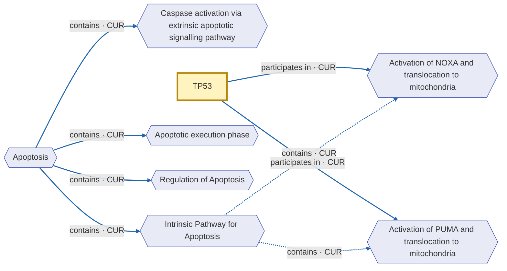

# BioPathway Mapper: process analysis

**Query:** `apoptosis | genes: TP53`

## 1. Input and resolved identifiers

| Input | Symbol | NCBI Gene | UniProt | Name | Location |
|---|---|---|---|---|---|
| TP53 | TP53 | 7157 | P04637 | tumor protein p53 | 17p13.1 |

## 2. Data source status

| Source | Status |
|---|---|
| KEGG | ok |
| NCBI Gene | ok |
| PubMed | ok |
| Reactome | ok |
| UniProt | ok |

15 API requests (15 served from cache).

## 3. Pathway context

| Source | ID | Name | Gene | Evidence | Note |
|---|---|---|---|---|---|
| Reactome | [R-HSA-109581](https://reactome.org/content/detail/R-HSA-109581) | Apoptosis |  | CUR |  |
| Reactome | [R-HSA-111448](https://reactome.org/content/detail/R-HSA-111448) | Activation of NOXA and translocation to mitochondria | TP53 | CUR | inside R-HSA-109581 |
| Reactome | [R-HSA-139915](https://reactome.org/content/detail/R-HSA-139915) | Activation of PUMA and translocation to mitochondria | TP53 | CUR | inside R-HSA-109581 |
| Reactome | [R-HSA-1912408](https://reactome.org/content/detail/R-HSA-1912408) | Pre-NOTCH Transcription and Translation | TP53 | CUR | outside this process |
| Reactome | [R-HSA-2559580](https://reactome.org/content/detail/R-HSA-2559580) | Oxidative Stress Induced Senescence | TP53 | CUR | outside this process |
| Reactome | [R-HSA-2559584](https://reactome.org/content/detail/R-HSA-2559584) | Formation of Senescence-Associated Heterochromatin Foci (SAHF) | TP53 | CUR | outside this process |
| Reactome | [R-HSA-2559585](https://reactome.org/content/detail/R-HSA-2559585) | Oncogene Induced Senescence | TP53 | CUR | outside this process |
| Reactome | [R-HSA-2559586](https://reactome.org/content/detail/R-HSA-2559586) | DNA Damage/Telomere Stress Induced Senescence | TP53 | CUR | outside this process |
| Reactome | [R-HSA-3232118](https://reactome.org/content/detail/R-HSA-3232118) | SUMOylation of transcription factors | TP53 | CUR | outside this process |
| Reactome | [R-HSA-349425](https://reactome.org/content/detail/R-HSA-349425) | Autodegradation of the E3 ubiquitin ligase COP1 | TP53 | CUR | outside this process |
| Reactome | [R-HSA-390471](https://reactome.org/content/detail/R-HSA-390471) | Association of TriC/CCT with target proteins during biosynthesis | TP53 | CUR | outside this process |
| Reactome | [R-HSA-5620971](https://reactome.org/content/detail/R-HSA-5620971) | Pyroptosis | TP53 | CUR | outside this process |
| Reactome | [R-HSA-5628897](https://reactome.org/content/detail/R-HSA-5628897) | TP53 Regulates Metabolic Genes | TP53 | CUR | outside this process |
| Reactome | [R-HSA-5689880](https://reactome.org/content/detail/R-HSA-5689880) | Ub-specific processing proteases | TP53 | CUR | outside this process |
| Reactome | [R-HSA-5689896](https://reactome.org/content/detail/R-HSA-5689896) | Ovarian tumor domain proteases | TP53 | CUR | outside this process |
| Reactome | [R-HSA-5693565](https://reactome.org/content/detail/R-HSA-5693565) | Recruitment and ATM-mediated phosphorylation of repair and signaling proteins at DNA double strand breaks | TP53 | CUR | outside this process |
| Reactome | [R-HSA-6785807](https://reactome.org/content/detail/R-HSA-6785807) | Interleukin-4 and Interleukin-13 signaling | TP53 | CUR | outside this process |
| Reactome | [R-HSA-6796648](https://reactome.org/content/detail/R-HSA-6796648) | TP53 Regulates Transcription of DNA Repair Genes | TP53 | CUR | outside this process |
| Reactome | [R-HSA-6803204](https://reactome.org/content/detail/R-HSA-6803204) | TP53 Regulates Transcription of Genes Involved in Cytochrome C Release | TP53 | CUR | outside this process |
| Reactome | [R-HSA-6803205](https://reactome.org/content/detail/R-HSA-6803205) | TP53 regulates transcription of several additional cell death genes whose specific roles in p53-dependent apoptosis remain uncertain | TP53 | CUR | outside this process |
| Reactome | [R-HSA-6803207](https://reactome.org/content/detail/R-HSA-6803207) | TP53 Regulates Transcription of Caspase Activators and Caspases | TP53 | CUR | outside this process |
| Reactome | [R-HSA-6803211](https://reactome.org/content/detail/R-HSA-6803211) | TP53 Regulates Transcription of Death Receptors and Ligands | TP53 | CUR | outside this process |
| Reactome | [R-HSA-6804114](https://reactome.org/content/detail/R-HSA-6804114) | TP53 Regulates Transcription of Genes Involved in G2 Cell Cycle Arrest | TP53 | CUR | outside this process |
| Reactome | [R-HSA-6804115](https://reactome.org/content/detail/R-HSA-6804115) | TP53 regulates transcription of additional cell cycle genes whose exact role in the p53 pathway remain uncertain | TP53 | CUR | outside this process |
| Reactome | [R-HSA-6804116](https://reactome.org/content/detail/R-HSA-6804116) | TP53 Regulates Transcription of Genes Involved in G1 Cell Cycle Arrest | TP53 | CUR | outside this process |
| Reactome | [R-HSA-6804754](https://reactome.org/content/detail/R-HSA-6804754) | Regulation of TP53 Expression | TP53 | CUR | outside this process |
| KEGG | [hsa04210](https://www.kegg.jp/pathway/hsa04210) | Apoptosis |  | CUR | name match 1.51 TP53: in map |
| KEGG | [hsa04215](https://www.kegg.jp/pathway/hsa04215) | Apoptosis - multiple species |  | CUR | name match 1.005 TP53: not in map |

## 4. Reconstructed molecular relationships

Evidence mix: CUR 8

| From | Relation | To | Evidence | Basis | Refs |
|---|---|---|---|---|---|
| Apoptosis | → contains | Caspase activation via extrinsic apoptotic signalling pathway | CUR | Reactome expert-curated, peer-reviewed event | [1] |
| Apoptosis | → contains | Intrinsic Pathway for Apoptosis | CUR | Reactome expert-curated, peer-reviewed event | [1] |
| Apoptosis | → contains | Apoptotic execution phase | CUR | Reactome expert-curated, peer-reviewed event | [1] |
| Apoptosis | → contains | Regulation of Apoptosis | CUR | Reactome expert-curated, peer-reviewed event | [1] |
| TP53 | → participates in | Activation of NOXA and translocation to mitochondria | CUR | Reactome expert-curated, peer-reviewed event | [2] |
| Intrinsic Pathway for Apoptosis | → contains | Activation of NOXA and translocation to mitochondria | CUR | Reactome hierarchy; intermediate sub-pathways omitted | [3] |
| TP53 | → participates in | Activation of PUMA and translocation to mitochondria | CUR | Reactome expert-curated, peer-reviewed event | [4] |
| Intrinsic Pathway for Apoptosis | → contains | Activation of PUMA and translocation to mitochondria | CUR | Reactome hierarchy; intermediate sub-pathways omitted | [3] |

## 5. Evidence-labelled statements

### Process overview

- **[CUR]** Apoptosis (Reactome summary): Apoptosis is a distinct form of cell death that is functionally and morphologically different from necrosis. Nuclear chromatin condensation, cytoplasmic shrinking, dilated endoplasmic reticulum, and membrane blebbing characterize apoptosis in general. Mitochondria remain morphologically unchanged. In 1972 Kerr et al introduced the concept of apoptosis as a distinct form of "cell-death", and the mechanisms of various apoptotic pathways are still being revealed today. The two principal pathways of apoptosis are (1) the Bcl-2 inhibitable or intrinsic pathway induced by various forms of stress ... [1]

### Mechanism (TP53)

- **[CUR]** Reactome event R-HSA-4331331: TP53 binds the PMAIP1 (NOXA) promoter [5]
- **[CUR]** Reactome event R-HSA-140214: TP53 stimulates PMAIP1 (NOXA) expression [6]
- **[CUR]** Reactome event R-HSA-139913: TP53 stimulates BBC3 (PUMA) expression [7]
- **[CUR]** Reactome event R-HSA-4331340: TP53 binds the BBC3 (PUMA) promoter [8]

## 6. Pathway diagram

Reactome hierarchy: process -> sub-pathways, and the curated sub-pathways each queried gene participates in. Dashed 'contains' skips intermediate levels.

| Line colour | Code | Evidence class |
|---|---|---|
| green | EXP | experimentally validated |
| blue | CUR | curated database evidence |
| orange | PRED | computationally predicted |
| purple | LIT | literature-supported association |
| grey | HYP | hypothetical/insufficiently established |

Solid arrow = activation/conversion/membership; `x` head = inhibition; dashed = expression, indirect or non-curated; no head = undirected association.

## 7. Interpretation notes and limits

- Reactome candidates: R-HSA-109581 Apoptosis; R-HSA-169911 Regulation of Apoptosis; R-HSA-9635465 Suppression of apoptosis; R-HSA-109606 Intrinsic Pathway for Apoptosis; R-HSA-9920951 Dengue virus modulates apoptosis.
- TP53 has 44 Reactome pathways outside Apoptosis (listed in section 3). Roles there are not part of this process reconstruction.

## 8. Literature

CUR rows are references cited by the curated pathway record; LIT rows are search hits offered for reading and were not used to draw any relationship.

- **[CUR]** Ashkenazi A (2002). Targeting death and decoy receptors of the tumour-necrosis factor superfamily. *Nat Rev Cancer*. [PMID:12189384](https://pubmed.ncbi.nlm.nih.gov/12189384/) — reference of Reactome R-HSA-109581
- **[CUR]** Cory S (2002). The Bcl2 family: regulators of the cellular life-or-death switch. *Nat Rev Cancer*. [PMID:12209154](https://pubmed.ncbi.nlm.nih.gov/12209154/) — reference of Reactome R-HSA-109581
- **[CUR]** Kerr JF (1972). Apoptosis: a basic biological phenomenon with wide-ranging implications in tissue kinetics. *Br J Cancer*. [PMID:4561027](https://pubmed.ncbi.nlm.nih.gov/4561027/) — reference of Reactome R-HSA-109581
- **[CUR]** Cory S (2003). The Bcl-2 family: roles in cell survival and oncogenesis. *Oncogene*. [PMID:14634621](https://pubmed.ncbi.nlm.nih.gov/14634621/) — reference of Reactome R-HSA-109581
- **[CUR]** Adams JM (2003). Ways of dying: multiple pathways to apoptosis. *Genes Dev*. [PMID:14561771](https://pubmed.ncbi.nlm.nih.gov/14561771/) — reference of Reactome R-HSA-109581
- **[LIT]** Voskarides K (2023). The Role of TP53 in Adaptation and Evolution. *Cells*. [PMID:36766853](https://pubmed.ncbi.nlm.nih.gov/36766853/) — PubMed search: TP53[tiab] AND apoptosis[tiab]
- **[LIT]** Ogawa A (2025). SLFN11-mediated ribosome biogenesis impairment induces TP53-independent apoptosis. *Mol Cell*. [PMID:39909041](https://pubmed.ncbi.nlm.nih.gov/39909041/) — PubMed search: TP53[tiab] AND apoptosis[tiab]
- **[LIT]** Baliakas P (2025). The TP53 tumor suppressor gene: From molecular biology to clinical investigations. *J Intern Med*. [PMID:40524430](https://pubmed.ncbi.nlm.nih.gov/40524430/) — PubMed search: TP53[tiab] AND apoptosis[tiab]
- **[LIT]** Macheret M (2015). DNA replication stress as a hallmark of cancer. *Annu Rev Pathol*. [PMID:25621662](https://pubmed.ncbi.nlm.nih.gov/25621662/) — PubMed search: TP53[tiab] AND apoptosis[tiab]
- **[LIT]** Kang HJ (2018). p53 and reproduction. *Fertil Steril*. [PMID:29307398](https://pubmed.ncbi.nlm.nih.gov/29307398/) — PubMed search: TP53[tiab] AND apoptosis[tiab]

## Sources

1. Reactome R-HSA-109581 — Apoptosis. <https://reactome.org/content/detail/R-HSA-109581>
2. Reactome R-HSA-111448 — Activation of NOXA and translocation to mitochondria. <https://reactome.org/content/detail/R-HSA-111448>
3. Reactome R-HSA-109606. <https://reactome.org/content/detail/R-HSA-109606>
4. Reactome R-HSA-139915 — Activation of PUMA and translocation to mitochondria. <https://reactome.org/content/detail/R-HSA-139915>
5. Reactome R-HSA-4331331 — TP53 binds the PMAIP1 (NOXA) promoter. <https://reactome.org/content/detail/R-HSA-4331331>
6. Reactome R-HSA-140214 — TP53 stimulates PMAIP1 (NOXA) expression. <https://reactome.org/content/detail/R-HSA-140214>
7. Reactome R-HSA-139913 — TP53 stimulates BBC3 (PUMA) expression. <https://reactome.org/content/detail/R-HSA-139913>
8. Reactome R-HSA-4331340 — TP53 binds the BBC3 (PUMA) promoter. <https://reactome.org/content/detail/R-HSA-4331340>

Records retrieved between 2026-11-13T19:28:03Z and 2026-11-13T19:28:35Z (UTC). Databases are updated continually; re-run to refresh.