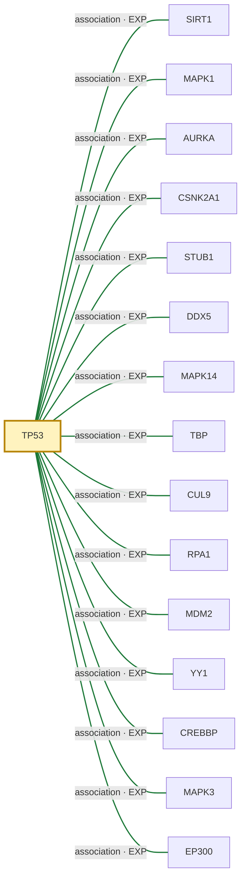

# BioPathway Mapper: gene analysis

**Query:** `TP53`

## 1. Input and resolved identifiers

| Input | Symbol | NCBI Gene | UniProt | Name | Location |
|---|---|---|---|---|---|
| TP53 | TP53 | 7157 | P04637 | tumor protein p53 | 17p13.1 |

## 2. Data source status

| Source | Status |
|---|---|
| KEGG | ok |
| NCBI Gene | ok |
| PubMed | ok |
| Reactome | ok |
| STRING | ok |
| UniProt | ok |

9 API requests (9 served from cache).

## 3. Pathway context

| Source | ID | Name | Gene | Evidence | Note |
|---|---|---|---|---|---|
| Reactome | [R-HSA-111448](https://reactome.org/content/detail/R-HSA-111448) | Activation of NOXA and translocation to mitochondria | TP53 | CUR |  |
| Reactome | [R-HSA-139915](https://reactome.org/content/detail/R-HSA-139915) | Activation of PUMA and translocation to mitochondria | TP53 | CUR |  |
| Reactome | [R-HSA-1912408](https://reactome.org/content/detail/R-HSA-1912408) | Pre-NOTCH Transcription and Translation | TP53 | CUR |  |
| Reactome | [R-HSA-2559580](https://reactome.org/content/detail/R-HSA-2559580) | Oxidative Stress Induced Senescence | TP53 | CUR |  |
| Reactome | [R-HSA-2559584](https://reactome.org/content/detail/R-HSA-2559584) | Formation of Senescence-Associated Heterochromatin Foci (SAHF) | TP53 | CUR |  |
| Reactome | [R-HSA-2559585](https://reactome.org/content/detail/R-HSA-2559585) | Oncogene Induced Senescence | TP53 | CUR |  |
| Reactome | [R-HSA-2559586](https://reactome.org/content/detail/R-HSA-2559586) | DNA Damage/Telomere Stress Induced Senescence | TP53 | CUR |  |
| Reactome | [R-HSA-3232118](https://reactome.org/content/detail/R-HSA-3232118) | SUMOylation of transcription factors | TP53 | CUR |  |
| Reactome | [R-HSA-349425](https://reactome.org/content/detail/R-HSA-349425) | Autodegradation of the E3 ubiquitin ligase COP1 | TP53 | CUR |  |
| Reactome | [R-HSA-390471](https://reactome.org/content/detail/R-HSA-390471) | Association of TriC/CCT with target proteins during biosynthesis | TP53 | CUR |  |
| Reactome | [R-HSA-5620971](https://reactome.org/content/detail/R-HSA-5620971) | Pyroptosis | TP53 | CUR |  |
| Reactome | [R-HSA-5628897](https://reactome.org/content/detail/R-HSA-5628897) | TP53 Regulates Metabolic Genes | TP53 | CUR |  |
| Reactome | [R-HSA-5689880](https://reactome.org/content/detail/R-HSA-5689880) | Ub-specific processing proteases | TP53 | CUR |  |
| Reactome | [R-HSA-5689896](https://reactome.org/content/detail/R-HSA-5689896) | Ovarian tumor domain proteases | TP53 | CUR |  |
| Reactome | [R-HSA-5693565](https://reactome.org/content/detail/R-HSA-5693565) | Recruitment and ATM-mediated phosphorylation of repair and signaling proteins at DNA double strand breaks | TP53 | CUR |  |
| Reactome | [R-HSA-6785807](https://reactome.org/content/detail/R-HSA-6785807) | Interleukin-4 and Interleukin-13 signaling | TP53 | CUR |  |
| Reactome | [R-HSA-6796648](https://reactome.org/content/detail/R-HSA-6796648) | TP53 Regulates Transcription of DNA Repair Genes | TP53 | CUR |  |
| Reactome | [R-HSA-6803204](https://reactome.org/content/detail/R-HSA-6803204) | TP53 Regulates Transcription of Genes Involved in Cytochrome C Release | TP53 | CUR |  |
| Reactome | [R-HSA-6803205](https://reactome.org/content/detail/R-HSA-6803205) | TP53 regulates transcription of several additional cell death genes whose specific roles in p53-dependent apoptosis remain uncertain | TP53 | CUR |  |
| Reactome | [R-HSA-6803207](https://reactome.org/content/detail/R-HSA-6803207) | TP53 Regulates Transcription of Caspase Activators and Caspases | TP53 | CUR |  |
| Reactome | [R-HSA-6803211](https://reactome.org/content/detail/R-HSA-6803211) | TP53 Regulates Transcription of Death Receptors and Ligands | TP53 | CUR |  |
| Reactome | [R-HSA-6804114](https://reactome.org/content/detail/R-HSA-6804114) | TP53 Regulates Transcription of Genes Involved in G2 Cell Cycle Arrest | TP53 | CUR |  |
| Reactome | [R-HSA-6804115](https://reactome.org/content/detail/R-HSA-6804115) | TP53 regulates transcription of additional cell cycle genes whose exact role in the p53 pathway remain uncertain | TP53 | CUR |  |
| Reactome | [R-HSA-6804116](https://reactome.org/content/detail/R-HSA-6804116) | TP53 Regulates Transcription of Genes Involved in G1 Cell Cycle Arrest | TP53 | CUR |  |
| Reactome | [R-HSA-6804754](https://reactome.org/content/detail/R-HSA-6804754) | Regulation of TP53 Expression | TP53 | CUR |  |
| Reactome | [R-HSA-6804756](https://reactome.org/content/detail/R-HSA-6804756) | Regulation of TP53 Activity through Phosphorylation | TP53 | CUR |  |
| Reactome | [R-HSA-6804757](https://reactome.org/content/detail/R-HSA-6804757) | Regulation of TP53 Degradation | TP53 | CUR |  |
| Reactome | [R-HSA-6804758](https://reactome.org/content/detail/R-HSA-6804758) | Regulation of TP53 Activity through Acetylation | TP53 | CUR |  |
| Reactome | [R-HSA-6804759](https://reactome.org/content/detail/R-HSA-6804759) | Regulation of TP53 Activity through Association with Co-factors | TP53 | CUR |  |
| Reactome | [R-HSA-6804760](https://reactome.org/content/detail/R-HSA-6804760) | Regulation of TP53 Activity through Methylation | TP53 | CUR |  |
| Reactome | [R-HSA-6811555](https://reactome.org/content/detail/R-HSA-6811555) | PI5P Regulates TP53 Acetylation | TP53 | CUR |  |
| Reactome | [R-HSA-69473](https://reactome.org/content/detail/R-HSA-69473) | G2/M DNA damage checkpoint | TP53 | CUR |  |
| Reactome | [R-HSA-69481](https://reactome.org/content/detail/R-HSA-69481) | G2/M Checkpoints | TP53 | CUR |  |
| Reactome | [R-HSA-69541](https://reactome.org/content/detail/R-HSA-69541) | Stabilization of p53 | TP53 | CUR |  |
| Reactome | [R-HSA-69895](https://reactome.org/content/detail/R-HSA-69895) | Transcriptional  activation of  cell cycle inhibitor p21  | TP53 | CUR |  |
| Reactome | [R-HSA-8852276](https://reactome.org/content/detail/R-HSA-8852276) | The role of GTSE1 in G2/M progression after G2 checkpoint | TP53 | CUR |  |
| Reactome | [R-HSA-8853884](https://reactome.org/content/detail/R-HSA-8853884) | Transcriptional Regulation by VENTX | TP53 | CUR |  |
| Reactome | [R-HSA-8941855](https://reactome.org/content/detail/R-HSA-8941855) | RUNX3 regulates CDKN1A transcription | TP53 | CUR |  |
| Reactome | [R-HSA-8943724](https://reactome.org/content/detail/R-HSA-8943724) | Regulation of PTEN gene transcription | TP53 | CUR |  |
| Reactome | [R-HSA-9723905](https://reactome.org/content/detail/R-HSA-9723905) | Loss of function of TP53 in cancer due to loss of tetramerization ability | TP53 | CUR |  |
| Reactome | [R-HSA-9725370](https://reactome.org/content/detail/R-HSA-9725370) | Signaling by ALK fusions and activated point mutants | TP53 | CUR |  |
| Reactome | [R-HSA-9758274](https://reactome.org/content/detail/R-HSA-9758274) | Regulation of NF-kappa B signaling | TP53 | CUR |  |
| Reactome | [R-HSA-9819196](https://reactome.org/content/detail/R-HSA-9819196) | Zygotic genome activation (ZGA) | TP53 | CUR |  |
| Reactome | [R-HSA-983231](https://reactome.org/content/detail/R-HSA-983231) | Factors involved in megakaryocyte development and platelet production | TP53 | CUR |  |
| Reactome | [R-HSA-9833482](https://reactome.org/content/detail/R-HSA-9833482) | PKR-mediated signaling | TP53 | CUR |  |
| Reactome | [R-HSA-9988426](https://reactome.org/content/detail/R-HSA-9988426) | Negative transcriptional regulation of urea cycle enzymes | TP53 | CUR |  |
| KEGG | [hsa01522](https://www.kegg.jp/pathway/hsa01522) | Endocrine resistance | TP53 | CUR |  |
| KEGG | [hsa01524](https://www.kegg.jp/pathway/hsa01524) | Platinum drug resistance | TP53 | CUR |  |
| KEGG | [hsa03440](https://www.kegg.jp/pathway/hsa03440) | Homologous recombination | TP53 | CUR |  |
| KEGG | [hsa04010](https://www.kegg.jp/pathway/hsa04010) | MAPK signaling pathway | TP53 | CUR |  |
| KEGG | [hsa04071](https://www.kegg.jp/pathway/hsa04071) | Sphingolipid signaling pathway | TP53 | CUR |  |
| KEGG | [hsa04110](https://www.kegg.jp/pathway/hsa04110) | Cell cycle | TP53 | CUR |  |
| KEGG | [hsa04115](https://www.kegg.jp/pathway/hsa04115) | p53 signaling pathway | TP53 | CUR |  |
| KEGG | [hsa04137](https://www.kegg.jp/pathway/hsa04137) | Mitophagy - animal | TP53 | CUR |  |
| KEGG | [hsa04151](https://www.kegg.jp/pathway/hsa04151) | PI3K-Akt signaling pathway | TP53 | CUR |  |
| KEGG | [hsa04210](https://www.kegg.jp/pathway/hsa04210) | Apoptosis | TP53 | CUR |  |
| KEGG | [hsa04211](https://www.kegg.jp/pathway/hsa04211) | Longevity regulating pathway | TP53 | CUR |  |
| KEGG | [hsa04216](https://www.kegg.jp/pathway/hsa04216) | Ferroptosis | TP53 | CUR |  |
| KEGG | [hsa04218](https://www.kegg.jp/pathway/hsa04218) | Cellular senescence | TP53 | CUR |  |
| KEGG | [hsa04310](https://www.kegg.jp/pathway/hsa04310) | Wnt signaling pathway | TP53 | CUR |  |

38 more in the JSON output.

## 4. Reconstructed molecular relationships

Evidence mix: EXP 15

| From | Relation | To | Evidence | Basis | Refs |
|---|---|---|---|---|---|
| TP53 | — association | SIRT1 | EXP | STRING experiments channel 0.999 (>= 0.4); channel can include evidence transferred from orthologs | [1] |
| TP53 | — association | MAPK1 | EXP | STRING experiments channel 0.999 (>= 0.4); channel can include evidence transferred from orthologs | [2] |
| TP53 | — association | AURKA | EXP | STRING experiments channel 0.999 (>= 0.4); channel can include evidence transferred from orthologs | [3] |
| TP53 | — association | CSNK2A1 | EXP | STRING experiments channel 0.999 (>= 0.4); channel can include evidence transferred from orthologs | [4] |
| TP53 | — association | STUB1 | EXP | STRING experiments channel 0.999 (>= 0.4); channel can include evidence transferred from orthologs | [5] |
| TP53 | — association | DDX5 | EXP | STRING experiments channel 0.999 (>= 0.4); channel can include evidence transferred from orthologs | [6] |
| TP53 | — association | MAPK14 | EXP | STRING experiments channel 0.999 (>= 0.4); channel can include evidence transferred from orthologs | [7] |
| TP53 | — association | TBP | EXP | STRING experiments channel 0.999 (>= 0.4); channel can include evidence transferred from orthologs | [8] |
| TP53 | — association | CUL9 | EXP | STRING experiments channel 0.999 (>= 0.4); channel can include evidence transferred from orthologs | [9] |
| TP53 | — association | RPA1 | EXP | STRING experiments channel 0.999 (>= 0.4); channel can include evidence transferred from orthologs | [10] |
| TP53 | — association | MDM2 | EXP | STRING experiments channel 0.999 (>= 0.4); channel can include evidence transferred from orthologs | [11] |
| TP53 | — association | YY1 | EXP | STRING experiments channel 0.999 (>= 0.4); channel can include evidence transferred from orthologs | [12] |
| TP53 | — association | CREBBP | EXP | STRING experiments channel 0.999 (>= 0.4); channel can include evidence transferred from orthologs | [13] |
| TP53 | — association | MAPK3 | EXP | STRING experiments channel 0.972 (>= 0.4); channel can include evidence transferred from orthologs | [14] |
| TP53 | — association | EP300 | EXP | STRING experiments channel 0.999 (>= 0.4); channel can include evidence transferred from orthologs | [15] |

## 5. Evidence-labelled statements

### Function

- **[EXP]** TP53 function (UniProt P04637, UniProt evidence code ECO:0000269): Multifunctional transcription factor that induces cell cycle arrest, DNA repair or apoptosis upon binding to its target DNA sequence. Acts as a tumor suppressor in many tumor types; induces growth arrest or apoptosis depending on the physiological circumstances and cell type. Negatively regulates cell division by controlling expression of a set of genes required for this process. One of the activated genes is an inhibitor of cyclin-dependent kinases. Apoptosis induction seems to be mediated either by stimulation of BAX and FAS antigen expression, or by repression of Bcl-2 expression. Its pro-apoptotic activity is activated via its interaction with PPP1R13B/ASPP1 or TP53BP2/ASPP2. However, ... [16] [17] [18] [19] [20]

### Biological process

- **[EXP]** TP53 GO biological process annotations: autophagy, bone marrow development, cellular response to actinomycin D, cellular response to gamma radiation, cellular response to glucose starvation, cellular response to hypoxia, cellular response to ionizing radiation, cellular response to UV, cellular response to xenobiotic stimulus, cellular senescence, DNA damage response, DNA damage response, signal transduction by p53 class mediator (+45 more) [16]
- **[CUR]** TP53 GO biological process annotations: intrinsic apoptotic signaling pathway, negative regulation of helicase activity [16]
- **[PRED]** TP53 GO biological process annotations: circadian behavior, determination of adult lifespan, entrainment of circadian clock by photoperiod, intrinsic apoptotic signaling pathway in response to endoplasmic reticulum stress, positive regulation of programmed necrotic cell death, positive regulation of thymocyte apoptotic process, protein tetramerization, type II interferon-mediated signaling pathway [16]

## 6. Pathway diagram

Undirected STRING functional-association network around the queried gene(s); line colour = evidence class. For directed signalling use the pathway analysis.

| Line colour | Code | Evidence class |
|---|---|---|
| green | EXP | experimentally validated |
| blue | CUR | curated database evidence |
| orange | PRED | computationally predicted |
| purple | LIT | literature-supported association |
| grey | HYP | hypothetical/insufficiently established |

Solid arrow = activation/conversion/membership; `x` head = inhibition; dashed = expression, indirect or non-curated; no head = undirected association.

## 7. Interpretation notes and limits

- STRING edges are undirected functional associations scored per evidence channel. They do not establish direct physical binding, direction or activating/inhibiting effect.

## 8. Literature

CUR rows are references cited by the curated pathway record; LIT rows are search hits offered for reading and were not used to draw any relationship.

- **[LIT]** Voskarides K (2023). The Role of TP53 in Adaptation and Evolution. *Cells*. [PMID:36766853](https://pubmed.ncbi.nlm.nih.gov/36766853/) — PubMed search: TP53[tiab] AND review[pt]
- **[LIT]** Wong TN (2024). Are TP53 mutations all alike? *Hematology Am Soc Hematol Educ Program*. [PMID:39644062](https://pubmed.ncbi.nlm.nih.gov/39644062/) — PubMed search: TP53[tiab] AND review[pt]
- **[LIT]** Daver NG (2022). TP53-Mutated Myelodysplastic Syndrome and Acute Myeloid Leukemia: Biology, Current Therapy, and Future Directions. *Cancer Discov*. [PMID:36218325](https://pubmed.ncbi.nlm.nih.gov/36218325/) — PubMed search: TP53[tiab] AND review[pt]
- **[LIT]** Shah MV (2025). TP53 -Mutated Myeloid Neoplasms: 2024 Update on Diagnosis, Risk-Stratification, and Management. *Am J Hematol*. [PMID:40066944](https://pubmed.ncbi.nlm.nih.gov/40066944/) — PubMed search: TP53[tiab] AND review[pt]
- **[LIT]** Baliakas P (2025). The TP53 tumor suppressor gene: From molecular biology to clinical investigations. *J Intern Med*. [PMID:40524430](https://pubmed.ncbi.nlm.nih.gov/40524430/) — PubMed search: TP53[tiab] AND review[pt]

## Sources

1. STRING TP53--SIRT1 — STRING association TP53-SIRT1. <https://string-db.org/cgi/network?identifiers=TP53%0dSIRT1&species=9606>
2. STRING TP53--MAPK1 — STRING association TP53-MAPK1. <https://string-db.org/cgi/network?identifiers=TP53%0dMAPK1&species=9606>
3. STRING TP53--AURKA — STRING association TP53-AURKA. <https://string-db.org/cgi/network?identifiers=TP53%0dAURKA&species=9606>
4. STRING TP53--CSNK2A1 — STRING association TP53-CSNK2A1. <https://string-db.org/cgi/network?identifiers=TP53%0dCSNK2A1&species=9606>
5. STRING TP53--STUB1 — STRING association TP53-STUB1. <https://string-db.org/cgi/network?identifiers=TP53%0dSTUB1&species=9606>
6. STRING TP53--DDX5 — STRING association TP53-DDX5. <https://string-db.org/cgi/network?identifiers=TP53%0dDDX5&species=9606>
7. STRING TP53--MAPK14 — STRING association TP53-MAPK14. <https://string-db.org/cgi/network?identifiers=TP53%0dMAPK14&species=9606>
8. STRING TP53--TBP — STRING association TP53-TBP. <https://string-db.org/cgi/network?identifiers=TP53%0dTBP&species=9606>
9. STRING TP53--CUL9 — STRING association TP53-CUL9. <https://string-db.org/cgi/network?identifiers=TP53%0dCUL9&species=9606>
10. STRING TP53--RPA1 — STRING association TP53-RPA1. <https://string-db.org/cgi/network?identifiers=TP53%0dRPA1&species=9606>
11. STRING TP53--MDM2 — STRING association TP53-MDM2. <https://string-db.org/cgi/network?identifiers=TP53%0dMDM2&species=9606>
12. STRING TP53--YY1 — STRING association TP53-YY1. <https://string-db.org/cgi/network?identifiers=TP53%0dYY1&species=9606>
13. STRING TP53--CREBBP — STRING association TP53-CREBBP. <https://string-db.org/cgi/network?identifiers=TP53%0dCREBBP&species=9606>
14. STRING TP53--MAPK3 — STRING association TP53-MAPK3. <https://string-db.org/cgi/network?identifiers=TP53%0dMAPK3&species=9606>
15. STRING TP53--EP300 — STRING association TP53-EP300. <https://string-db.org/cgi/network?identifiers=TP53%0dEP300&species=9606>
16. UniProt P04637 — TP53: Cellular tumor antigen p53. <https://www.uniprot.org/uniprotkb/P04637/entry>
17. PubMed PMID:11025664. <https://pubmed.ncbi.nlm.nih.gov/11025664/>
18. PubMed PMID:12524540. <https://pubmed.ncbi.nlm.nih.gov/12524540/>
19. PubMed PMID:12810724. <https://pubmed.ncbi.nlm.nih.gov/12810724/>
20. PubMed PMID:15186775. <https://pubmed.ncbi.nlm.nih.gov/15186775/>

Records retrieved between 2026-11-13T19:28:03Z and 2026-11-13T19:29:57Z (UTC). Databases are updated continually; re-run to refresh.