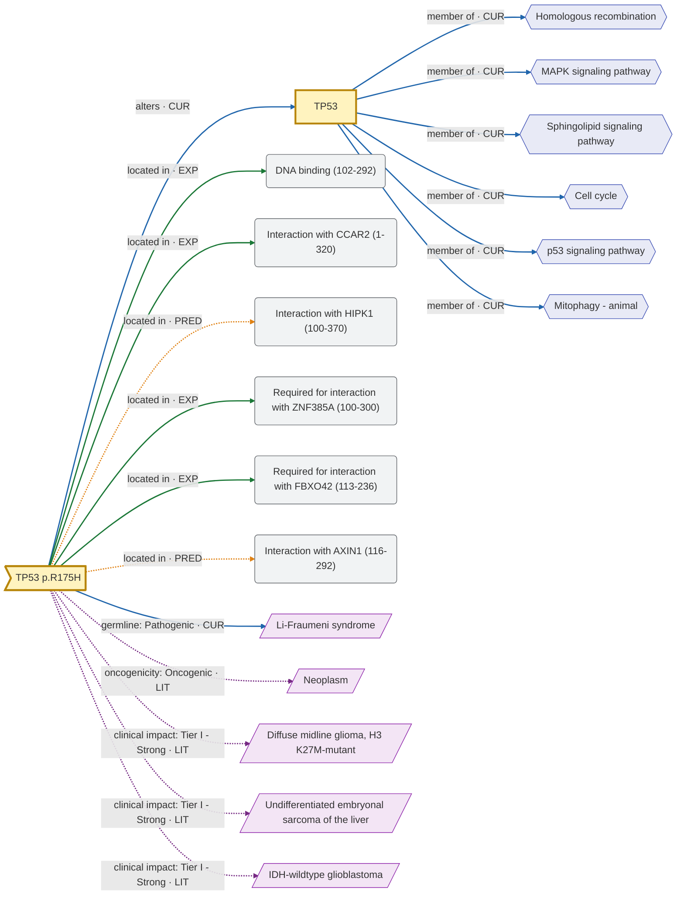

# BioPathway Mapper: mutation analysis

**Query:** `TP53 R175H`

## 1. Input and resolved identifiers

| Input | Symbol | NCBI Gene | UniProt | Name | Location |
|---|---|---|---|---|---|
| TP53 | TP53 | 7157 | P04637 | tumor protein p53 | 17p13.1 |

Variant parsed as **p.Arg175His** (R175H; missense, residue 175).

## 2. Data source status

| Source | Status |
|---|---|
| ClinVar | ok |
| KEGG | ok |
| NCBI Gene | ok |
| PubMed | ok |
| UniProt | ok |

10 API requests (10 served from cache).

## 3. Pathway context

| Source | ID | Name | Gene | Evidence | Note |
|---|---|---|---|---|---|
| KEGG | [hsa01522](https://www.kegg.jp/pathway/hsa01522) | Endocrine resistance | TP53 | CUR |  |
| KEGG | [hsa01524](https://www.kegg.jp/pathway/hsa01524) | Platinum drug resistance | TP53 | CUR |  |
| KEGG | [hsa03440](https://www.kegg.jp/pathway/hsa03440) | Homologous recombination | TP53 | CUR |  |
| KEGG | [hsa04010](https://www.kegg.jp/pathway/hsa04010) | MAPK signaling pathway | TP53 | CUR |  |
| KEGG | [hsa04071](https://www.kegg.jp/pathway/hsa04071) | Sphingolipid signaling pathway | TP53 | CUR |  |
| KEGG | [hsa04110](https://www.kegg.jp/pathway/hsa04110) | Cell cycle | TP53 | CUR |  |
| KEGG | [hsa04115](https://www.kegg.jp/pathway/hsa04115) | p53 signaling pathway | TP53 | CUR |  |
| KEGG | [hsa04137](https://www.kegg.jp/pathway/hsa04137) | Mitophagy - animal | TP53 | CUR |  |
| KEGG | [hsa04151](https://www.kegg.jp/pathway/hsa04151) | PI3K-Akt signaling pathway | TP53 | CUR |  |
| KEGG | [hsa04210](https://www.kegg.jp/pathway/hsa04210) | Apoptosis | TP53 | CUR |  |
| KEGG | [hsa04211](https://www.kegg.jp/pathway/hsa04211) | Longevity regulating pathway | TP53 | CUR |  |
| KEGG | [hsa04216](https://www.kegg.jp/pathway/hsa04216) | Ferroptosis | TP53 | CUR |  |
| KEGG | [hsa04218](https://www.kegg.jp/pathway/hsa04218) | Cellular senescence | TP53 | CUR |  |
| KEGG | [hsa04310](https://www.kegg.jp/pathway/hsa04310) | Wnt signaling pathway | TP53 | CUR |  |
| KEGG | [hsa04722](https://www.kegg.jp/pathway/hsa04722) | Neurotrophin signaling pathway | TP53 | CUR |  |
| KEGG | [hsa04919](https://www.kegg.jp/pathway/hsa04919) | Thyroid hormone signaling pathway | TP53 | CUR |  |
| KEGG | [hsa05012](https://www.kegg.jp/pathway/hsa05012) | Parkinson disease | TP53 | CUR |  |
| KEGG | [hsa05014](https://www.kegg.jp/pathway/hsa05014) | Amyotrophic lateral sclerosis | TP53 | CUR |  |
| KEGG | [hsa05016](https://www.kegg.jp/pathway/hsa05016) | Huntington disease | TP53 | CUR |  |
| KEGG | [hsa05131](https://www.kegg.jp/pathway/hsa05131) | Shigellosis | TP53 | CUR |  |
| KEGG | [hsa05160](https://www.kegg.jp/pathway/hsa05160) | Hepatitis C | TP53 | CUR |  |
| KEGG | [hsa05161](https://www.kegg.jp/pathway/hsa05161) | Hepatitis B | TP53 | CUR |  |
| KEGG | [hsa05162](https://www.kegg.jp/pathway/hsa05162) | Measles | TP53 | CUR |  |
| KEGG | [hsa05163](https://www.kegg.jp/pathway/hsa05163) | Human cytomegalovirus infection | TP53 | CUR |  |
| KEGG | [hsa05165](https://www.kegg.jp/pathway/hsa05165) | Human papillomavirus infection | TP53 | CUR |  |
| KEGG | [hsa05166](https://www.kegg.jp/pathway/hsa05166) | Human T-cell leukemia virus 1 infection | TP53 | CUR |  |
| KEGG | [hsa05167](https://www.kegg.jp/pathway/hsa05167) | Kaposi sarcoma-associated herpesvirus infection | TP53 | CUR |  |
| KEGG | [hsa05168](https://www.kegg.jp/pathway/hsa05168) | Herpes simplex virus 1 infection | TP53 | CUR |  |
| KEGG | [hsa05169](https://www.kegg.jp/pathway/hsa05169) | Epstein-Barr virus infection | TP53 | CUR |  |
| KEGG | [hsa05200](https://www.kegg.jp/pathway/hsa05200) | Pathways in cancer | TP53 | CUR |  |
| KEGG | [hsa05202](https://www.kegg.jp/pathway/hsa05202) | Transcriptional misregulation in cancer | TP53 | CUR |  |
| KEGG | [hsa05203](https://www.kegg.jp/pathway/hsa05203) | Viral carcinogenesis | TP53 | CUR |  |
| KEGG | [hsa05205](https://www.kegg.jp/pathway/hsa05205) | Proteoglycans in cancer | TP53 | CUR |  |
| KEGG | [hsa05206](https://www.kegg.jp/pathway/hsa05206) | MicroRNAs in cancer | TP53 | CUR |  |
| KEGG | [hsa05210](https://www.kegg.jp/pathway/hsa05210) | Colorectal cancer | TP53 | CUR |  |
| KEGG | [hsa05212](https://www.kegg.jp/pathway/hsa05212) | Pancreatic cancer | TP53 | CUR |  |
| KEGG | [hsa05213](https://www.kegg.jp/pathway/hsa05213) | Endometrial cancer | TP53 | CUR |  |
| KEGG | [hsa05214](https://www.kegg.jp/pathway/hsa05214) | Glioma | TP53 | CUR |  |
| KEGG | [hsa05215](https://www.kegg.jp/pathway/hsa05215) | Prostate cancer | TP53 | CUR |  |
| KEGG | [hsa05216](https://www.kegg.jp/pathway/hsa05216) | Thyroid cancer | TP53 | CUR |  |
| KEGG | [hsa05217](https://www.kegg.jp/pathway/hsa05217) | Basal cell carcinoma | TP53 | CUR |  |
| KEGG | [hsa05218](https://www.kegg.jp/pathway/hsa05218) | Melanoma | TP53 | CUR |  |
| KEGG | [hsa05219](https://www.kegg.jp/pathway/hsa05219) | Bladder cancer | TP53 | CUR |  |
| KEGG | [hsa05220](https://www.kegg.jp/pathway/hsa05220) | Chronic myeloid leukemia | TP53 | CUR |  |
| KEGG | [hsa05222](https://www.kegg.jp/pathway/hsa05222) | Small cell lung cancer | TP53 | CUR |  |
| KEGG | [hsa05223](https://www.kegg.jp/pathway/hsa05223) | Non-small cell lung cancer | TP53 | CUR |  |
| KEGG | [hsa05224](https://www.kegg.jp/pathway/hsa05224) | Breast cancer | TP53 | CUR |  |
| KEGG | [hsa05225](https://www.kegg.jp/pathway/hsa05225) | Hepatocellular carcinoma | TP53 | CUR |  |
| KEGG | [hsa05226](https://www.kegg.jp/pathway/hsa05226) | Gastric cancer | TP53 | CUR |  |
| KEGG | [hsa05230](https://www.kegg.jp/pathway/hsa05230) | Central carbon metabolism in cancer | TP53 | CUR |  |
| KEGG | [hsa05417](https://www.kegg.jp/pathway/hsa05417) | Lipid and atherosclerosis | TP53 | CUR |  |
| KEGG | [hsa05418](https://www.kegg.jp/pathway/hsa05418) | Fluid shear stress and atherosclerosis | TP53 | CUR |  |

## 4. Reconstructed molecular relationships

Evidence mix: EXP 4, CUR 8, PRED 2, LIT 4

| From | Relation | To | Evidence | Basis | Refs |
|---|---|---|---|---|---|
| TP53 p.R175H | → alters | TP53 | CUR | variant is defined on this gene's product | [1] |
| TP53 p.R175H | → located in | DNA binding (102-292) | EXP | UniProt evidence code ECO:0000269 | [2] [3] [4] [5] |
| TP53 p.R175H | → located in | Interaction with CCAR2 (1-320) | EXP | UniProt evidence code ECO:0000269 | [2] [6] |
| TP53 p.R175H | → located in | Interaction with HIPK1 (100-370) | PRED | UniProt evidence code ECO:0000250 | [2] |
| TP53 p.R175H | → located in | Required for interaction with ZNF385A (100-300) | EXP | UniProt evidence code ECO:0000269 | [2] [7] |
| TP53 p.R175H | → located in | Required for interaction with FBXO42 (113-236) | EXP | UniProt evidence code ECO:0000269 | [2] [8] |
| TP53 p.R175H | → located in | Interaction with AXIN1 (116-292) | PRED | UniProt evidence code ECO:0000250 | [2] |
| TP53 p.R175H | → germline: Pathogenic | Li-Fraumeni syndrome | CUR | ClinVar review status: reviewed by expert panel | [9] |
| TP53 p.R175H | → oncogenicity: Oncogenic | Neoplasm | LIT | ClinVar review status: criteria provided, single submitter (not independently confirmed) | [9] |
| TP53 p.R175H | → clinical impact: Tier I - Strong | Diffuse midline glioma, H3 K27M-mutant | LIT | ClinVar review status: criteria provided, single submitter (not independently confirmed) | [9] |
| TP53 p.R175H | → clinical impact: Tier I - Strong | Undifferentiated embryonal sarcoma of the liver | LIT | ClinVar review status: criteria provided, single submitter (not independently confirmed) | [9] |
| TP53 p.R175H | → clinical impact: Tier I - Strong | IDH-wildtype glioblastoma | LIT | ClinVar review status: criteria provided, single submitter (not independently confirmed) | [9] |
| TP53 | → member of | Homologous recombination | CUR | KEGG gene-pathway link | [10] |
| TP53 | → member of | MAPK signaling pathway | CUR | KEGG gene-pathway link | [11] |
| TP53 | → member of | Sphingolipid signaling pathway | CUR | KEGG gene-pathway link | [12] |
| TP53 | → member of | Cell cycle | CUR | KEGG gene-pathway link | [13] |
| TP53 | → member of | p53 signaling pathway | CUR | KEGG gene-pathway link | [14] |
| TP53 | → member of | Mitophagy - animal | CUR | KEGG gene-pathway link | [15] |

## 5. Evidence-labelled statements

### Identifiers

- **[CUR]** Reference residue check: P04637 position 175 is R, matching the input. [2]

### Structural context

- **[EXP]** Position 175 lies in UniProt dna binding 'DNA binding' (102-292). [2] [3] [4] [5]
- **[EXP]** Position 175 lies in UniProt region 'Interaction with CCAR2' (1-320). [2] [6]
- **[PRED]** Position 175 lies in UniProt region 'Interaction with HIPK1' (100-370). [2]
- **[EXP]** Position 175 lies in UniProt region 'Required for interaction with ZNF385A' (100-300). [2] [7]
- **[EXP]** Position 175 lies in UniProt region 'Required for interaction with FBXO42' (113-236). [2] [8]
- **[PRED]** Position 175 lies in UniProt region 'Interaction with AXIN1' (116-292). [2]

### Other variants at this position

- **[CUR]** UniProt natural variant VAR_005928 R175C (different substitution at this position): in sporadic cancers; somatic mutation; dbSNP:rs138729528 [2]
- **[CUR]** UniProt natural variant VAR_005929 R175G (different substitution at this position): in LFS; germline mutation and in sporadic cancers; somatic mutation; dbSNP:rs138729528 [2]
- **[CUR]** UniProt natural variant VAR_005930 R175L (different substitution at this position): in LFS; germline mutation and in sporadic cancers; somatic mutation; dbSNP:rs28934578 [2]
- **[EXP]** UniProt natural variant VAR_005931 R175P (different substitution at this position): in sporadic cancers; somatic mutation [2] [7]
- **[CUR]** UniProt natural variant VAR_044916 R175Q (different substitution at this position): in a sporadic cancer; somatic mutation [2]
- **[CUR]** UniProt natural variant VAR_044917 R175S (different substitution at this position): in sporadic cancers; somatic mutation [2]

### Reported variant effects

- **[EXP]** UniProt natural variant VAR_005932 R175H (same substitution): in LFS; germline mutation and in sporadic cancers; somatic mutation; does not induce SNAI1 degradation; reduces interaction with ZNF385A; dbSNP:rs28934578 [2] [7] [16] [17]

### Clinical assertions

- **[CUR]** ClinVar VCV000012374 (NM_000546.6(TP53):c.524G>A (p.Arg175His)) germline classification: Pathogenic for Li-Fraumeni syndrome [ClinVar review status: reviewed by expert panel; last evaluated 2024/09/06]. This is a clinical association, not a mechanism. [9]
- **[LIT]** ClinVar VCV000012374 (NM_000546.6(TP53):c.524G>A (p.Arg175His)) oncogenicity classification: Oncogenic for Neoplasm [ClinVar review status: criteria provided, single submitter (not independently confirmed); last evaluated 2025/03/04]. This is a clinical association, not a mechanism. [9]
- **[LIT]** ClinVar VCV000012374 (NM_000546.6(TP53):c.524G>A (p.Arg175His)) clinical impact classification: Tier I - Strong for Diffuse midline glioma, H3 K27M-mutant; Undifferentiated embryonal sarcoma of the liver; IDH-wildtype glioblastoma; Medulloblastoma SHH activated and TP53 mutant [ClinVar review status: criteria provided, single submitter (not independently confirmed); last evaluated 2025/08/20]. This is a clinical association, not a mechanism. [9]

## 6. Pathway diagram

Variant -> gene, the UniProt regions it falls in, ClinVar conditions, and the gene's KEGG maps.

| Line colour | Code | Evidence class |
|---|---|---|
| green | EXP | experimentally validated |
| blue | CUR | curated database evidence |
| orange | PRED | computationally predicted |
| purple | LIT | literature-supported association |
| grey | HYP | hypothetical/insufficiently established |

Solid arrow = activation/conversion/membership; `x` head = inhibition; dashed = expression, indirect or non-curated; no head = undirected association.

## 7. Interpretation notes and limits

- TP53 is in 14 KEGG signalling/process maps; 6 drawn.
- Pathway membership is that of the wild-type gene. Whether this variant gains, loses or alters a pathway function is only stated where a cited record says so.

## 8. Literature

CUR rows are references cited by the curated pathway record; LIT rows are search hits offered for reading and were not used to draw any relationship.

- **[LIT]** Hsiue EH (2021). Targeting a neoantigen derived from a common TP53 mutation. *Science*. [PMID:33649166](https://pubmed.ncbi.nlm.nih.gov/33649166/) — PubMed search: TP53[tiab] AND (R175H OR Arg175His)
- **[LIT]** Huang L (2015). Ductal pancreatic cancer modeling and drug screening using human pluripotent stem cell- and patient-derived tumor organoids. *Nat Med*. [PMID:26501191](https://pubmed.ncbi.nlm.nih.gov/26501191/) — PubMed search: TP53[tiab] AND (R175H OR Arg175His)
- **[LIT]** Haratani K (2026). Cancers modulate processing and presentation of p53 neoantigens to evade T cell detection. *Immunity*. [PMID:42753739](https://pubmed.ncbi.nlm.nih.gov/42753739/) — PubMed search: TP53[tiab] AND (R175H OR Arg175His)
- **[LIT]** Chiang YT (2021). The Function of the Mutant p53-R175H in Cancer. *Cancers (Basel)*. [PMID:34439241](https://pubmed.ncbi.nlm.nih.gov/34439241/) — PubMed search: TP53[tiab] AND (R175H OR Arg175His)
- **[LIT]** Yang J (2026). MVB Maturation Responsive to KRAS(G12D)/TP53(R175H) Co-mutations Fuels Extracellular Vesicle-hypersecretion Phenotype to Aggravate Lymphangiogenesis and Lymphatic Metastasis. *J Extracell Vesicles*. [PMID:42858298](https://pubmed.ncbi.nlm.nih.gov/42858298/) — PubMed search: TP53[tiab] AND (R175H OR Arg175His)

## Sources

1. NCBI Gene 7157 — TP53: tumor protein p53. <https://www.ncbi.nlm.nih.gov/gene/7157>
2. UniProt P04637 — TP53: Cellular tumor antigen p53. <https://www.uniprot.org/uniprotkb/P04637/entry>
3. PubMed PMID:16793544. <https://pubmed.ncbi.nlm.nih.gov/16793544/>
4. PubMed PMID:18996393. <https://pubmed.ncbi.nlm.nih.gov/18996393/>
5. PubMed PMID:20364130. <https://pubmed.ncbi.nlm.nih.gov/20364130/>
6. PubMed PMID:25732823. <https://pubmed.ncbi.nlm.nih.gov/25732823/>
7. PubMed PMID:17719541. <https://pubmed.ncbi.nlm.nih.gov/17719541/>
8. PubMed PMID:19509332. <https://pubmed.ncbi.nlm.nih.gov/19509332/>
9. ClinVar VCV000012374 — NM_000546.6(TP53):c.524G>A (p.Arg175His). <https://www.ncbi.nlm.nih.gov/clinvar/variation/12374/>
10. KEGG hsa03440 — Homologous recombination. <https://www.kegg.jp/pathway/hsa03440>
11. KEGG hsa04010 — MAPK signaling pathway. <https://www.kegg.jp/pathway/hsa04010>
12. KEGG hsa04071 — Sphingolipid signaling pathway. <https://www.kegg.jp/pathway/hsa04071>
13. KEGG hsa04110 — Cell cycle. <https://www.kegg.jp/pathway/hsa04110>
14. KEGG hsa04115 — p53 signaling pathway. <https://www.kegg.jp/pathway/hsa04115>
15. KEGG hsa04137 — Mitophagy - animal. <https://www.kegg.jp/pathway/hsa04137>
16. PubMed PMID:16959974. <https://pubmed.ncbi.nlm.nih.gov/16959974/>
17. PubMed PMID:1868473. <https://pubmed.ncbi.nlm.nih.gov/1868473/>

Records retrieved between 2026-11-13T19:28:03Z and 2026-11-13T19:30:01Z (UTC). Databases are updated continually; re-run to refresh.